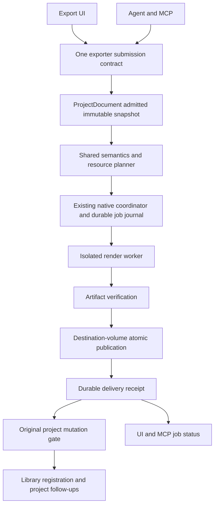

# Exporter Architecture and Reliability

Status: owner authorized uninterrupted implementation across phases on 2026-10-14.
E0 streaming qualification remains open; E1/E2 shared-boundary work and E3 native
verified-delivery work are in progress. Large-rewrite and release gates remain unpassed.

The owner authorized implementation on 2026-10-13 and requested a maintained
reference document. This file is that document: requirements and design above,
current implementation ledger below. It does not certify 99% reliability or
authorize release, new formats, paid services, or a project-persistence migration.
The current bounded-export fix is local and unreleased; it is a useful baseline,
not this complete architecture.

## Progress Tracker

**Overall: 43% (13/30 milestones complete). Last updated: 2026-10-15.**

**Owner-selected approach: A, feasibility first (2026-10-15).** Continue bounded
prototype optimization and artifact/resource proof before the substantial
production rewrite. Active milestone: E0.4; it has not passed. Selecting the
approach does not increase completed-milestone credit.

**Owner sequencing update (2026-10-15):** defer physical8GB/Mac/Linux testing
until the remaining export changes are implemented. Continue the locally available
export implementation and checks without waiting for those machines or asking for
them again during implementation. Their final hardware/OS/resource acceptance
remains mandatory before qualification/release; simulation earns no hardware pass.
This updates the physical-testing order, not output-quality or resource budgets.

**Latest verified work:** E0.3's complete candidate feature/licensing/build plan
remains the last completed milestone. Candidate raw-picture and PCM verification now
stream with identical frozen verdicts; real74649600B video and67584000B stereo streams
pass beyond the former64MiB whole-buffer limit. Experimental packet piping preserves
encoded/MP4 bytes without an elementary scratch copy, but its6GiB run FAILS the
unchanged115s deadline at1696/1800frames. It is not the default or a resource pass.
That earlier failure remains retained. A smaller single-thread QA harness later
passes30s, and explicit lossless caption-band transfer plus GPU submission passes
the one-minute6GiB profile:3600frames/captions,2880000stereo samples, unchanged
packet/MP4 bytes,239.567s measured child-tree wall and4573978624B reported peak.
Only0.433s of the four-times60s budget remains; this is NOT two-hour qualification.
An unchanged repeat takes338.420s overall despite identical output, so that narrow
result is not a reliable timing guarantee. Removing a duplicated Vitest launch,
while running the identical independent verifier in the pipeline worker, yields
two complete measured runs of236.896s and215.526s under the same6GiB simulation.
Both retain original packet/MP4 bytes and all checks; minimum observed margin3.104s
is still small. No budget was raised and no two-hour/minimum-machine gate passed.
Private exact-repeat scene compaction now stores the30s caption scene in80664B
instead of806420B, with original packet/MP4 bytes and the full verifier unchanged.
Nonrepeating input and malformed native payloads refuse; this is not a general
5000clip plan or permission to extrapolate the minute timings to two hours.
New E3 sub-gates cover physical source aliases,
destination-preserving cross-volume copies, owned staging/missing names and retryable
refused publication. Current protocol11 gates: 48 local native delivery checks
(including two real-FFmpeg artifact lanes), 105 client adapter checks and actual
isolated Windows/macOS/Linux crash/recovery receipts preserving all30 video frames
and48000 stereo sample frames with one recovery and recorded build/worker hashes.
Native Mac/Linux CI passes68 job checks per platform plus commit-volume outcomes;
generic CI38689612168 is successful at the same native-only QA commit9e790f3.
Latest dense6GiB process-tree simulation includes worker, mux and artifact verifier:
1800frames/captions/stereo pass, reported peak4472283136bytes and148.771s child-tree
wall for30s output (previous190.637s). Exact-byte caption reuse reduces1800uploads to30 with identical
MP4 bytes. Verified SDK setup reuse plus fresh worker compilation takes15.471s
versus measured2574.966s cold. These are not physical8GB/two-hour qualification;
latest processing107.790s is below four-times30s, but full measured setup-inclusive
wall is not, and neither short measurement proves the combined case. Native-only CI does
not certify broader local compiler/project edits. Tracker13/30 remains43%; engine
selection, complete resource/feature/platform qualification and replacement stay open.

This is a fixed, equally counted milestone checklist, not percent of engineering
hours, code written, release readiness or achieved reliability. Partial work earns
no completed-milestone credit. The full phase gates below still apply. Update this
summary, phase counts and checkboxes together after verified milestone completion;
do not increase the percentage merely because another test or prototype ran.

| Phase | Complete | Progress | Current Focus |
| --- | ---: | ---: | --- |
| E0: feasibility | 3/5 | 60% | Combined workload proof and accepted engine/minimum specification |
| E1: shared boundary | 4/5 | 80% | Finish mandatory-contract and lifecycle closure |
| E2: reliable renderer | 3/5 | 60% | Enforce the whole-job resource envelope |
| E3: durable delivery | 3/5 | 60% | Filesystem/concurrency and recovery acceptance closure |
| E4: streaming replacement | 0/5 | 0% | Prototype exists; qualified production replacement is not selected |
| E5: qualification/rollout | 0/5 | 0% | Physical 8 GB, all three OSes and representative outcomes |

**Latest Sub-Gates (Not Additional Milestones)**

| Slice | Evidence State | Remaining Gate |
| --- | --- | --- |
| Premiere-style media rotation | Static/animated corner pixels, signed angles, later frame windows and contain transparency verified; approved 4K reference passes and ignored-angle artifact refuses | Complete transform/feature/resource conformance remains open |
| Historical rotation corpus | Original snapshot file bytes preserved; explicit approved graph deltas pass the 135-check compiler/corpus gate | No claim of unchanged historical pictures |
| Native source-preservation boundary | Shared lease predicate covers admission, binding/replay, publication and native moves/deletion; live hard-link aliases use physical identity and actual-byte/restart checks pass | External races, complete file-ID/volume and application matrix remain open; protocol11 required |
| Cross-volume commit fallback | Interrupted native copy preserves the previous destination; Linux CI exercises different devices and complete publication before source cleanup | Full volume, hard-crash orphan cleanup, power-loss durability and whole-job workspace budget remain open |
| Native stage ownership / refused publication | Guarded filesystem mutations refuse prepared/verified staging and its aliases/missing name; explicit no-effect rename failures remain settleable/retryable after restart | Raw writers/external races, journal-unavailable recovery and complete lifecycle matrix remain open |
| Private build setup | Verified SDK/header reuse plus fresh compile15.471s; changed flags/header digests/binary bytes refuse; duplicate-only VS search paths normalized | Private consumer SDK only; slower whole-toolchain worker cache discarded |
| Dense render plus verifier | Same6GiB-owned tree passes1800frames/16readers/captions/stereo;148.771s wall,4.17GiB reported peak; processing107.790s; all retained MP4 bytes identical | Short processing fits four-times30s; setup-inclusive wall does not. No two-hour/5000clips/physical8GB qualification |
| Bounded candidate verification | All overlap/caption/motion/alpha/tile candidates and stereo samples stream; seven retained verdicts preserve every old content metric; >64MiB video/PCM outcome checks pass | Short references remain capped, metrics scale with frame count and60s decode limits remain; not full two-hour qualification |
| Encoded packet pipe, private opt-in | Earlier failures and338.420s repeat retained; same-worker shared verification yields two minute runs236.896/215.526s,4686176256/4726300672B reported commit, original packet/MP4 bytes and no H.264 scratch | Smallest margin3.104s in only two runs; not two-hour/5000clip/physical8GB qualification or a robust runtime guarantee. File/full-frame routes stay default |
| Lossless caption-band transfer | All180reference program frames have zero omitted ARGB; real out-of-band ink refuses; repeated clips must be identical except ID/offset; original30s and60s output preserved in tested passes | Fixture-specific private opt-in, not general caption culling; GPU ordering/driver variability and full-duration resource proof remain open |
| Compact exact-repeat scene | NPL8 stores180shared frames for the repeated caption fixture;30s payload806420to80664B; strict packet/MP4 and all picture/caption/stereo metrics pass; malformed/nonrepeating input refuses | Only exact repeated caption scenes; producer still reads the flat input and keeps timeline metadata. Not general curves, diverse sources or5000clip/two-hour qualification |
| Reusable GPU component extraction | Owner deferred on 2026-10-15 | Private prototype remains a qualification tool, not a reusable production library |

### E0: Feasibility

- [x] E0.1 Freeze real output/source baselines and independent artifact checks.
- [x] E0.2 Measure alternative engines and the private streaming prototype.
- [x] E0.3 Finish the candidate's complete feature, licensing and build plan.
- [ ] E0.4 Demonstrate the combined workload within the agreed resource envelope.
- [ ] E0.5 Record the accepted engine decision and measured minimum specification.

### E1: Shared Boundary

- [x] E1.1 Capture the admitted immutable edit and destination before queue awaits.
- [x] E1.2 Declare dependencies and protect them through queued and active work.
- [x] E1.3 Bind versioned snapshots, requests, executable bytes and output contracts.
- [x] E1.4 Route existing UI/agent/MCP/render/copy doors through shared owners.
- [ ] E1.5 Close the complete mandatory-contract/capability/lifecycle audit.

### E2: Reliable Renderer

- [x] E2.1 Repair and artifact-test the original long-command/349-input failure.
- [x] E2.2 Prove ordinary mono/stereo layout and existing audio-policy conformance.
- [x] E2.3 Pass core format/range/branding/ownership real-artifact regression lanes.
- [ ] E2.4 Enforce and verify the complete RAM/VRAM/time/scratch resource envelope.
- [ ] E2.5 Close complete supported-feature, colour and quality conformance.

### E3: Durable Delivery

- [x] E3.1 Persist native intent ownership and versioned execution/recovery data.
- [x] E3.2 Publish staged verified bytes and reconcile checked restart orderings.
- [x] E3.3 Prove bounded render/copy restart, cancellation and retained cleanup.
- [ ] E3.4 Close filesystem identity, volume rules and concurrent side-effect orderings.
- [ ] E3.5 Qualify complete restart/registration behavior through the real application.

### E4: Streaming Replacement

- [ ] E4.1 Integrate the selected, versioned and distributable streaming backend.
- [ ] E4.2 Preserve all admitted visuals, text, effects, transitions and timing.
- [ ] E4.3 Preserve real sample-accurate audio mixing, fades and ducking.
- [ ] E4.4 Select backends through mandatory shared planning and eligibility rules.
- [ ] E4.5 Qualify the integrated combined workload without quality/budget concessions.

### E5: Qualification And Rollout

- [ ] E5.1 Qualify Windows/macOS/Linux bundles, sidecars and protocol compatibility.
- [ ] E5.2 Pass the actual minimum-machine two-hour/8-hour/20-GB combined case.
- [ ] E5.3 Pass real UI/MCP workflows and the complete lifecycle fault matrix.
- [ ] E5.4 Complete an opt-in rollout with tested recovery and safe switch-back.
- [ ] E5.5 Establish representative ready/overall outcome and reliability evidence.

**Next:** remaining shared export completion/recovery/contract implementation and
local checks, alongside E0.4 feasibility preparation. Keep unqualified replacement
and release gated; defer physical acceptance until the changes are implemented.
**Qualification unavailable here:** physical 8 GB and macOS/Linux test
machines. Owner scheduled these tests after implementation; they are not a blocker
to the remaining local export work. They remain required for final acceptance;
local process caps do not substitute for them.

## 0. Owner Alignment

The owner confirmed the following through plain-language questions on 2026-10-13.
These decisions supersede the earlier proposed metric and Windows-first scope.

| Product decision | Agreed requirement |
| --- | --- |
| 99% target | Correct, complete delivery for supported exports when the source files and destination/storage are ready; also report all-request success and blocked requests. |
| First release | Windows, macOS and Linux, each independently qualified; no Windows-only reliability claim presented as product-wide. |
| Project coverage | Ordinary HD up to 30 minutes, two-hour projects, 4K at 60 FPS, thousands of clips, overlapping video/stills, animated captions and music. |
| Combined qualification case | One two-hour 4K/60 FPS project with 5,000 clips and 16 simultaneous videos/pictures, including the caption/audio cases. This is a required stress test, not a new hard product cap. |
| Ordinary laptops | Target 8 GB system memory with no dedicated graphics card; CPU/OS/storage minimums must be selected from real measurements and published. Not every historical 8 GB laptop is promised to qualify. |
| Completion time | Up to eight hours for the combined demanding project on the qualified minimum machine, including preparation, rendering, verification and delivery. Qualify with an otherwise idle queue; report queue delay and interrupted elapsed time separately rather than hiding them. |
| Temporary disk | At most 20 GB extra beyond the final deliverable for the active job, including normalization, intermediates, checkpoints and verification workspace. Existing original sources are not temporary copies and must never be deleted. |
| Recovery | Automatically resume after an app crash when sources and verified checkpoints are still valid; explicitly cancelled exports stay cancelled. |
| Tradeoff | Correctness and completion take precedence over speed, but do not waive the agreed time and disk bounds or silently lower output quality. |
| Launch | Start with a small group and expand only after observing correct results; retain a safe switch-back path. |

Requirements confidence is high after these decisions. Numerical "95% confidence"
in engine feasibility is not established by a questionnaire: the combined workload,
8 GB machine, eight-hour deadline and 20 GB disk budget must pass the E0 feasibility
gate before a large rewrite is approved. Actual 99% delivery needs the separate
representative outcome evidence in section 3.

## 1. Decision

Build a dedicated local exporter subsystem with one submission contract, an immutable
render plan, resource-aware execution, bounded recovery, artifact verification and
crash-recoverable delivery. UI, agent and MCP are adapters over that subsystem.

Keep the proven FFmpeg compositor available while extracting reliable delivery
boundaries. The target architecture is a bounded frame/sample pipeline, not a
permanent expansion of CLI chunking. Evaluate an existing engine, particularly
MLT, before committing to a custom libav-based timeline engine. The agreed worst
case requires early streaming/resource feasibility evidence; E4 is not an optional
post-launch enhancement if E2 cannot meet that case within 20 GB and eight hours.

The governing invariant is:

> An export delivers the submitted edit, or reports why it could not. A queued job,
> a successful process exit, a playable but wrong file, and a replacement file whose
> identity cannot be proven are not successful exports.

Exporter boundaries must respect [Project Document Architecture](PROJECT_DOCUMENT_ARCHITECTURE.md)
and [Manual Editing Parity](MANUAL_EDITING_PARITY.md). There is no second project
state owner, raw-project writer, undo stack or persistence authority.

## 2. What Exists Today

Export is already separated into collaborating pieces, but not a complete dedicated
reliability architecture:

| Responsibility | Current owner | Limit relevant to this design |
| --- | --- | --- |
| Look, timing and visibility rules | `src/timeline/renderPlan.ts` and related timeline helpers | These remain authoritative; another renderer must not reimplement them independently. |
| Source resolution, graph compilation and validation | `src/timeline/render.ts` | Delivery planning and low-level rendering are mixed in one module; artifact validation is partial. |
| Whole timeline and separate files | `src/timeline/exportItems.ts` | One call may have several distinct deliverables; batch and file outcomes must not be conflated. |
| Destination reservation, publication, registration and page adoption | `src/timeline/exportQueue.ts` | Page-managed completion and filesystem fallbacks do not provide the proposed durable delivery protocol. |
| Partial-file cleanup | `src/timeline/exportStaging.ts` | Best-effort stale-partial deletion, not checkpointed resume. |
| Native process execution | `src/tools/jobSupervisor.ts`, `src-tauri/src/jobs.rs` | One job can now execute a sequence across page reloads; its supervisor state is in memory across the app process. |
| Result telemetry | `src/api/exportEvents.ts` | Best-effort terminal-only reporting misses preflight refusals and processes that never report completion. |

The local fix externalizes large graphs, bounds command length, uses lossless
FFV1/64-bit PCM NUT intermediates, and assembles the deliverable once. It preserves
full audio history, which can repeat expensive work. Dense simultaneous inputs can
still exceed a safe command, and intermediates can consume substantial disk space.

The existing page-adoption rule can infer that a destination was already moved from
the absence of staging plus the presence of the destination. The new protocol must
prove artifact identity instead; an old destination at the same path is not proof.

Existing mono-first channel-layout behavior, branding failure behavior and
permission-limited artifact checks need explicit conformance coverage. This design
does not claim the preceding fix resolved them.

## 3. Define the 99% Target

### Primary product metric

Target: at least 99% verified delivery of non-cancelled supported video-export
intents when source files and destination/storage are ready. Record every intent
at submission, before preflight. Automatic retries keep the same intent ID; they
do not create extra successes.

`ready_delivery_rate = verified_delivered_ready_intents / noncancelled_ready_supported_intents`

Also report `overall_delivery_rate` over every non-cancelled supported intent and
report blocked reasons separately. Determine readiness using a fixed documented
rule before execution: source availability/usable bytes and destination/storage
availability, independently of which renderer is chosen. Preserve the classification
and its evidence. If readiness is unknown, report unknown, not success or an invented
exclusion.

For a batch, the intent succeeds only when every requested file is verified and
delivered. Also measure per-file results. Missing files, an initially full disk or
an unavailable destination may be blocked outside the ready-target denominator,
but stay in the overall metric. An internal planning/decoder/encoder failure,
unsupported implementation of an existing feature, app crash, OOM, timeout or
inability to meet the promised resource envelope is a failure of a ready export,
not a retroactive "not ready" classification. Resource bugs that fill a previously
adequate disk also count as exporter failures.

Explicit user cancellation is reported separately. App crashes, worker kills,
timeouts, cancellation caused by an internal failure and incomplete journals are
not relabelled as user cancellation. Unsupported future formats have their own
refusal metric; existing supported workflows cannot be quietly reclassified.

Measure eventual delivery over a proposed 24-hour recovery window from submission,
including queue time. An earlier declared job deadline still applies. Keep an
on-time metric as well, so a resumable job cannot hide an indefinite stall.

The 24-hour reporting/reconciliation window is not permission for 24-hour processing:
the agreed demanding-job qualification budget is eight hours. Report uninterrupted
first completion, automatic recovery completion, user-waiting wall time and missed
deadlines separately. The exact reporting window still needs approval before
claiming an SLO; it does not block defining the build or the benchmark.

### Engineering metrics

Track first-attempt success, recovery-assisted success, preflight refusal, verified
render success, destination commit success, restart recovery and library-registration
success separately. Report by OS, app/worker version, codec, resolution, duration,
distinct sources, peak active layers, effects and destination type.

The aggregate must not hide a broken platform or a common workflow. Library copies
are tracked separately and do not dilute the video-render failure rate.

### Claim gate

99% is a measured service-level objective, not a mathematical guarantee from a
design. Report sample size, missing telemetry and a one-sided 95% confidence bound.
Require the lower bound to reach 99% before claiming demonstrated reliability for
a platform/cohort; otherwise report provisional or insufficient evidence.

As a scale reference, 299 independent, representative successes with no failures
put the one-sided exact 95% lower bound just above 99%. Repeating one synthetic
fixture 299 times is not representative evidence. Proposed production reporting
uses a rolling 30-day window with at least 1,000 ready supported intents per platform;
low-volume cohorts remain explicitly uncertified rather than pooled away.

Missing telemetry cannot count as success. Use durable local intent/terminal records
and reconcile aggregate counts; report unknown outcomes and reporting coverage.

## 4. Scope and Support Envelope

Preserve the existing public contract first: MP4 timeline export, clip-range
deliverables, separate-file batches, library copies, resolution/quality/FPS options,
existing effects, captions, audio, watermark exemptions and end-card policies.
Internal working renders and frame inspection share rendering semantics but are
not user-delivery jobs. Raw `run_ffmpeg` remains a separate media utility, not the
exporter's recovery orchestrator.

Certify Windows, macOS and Linux for the first release with the same artifact corpus.
A Windows pass does not certify the other two. Local, external and network destinations are
reported separately; restrictions require an explicit product decision, not an
implementation shortcut that changes an accepted destination into a refusal.

Owner-aligned qualification workloads, to measure rather than promise immediately:

| Workload | Initial certification objective |
| --- | --- |
| Ordinary delivery | 1080p, 1-30 minutes, mixed video/stills/captions/audio on the minimum supported machine |
| Large montage | 5,000 placements, including hundreds/thousands of distinct long-path sources |
| Dense edit | 16 active visual layers plus captions, transitions and sidechain audio |
| Combined demanding delivery | Two-hour 4K/60 FPS, 5,000 clips, 16 simultaneous visuals and animated captions/music on qualified 8 GB integrated-graphics laptops; <=8 hours, <=20 GB extra scratch |
| Real customer corpus | Opt-in, sanitized reproductions of actual failures, including the original 349-input project when available |

The shipped envelope must be published from measured gates. These objectives are
not new hard rejection limits. Broken/corrupt sources, physically unavailable
files, revoked permissions, a full/unplugged volume and machine termination cannot
be made successful by code alone. Detect and recover where possible; never invent
footage, drop effects, remove branding or claim completion to protect the metric.

## 5. Ownership and Boundaries

| Authority | Stable identity and responsibility |
| --- | --- |
| `ProjectDocument` | Logical project ID/session/revision; creates the admitted immutable snapshot and owns subsequent library/chat mutations. |
| Shared render semantics | Versioned plan plus existing timeline helpers; defines frames, source windows, visibility, transitions, effects, text and audio exactly once. |
| Native export coordinator | Intent ID/job ID/attempt generation; queue, cancellation, resource reservations, execution, durable job state and external artifact delivery. Extend the existing supervisor, do not introduce a rival queue. |
| Artifact verifier | Plan fingerprint plus produced bytes; decides whether a staged file satisfies its output contract. |
| Project mutation gate | Rechecks the original logical project and current admitted session immediately before library registration. Never mutates the frontmost project just because it is open. |

The native coordinator writes only its app-wide job/work directory and the selected
external destination. It must never read live project JSON or update timeline,
library, chat or undo directly. Its durable job journal is execution/recovery data,
not a competing project repository or a shortcut around deferred project Phase 6.

Destination leases use the actual volume's case/identity rules, not unconditional
lowercasing. Coordinate concurrent app processes through an OS-held lease or an
explicit single-instance invariant; a module-local reservation cannot prevent two
processes publishing to one path. This is an export-destination lease, not approval
of the deferred cross-process project-package writer lock.



Suggested eventual homes: `src/export/` for typed submission/planning adapters;
`src-tauri/src/export/` for native journal, resource scheduling, worker orchestration,
verification and publication. Existing timeline look/math stays with `timeline/`.
Move responsibilities incrementally, never maintain old and new production writers.

## 6. Immutable Job Contract

Submission produces a versioned manifest containing:

- Intent, job and attempt IDs; logical project ID, originating document session,
  snapshot revision/hash and a required cancellation/commit authorization token.
- Exact timeline/range snapshot, resolved shared render plan, delivery options,
  expected output frames and audio samples, dimensions, rate and color contract.
- Library refs bound internally to resolved source identities, stream metadata,
  trim/speed rules and fingerprints; LUT/font/image dependencies included.
- Branding policy decision, asset versions and hashes; end card once for a whole
  deliverable, no end card for a clip-range deliverable, as the current contract says.
- Explicit destination/overwrite authorization, destination-volume staging location,
  resource budget, checkpoint policy, renderer version and capability fingerprint.

Paths are internal executor bindings, not agent media arguments. Agents continue
to address `media_ref` or `clip_id`; `import_media` remains the entry point.

Exports render the submitted revision even while the user edits. An explicit
"export latest" action submits a new intent; it does not retarget a running job.
Project switches and chat Stop do not cancel an accepted export. Explicit export
Cancel and app-exit Wait/Cancel remain the controlling lifecycle actions.

Project-owned dependencies receive export leases so garbage collection or undo
cleanup cannot delete required bytes mid-job. Linked files are never deleted by the
exporter. Pin open handles where practical and validate external-source identity
between steps; detect replacement/truncation. Strict resume requires unchanged
content fingerprints, not only path, size and modification time. Bounded snapshot
copies for unstable sources require available disk and explicit reported policy.

Manifest/schema skew is checked before work starts. An older shell or worker must
refuse an unsupported protocol; ignoring new fields cannot turn into partial success.

## 7. Preflight and Resource Planning

Preflight is part of the reliability result, not a way to exclude failures:

1. Validate through shared model/renderer eligibility rules and the feature registry.
2. Resolve every dependency and generation status. Probe actual dimensions, streams,
   timing, rotation, alpha, sample rate and layout; exit 0 without usable dimensions
   is not healthy media. Bound probes and targeted decodes, including late-source
   locations for risky formats. Preflight alone cannot prove a whole file decodes.
3. Check shipped worker/FFmpeg/font/brand capabilities, binary compatibility and
   runtime dependencies. Verify artifacts, not just configured build flags.
4. Open a destination-volume staging file through native filesystem APIs; verify
   writability and atomic replacement support without modifying the destination.
5. Estimate and reserve peak RAM/VRAM, active decoders, threads, descriptors, scratch
   bytes and final output headroom. Include worst-case lossless expansion, not an
   assumed compression ratio. Check scratch and destination volumes independently.
6. Build a dependency/lifetime DAG and choose a feasible execution strategy. If a
   budget cannot be met, first try an equivalent bounded plan; otherwise explain
   the precise resource shortage and leave the edit/destination unchanged.

Initial scheduler defaults to calibrate: one heavy export job app-wide, at most four
metadata probes and four concurrent source decoders per worker, bounded frame/audio
queues and at most eight worker threads. Peak buffer-byte limits are explicit;
four large frames can exceed a small machine's budget. No one-task-per-clip fan-out.

Enforce the resource contract at the worker boundary, including child processes;
collect actual high-water marks and adapt to the machine. Export must coexist with
playback. Never silently reduce delivery resolution, frame rate or quality to fit.

The 20 GB extra-disk cap includes all live derived files and retained checkpoints
for the active job, not just a conveniently named temp directory. Account for both
volumes if scratch and destination differ. The final staged deliverable is the
final-file allocation, not a second unbounded scratch copy. If replacement needs
an existing destination and new stage to coexist, report that existing-file space
explicitly. App-wide queued/completed checkpoint retention has a bounded budget
too; refuse eviction of pinned/live data rather than exceeding it silently.

Resume and low-disk requirements conflict if retaining all lossless frames exceeds
20 GB. Use bounded verified recovery units or recompute discarded work. A design
whose successful run keeps every lossless part for final assembly does not meet
the resource target simply because those parts are eventually deleted.

## 8. Rendering Strategy

### Required engine feasibility decision

Before expanding CLI orchestration, compare reusing MLT with a small custom libav
worker under our shared semantic-plan contract. Prefer the existing engine when
feature parity, resources, platform packaging and licensing are demonstrated.
MLT is not automatically compatible with our caption layout, effect order, alpha,
time/transition rules or audio state; identify adapters and prove their artifacts.
Do not ask the EM to choose libraries, thread counts or APIs.

The prototype must exercise active-source scheduling, late source seeks, a
backdrop-dependent visual treatment, animated captions, genuine mono/stereo audio,
sidechain state, encoding backpressure and restart/cancel fencing. Measure the
highest-memory/slowest representative case, not just a clean sequential montage.
Record complete packaging/dependency and shared-rule coverage for each candidate.

Exit E0 with one recommended engine, measured resource/throughput evidence on
affordable candidate machines, a complete feature-gap list and a build estimate.
If no candidate can satisfy the combined case, bring measured findings back to the
owner before relaxing the eight-hour, 8 GB or 20 GB constraints. Do not declare
"95% confident" merely because a short prototype returned exit 0.

### First backend: resource-aware FFmpeg execution

Preserve small successful single-pass exports. Large plans use frame-aligned
temporal partitions, short source bindings and external graphs, with the command
budget enforced on every actual spawn after policy/quoting expansion.

Long timelines and dense simultaneous compositions are different problems. Dense
visual plans may need dependency-ordered z-band passes carrying the lower composite
forward, not endlessly smaller time slices. Backdrop-dependent blends, masks,
caption ordering and transitions must preserve their dependencies. Reject a proposed
regrouping unless its registry rules and artifact conformance prove equivalence.

Audio is a persistent dependency graph: normalize each source to the chosen sample
rate/layout before mixing, preserve real left/right content, then apply clip envelopes,
retiming, effects, sidechains and final mixing in declared order. Mix/duck state must
not reset at arbitrary video partitions. Stateful stems can be baked once and reused;
hierarchical mixing is enabled only after order/precision conformance, never assumed
equivalent. The known mono-first mix defect is a required gate, not a tolerated
success because the output reports two channels.

Partition boundaries carry explicit effect preroll/overlap. Discard overlap by exact
project-frame/sample coordinates. Unbounded-history effects keep state or bake once.
Encode the delivery audio once to avoid accumulating AAC priming/padding at seams.
Apply delivery scaling/rate/quality and required branding exactly once at the end.

Use verified intermediate formats and feature-specific alpha/color precision.
FFV1 plus 64-bit PCM in NUT is the tested opaque baseline, not proof that every alpha,
HDR or blend path can use the same pixel format. No lossy intermediates by default.

The planner accounts for intermediate lifetimes and releases them only after their
dependent verified work is safe. The current final-concat plan needs all its parts
present: do not claim bounded rolling disk just because cleanup is in a loop.
Recomputation after releasing a checkpoint is explicit and included in resume cost.

### Target backend: bounded streaming

For workloads where intermediates, repeated full-history audio or active-input
graphs cannot fit the envelope, use an isolated native worker with pooled decoders,
only active-source frames, persistent audio/effect state, bounded queues and one
encoder/muxer. Feed output with backpressure; processing cost follows duration and
active layers, not one simultaneously open pipeline per timeline placement.

Use proven media libraries such as libavformat/libavcodec/libswresample/libavfilter,
not hand-written codecs or parsers. Consume the same versioned semantic plan.
Evaluate CPU reference execution first; GPU acceleration is a conformance-gated
backend, not a different rendering rule. Audit ABI, packaging and redistribution
requirements before bundling libraries.

Palmier's published AVFoundation composition, per-lane track reuse, URL asset pool
and active-source compositor instructions are architectural references. AVFoundation
is not a Windows solution, and Palmier's newer proprietary implementation is unknown.
The streaming backend must prove parity before replacing any feature's current path.

## 9. Recovery and Liveness

Recovery is internal deterministic exporter behavior, never an LLM assembling the
user's project through `run_ffmpeg`. Preserve the original manifest and destination.

| Failure | Permitted recovery | Stop condition |
| --- | --- | --- |
| Command/descriptor pressure | Replan bounded batches or use the qualified streaming backend | No equivalent plan fits measured budget |
| OOM or GPU/device failure | Kill the failed attempt; reduce concurrency/buffers; use qualified software execution | Same constrained failure repeats or software path unavailable |
| Malformed-but-decodable input | Normalize through a verified decoder path and fingerprint the replacement | Decode cannot reproduce required source content |
| Encoder-specific defect | Retry the same delivery contract with a qualified alternative configuration/backend | Recovery would change requested codec, rate, resolution, branding or visual semantics |
| Temporary sharing violation | Small bounded commit retry using the already verified stage | Deadline/budget exhausted; retain recoverable stage |
| Disk full / revoked permission / unplugged volume | Pause with verified checkpoints; resume after resources return or user selects a destination | User discards, job expires, or source identity changes |
| Corrupt/missing media or unsupported feature | Precise blocker; permit relink/replacement followed by a new verified snapshot | No silent drop, black substitute, muted audio or omitted effect |

Proposed automatic budget: initial attempt plus at most two materially different
recovery attempts per intent, with a total work-byte/time budget. Never repeat an
unchanged command just because the prior call failed. User retry remains the same
intent unless they change the requested edit/options, and all attempts are recorded.

Automatic crash recovery is the agreed default. Verify journal, source fingerprints
and completed recovery units, then join/resume the same intent without asking again.
Never auto-resume explicit Cancel/discard or publish under a stale attempt token.
Missing/changed sources or an unavailable destination enter `needs_action`; they
do not trigger silent substitution or another duplicate export.

No-progress watchdogs are phase-specific and resource-aware. Probe/decode steps,
render advancement, mux finalization, verification and commit each have a deadline.
Finalization can legitimately emit no frames: use worker heartbeats and bytes/CPU
activity, plus an absolute cap, rather than treating every quiet interval as a hang.
Kill the entire process tree on a confirmed stall; never clean files while it writes.

## 10. Verification and Safe Delivery

Before publication, verify the produced file, not merely arguments or exit status:

- File exists, is nonempty and belongs to this attempt; container/trailer and streams
  parse; codec, dimensions, FPS, color tags and audio layout satisfy the manifest.
- Decode the complete encoded artifact in a bounded streaming verification pass.
  Detect corrupt packets, missing tail and non-monotonic output timing. This costs
  time and must be included in performance/resource qualification.
- Compare emitted frame count and decoded audio coverage to the expected contract,
  accounting explicitly for codec priming/padding and rational time conversion.
  Audio must span intentional silence, the timeline tail and the end card correctly.
- Use independent representative frame/audio checks at seams and required content
  points to detect missing captions, channel collapse or absent treatment. A globally
  black or silent file is not automatically wrong; intended black/silence must pass.
- Check end-card occurrence/placement and policy-driven watermark evidence. Policy
  lookup or asset failure cannot silently remove required branding. Fail safely
  when the requested policy cannot be honored.

Runtime probes cannot prove every pixel expresses the user's intention. Shared
semantics, full feature-registry artifact conformance and a real failure corpus are
also required. Do not present a metadata check as semantic export validation.

Use a required native destination commit port; remove direct-to-destination fallback
for production deliverables. Stage on the destination volume, close/flush handles,
record the verified artifact hash/size and recheck required authorization/generation
at the deepest commit boundary. Once commit is admitted, finish or reconcile it as
one short non-cancellable action. A Cancel racing commit may report delivered if
publication won; it must not pretend to have removed a file already committed.

Record a prepared receipt before atomic rename/replace. After installation, record
delivered with the verified identity. File publication and journal update are two
effects, not one transaction. After a crash, reconcile the destination against the
prepared artifact hash; path existence never suffices. Never overwrite an externally
changed destination without the original applicable authorization or a new choice.

Library registration and chat notification follow delivery under `ProjectDocument`.
A registration failure reports `delivered` plus `registration_pending`, not failed
render or invented `media_ref`. Reconcile on the original project's next admitted
session; never reuse a closed session token or write to a different project. Reads
must disclose whether the delivered file has a usable library ref.

Library-copy deliverables use the same staging, cancellation, verification and
publication boundary, with source/output byte hashes instead of render checks.
Each batch file commits independently: a failed later member preserves already
delivered files and produces an explicit partial batch receipt. An all-or-nothing
folder transaction is not claimed, and the primary intent metric still records
the batch as unsuccessful until every requested member is delivered.

## 11. Lifecycle, Journal and Failure Orderings

Required durable records: manifest/version/hash, attempt generation, state, resource
reservation, source pins, validated checkpoints, staging identity, verification
receipt and prepared/delivered publication receipt. Write atomically; preserve and
report an unreadable journal rather than assuming there are no jobs.

States: `preflighting`, `queued`, `rendering`, `assembling`, `verifying`, `committing`,
`delivered`, `registration_pending`, `needs_action`, `cancelled`, `failed`. Progress
states do not substitute for terminal outcomes. Every record settles or remains an
explicit recoverable job with a reason/deadline, not a spinner forever.

| Ordering / lifecycle event | Required externally visible result |
| --- | --- |
| Failure before admission or snapshot | No job side effects; counted precise refusal |
| Cancellation queued / between steps | No next effect; destination untouched; leases released |
| Worker ignores cancellation / stale callback | Attempt-generation fence blocks next work and publication |
| Partial chunk succeeds, later chunk/assembly/verification fails | No destination commit; validated checkpoints may remain resumable |
| Journal/checkpoint write fails | Do not claim durable recovery; halt/pause before unrecorded irreversible work |
| Page reload/crash | Native job and its status continue; new page joins the same job, not a duplicate |
| App crash/restart | Reconcile journal; validate fingerprints/checkpoints; resume or report interrupted/needs action |
| Rename fails after verification | Old destination intact; verified stage retained for bounded retry |
| Rename succeeds, delivered journal write fails | Recover prepared receipt by content identity; no rerender or guessed success |
| Delivered journal exists, destination missing/replaced | Report missing/replaced artifact; do not claim a current usable file |
| Delivery succeeds, project registration fails | Keep file and delivered receipt; defer only project follow-ups |
| Project switches/closes or failed close retains recovery state | Continue the captured external export; no old-session project writes; preserve close coordinator's decision |
| Quit / user discard | Existing Wait/Cancel semantics; cleanup only owned, unleased work after workers settle |
| Cache eviction while rendering/resuming | Pin dependencies; never remove live sources, checkpoints or an authorized destination |

Verify both commit/journal orderings and cancellation before, during and after the
last await. Promise process-crash recovery only after fault-injection proof.
Power-loss durability, filesystem flush behavior and atomic replacement guarantees
need separate OS/volume qualification; project Phase 6 remains deferred.

## 12. Test and Release Gates

Freeze the old renderer corpus before refactoring. Do not regenerate snapshots to
approve a changed image/sound. Build fixtures through real model/import paths.

Required gates:

- Conformance walks every supported effect, transition, keyframe, caption/font,
  media reader, output option and audio-layout entry against decoded artifacts.
- Whole-to-range and whole-to-partition tests compare all frames and samples;
  cover non-integer speeds, temporal effects, ducking history and boundaries not
  aligned to AAC packets. Animated behavior samples multiple times.
- Real shipped worker/sidecars on Windows/macOS/Linux; original 349-input witness,
  sibling audio-heavy case, dense layers, long paths, quoting fuzz, odd dimensions,
  16 kHz silence, mono-first/stereo, VFR, HEIF/animated stills, rotation and alpha.
- Lifecycle/commit fault injection covers the matrix above, ignored cancellation,
  stale attempt callbacks, deepest-side-effect failure and page/app restart.
- One end-to-end gate per UI/agent/MCP submission class inspects the actual
  delivered bytes and persisted job/project receipts, not three partial lanes.
- Resource stress measures RAM/VRAM, descriptors, disk and duration on supported
  low-end machines. Inject quota/permission/volume failures; do not require filling
  a user's real disk. Keep real customer files and credentials out of test setup.
- Property/mutation tests for new pure scheduling, timing, manifest and recovery
  modules; security transforms fuzz both rejection and legitimate preservation.

Existing focused baseline: 224 TS checks, 22 native supervisor checks and nine
artifact checks passed for the local bounded-export change. They are not a 99%
population reliability result, full release gate, actual customer-project replay,
or certification of a new renderer.

Release remains the repository's full client/server release matrix plus these
exporter gates and signed-packaging/sidecar verification. Normal design work does
not run full builds or suites. Canary rollout uses a native-owned capability flag
and measured error budget; rollback never bypasses safe publication or validation.

### Regression expectations and rollout

A new rendering backend can regress existing exports even when it successfully
writes a playable file. No zero-regression promise is justified. Expect defects
to be found during development and qualification; do not accept known user-facing
content or safety regressions as the price of rollout.

| Regression risk | Required protection |
| --- | --- |
| Colour, alpha, scaling, layer order or effects change | Compare the correct existing output and independent expected content against candidate output, including backdrop-dependent treatments and alpha. |
| Caption position, wrapping, fonts, animation or transitions change | Walk the real feature registry; inspect decoded pixels at multiple times and at boundary frames, on every OS. |
| Sound, stereo separation, speed, fades, ducking or synchronization change | Compare sample/timing invariants with mixed mono/stereo, late starts, retimed audio and long-history effects; do not mistake two channel labels for preserved stereo. |
| Memory/disk pressure, long waits or frozen editing | Qualify on the measured minimum 8 GB machine and the combined case; include verification in the eight-hour and 20 GB budgets. |
| Cancel, crash recovery, duplicate files or wrong destination | Exercise real process/file outcomes and both publication/journal orderings; old sessions and superseded attempts cannot commit. |

Keep a golden reference from the existing renderer where its behavior is correct.
Do not preserve a known bug such as mono-first channel loss as an expected image
or sound; verify fixes against the intended model/media, not a copied mistake.

Begin with internal qualification and a small, opt-in group across all three OSes.
Expand only after inspecting actual delivery results and comparing failure reasons,
resource usage and output correctness with the baseline. The replacement and
retained renderer run behind one exclusive coordinator and safe commit contract;
switch-back is not a second lifecycle owner or a return to unsafe publication.

One confirmed wrong-content, destination-damage, stale-write or false-success issue
pauses rollout immediately. Exporter-caused ready-intent failures consuming the
1% error budget also pause expansion; statistical uncertainty and small cohorts
must be disclosed. Preserve diagnostic receipts and checkpoints needed for safe
recovery. Passing unit tests alone never approves a rollout stage.

## 13. Incremental Implementation Plan

| Phase | Change | Exit criterion |
| --- | --- | --- |
| E0: baseline and feasibility | Freeze the corpus; define ready/overall intent accounting; compare MLT reuse with a custom streaming worker; measure the combined project on candidate minimum machines | Recommended engine and complete feature-gap/build plan; evidence for 8 GB, <=8 hours and <=20 GB; if infeasible, return to owner before changing requirements |
| E1: dedicated boundary | Extract typed exporter service around current rules; required snapshot/context, native version handshake and artifact receipt | UI, agent, MCP, clip batches and working renders use shared owners; search proves no production delivery bypass |
| E2: reliable FFmpeg backend | Resource planning, audio-layout conformance, dependency-aware partitions, bounded recovery and full artifact verification | Original and sibling failures resolved; all supported feature artifacts preserved; honest resource envelope |
| E3: durable delivery | Native job journal, fingerprinted checkpoints, destination-volume staging/commit and restart reconciliation | Every failure ordering passes; no project-authority change; direct-output and existence-only publication inference removed |
| E4: streaming backend | Build the E0-selected bounded decoder/render/audio/encoder pipeline; start earlier where needed rather than waiting for failed production exports | Complete admitted-feature parity and combined-workload qualification; backend selected by mandatory planner rules, not caller opt-in |
| E5: qualify and observe | Windows/macOS/Linux packaging, corpus/stress/MCP/UI gates, small-group rollout and ready/overall SLO reporting | All three platform gates pass; claim 99% only for cohorts with adequate coverage/confidence; no expansion with known content/safety regressions |

Every phase replaces one owning boundary and retains working behavior. Do not claim
E4 complete while some supported features bypass its eligibility/verification
contract; keep the proven backend as an explicit planner choice until parity lands.

For each implementation slice, publish an invariant ledger before coding and a
closure report after validation: authority, complete surface, lifecycle, commit
point, failure orderings; then Guaranteed / Residual / Deferred / Proof. Accepted
residuals need owner approval, not an unnamed "fallback".

## 14. Remaining Decisions and Evidence

Owner alignment in section 0 is complete for the product scope. Do not repeatedly
ask the EM to choose technical mechanisms or re-answer settled product questions.
The following are engineering evidence or narrowly outstanding policy decisions:

- Measure and recommend the minimum CPU/OS/storage specification consistent with
  the agreed 8 GB/no-dedicated-GPU goal; qualify destination volumes. Minimum memory
  alone is not evidence that the eight-hour deadline is achievable.
- Demonstrate the selected engine's complete feature/resource/platform contract
  before claiming 95% technical feasibility confidence or authorizing a large rewrite.
- Approve the proposed 24-hour reporting/reconciliation and checkpoint-retention
  policy, distinct from the agreed eight-hour demanding-job processing budget.
  Retention stays within the 20 GB active-job cap and an explicit app-wide cap;
  deleting a needed recovery unit implies documented recomputation, not fake resume.
- Recommend a bounded recovery-attempt budget using measured failures. Extra
  attempts and output verification must not waive the time/resource constraints.
- Confirm policy for account/branding changes after submission and unavailable
  required assets; fail-safe branding is proposed, not claimed as current behavior.
- Approve native journal/commit protocol and removal of direct-output fallback.
  This is exporter durability, not implicit approval of project Phase 6.
- Select/audit streaming engine and media-library packaging during E0, not after
  committing to a renderer rewrite. Do not rewrite the preview or copy a
  platform-specific exporter without the shared-rule and licensing evidence.
- Telemetry additions need backend schema/privacy review before shipping. Reuse
  existing aggregate reporting, scrub paths and user media, never upload frame/audio
  samples by default. Update both privacy-policy copies if data practices change.

## 15. Design Closure

- **Guaranteed by the proposal:** explicit owners, one job identity, immutable
  intent, bounded work/recovery, artifact-based success and defined commit orderings.
  These are implementation requirements, not present-runtime guarantees.
- **Residual:** external media/volume/device failures and semantic correctness
  beyond runtime probes; insufficient production samples cannot prove 99%.
- **Deferred:** implementation, new backend/platform qualification, release and
  any separately approved project persistence/privacy changes.
- **Proof required:** artifact corpus, native/process-boundary execution, lifecycle
  fault matrix, resource benchmarks and representative measured production outcomes.

## References

- [Current client architecture](ARCHITECTURE.md)
- [Project Document Architecture](PROJECT_DOCUMENT_ARCHITECTURE.md)
- [Manual Editing Parity](MANUAL_EDITING_PARITY.md)
- [Palmier public composition builder](https://github.com/palmier-io/palmier-pro/blob/last-gpl-source/Sources/PalmierPro/Preview/CompositionBuilder.swift)
- [Palmier public export service](https://github.com/palmier-io/palmier-pro/blob/last-gpl-source/Sources/PalmierPro/Export/ExportService.swift)
- [Adobe exporter frame/audio interface](https://ppro-plugins.docsforadobe.dev/exporters/getting-started/)
- [MLT FFmpeg-library output](https://www.mltframework.org/plugins/ConsumerAvformat/#notes)
- [Shotcut serialized-timeline render job](https://github.com/mltframework/shotcut/blob/master/src/jobs/meltjob.cpp)

## 16. Live Implementation Ledger

Read sections 0, 5, 13 and this ledger before each implementation slice. Update
this ledger after each focused validation or material decision. Do not mark a
phase passed from instructions, process exit status or a planned benchmark.

### Current state

| Item | Status / evidence |
| --- | --- |
| Owner authorization | Owner requested continuing all phases without repeated slice handoffs on 2026-10-14. Continue available implementation end to end, preserving engine/release qualification gates. No release/push/paid calls authorized. |
| Active phases | E0 qualification remains open; no engine meets complete combined-workload/resource/platform gates. E1/E2 now carry an isolated submitted request and mandatory actual-video output contract across live/working/adopted renders. E3 native verified-delivery journal/publication is connected to the existing supervisor and shared export queue; restart/recovery/retention and complete failure closure remain in progress. |
| Current local behavior | E0 prototype remains unintegrated. Current FFmpeg renderer now captures the whole compiled export request before queue awaits, verifies actual video dimensions/frame count/FPS/duration, and refuses unsupported old job metadata. Shared delivery refuses direct-output fallback; desktop publication requires a versioned native intent and SHA/size identity. Changes are local/unreleased. |
| Host | Windows x64, AMD Ryzen 7 PRO 7840U / Radeon 780M, 16 logical CPUs, 59.67 GiB usable RAM; observed free memory 9.88 GiB at first inspection. Not an 8 GB qualification machine. |
| Available executor | Shipped `artdaddy-ffmpeg` and `artdaddy-ffprobe` sidecars are present. Legacy unprefixed binaries are not evidence about shipped behavior. |
| MLT availability | Private pinned Shotcut portable runtime provisioned and archive SHA-256 matched upstream; `melt.exe --version` reports 7.41.0. Nothing installed system-wide or added to production bundles. |
| Existing measurement surface | `src/tools/bench_render.e2e.ts`: added `ARTDADDY_EXPORT_PROBE=1` short synthetic artifact lane. Retains separate baseline files, SHA-256 source/output identity, exact decoded frame count, changing frames and independently checked left/right frequencies. |
| Baseline evidence | HD reference: simple 3 s render 1.04 s, complex 3 s render 5.54 s. Latest 4K/60 reference: simple 5.28 s, complex 40.48 s for 3 s output; both artifact cases pass. Report `reports/bench/export-feasibility-baseline.json` records profile, separate verification time and current retained fixture directory. Baseline peak memory/physical scratch remain unknown, not zero. |
| MLT evaluation pin | Shotcut portable Windows x64 v26.9.27, asset 594038798, 213335062 bytes; upstream SHA-256 `1f8c50ce7b125a2f0dcb60777b358e86baf03b8515982612b6adae10a83d93a5`. Private temporary evaluation only, no installation/bundling decision. |
| MLT basic artifact proof | Frozen three-second 1080p source and reference hashes preserved; candidate emitted 90 frames, changing picture, left 440 Hz/right 880 Hz with negligible cross-channel energy. Mean decoded 32x18 RGB difference 0.0713 after explicit source/profile compatibility for this untagged fixture. Not general colour or full feature conformance. |
| MLT resource comparison | Same fixture before/after bounded source/frame queues: measured native peak working set 762744832 -> 568647680 bytes. Latest bounded render 1.975 s. Reports and actual output hashes retained in private `mlt-probe-*` directories beneath the recorded fixture. This is process memory, not an 8 GB machine or total-system measurement. |
| MLT 4K/60 basic result | Final basic candidate 3 s output: 8.642 s render, 1944154112-byte process peak, 180 frames; frozen low-resolution decoded picture and independent stereo-content comparison pass. This is one source, not 16 simultaneous visuals. |
| Dense candidate blocker | 16 separate 4K source-reader paths: with image caching, killed by the 4 GiB guard at 4317528064 bytes/frame 42; cache disabled, memory stayed below the guard (3908546560 peak) but hit the 120 s deadline. Neither run qualifies. Source bytes are reused via hard links; this is not 16 diverse real customer sources. |
| Accelerated evaluation surface | Dev-only `src/preview/__probe.ts` and `scripts/qa/exporterGpuProbe.mjs`; own ephemeral Vite/Edge process, frozen private source only, two-minute pipeline deadline, 60-second binary deadlines, encoder queue <=2 and encoded-byte budget 16 MiB. No production exporter/decoder changes. |
| GPU/readback result | Actual ANGLE Radeon 780M/D3D11 renderer, sixteen generated full-4K textures, thirty frames at 60 FPS. Mean draw 0.513 ms, full-frame readback 75.640 ms. This excludes source decoding/encoding/audio. Estimated texture storage 530841600 bytes is not measured peak memory. |
| Direct encode result | Thirty generated-texture frames through canvas VideoFrame/WebCodecs: 49.147 ms/frame including flush and two oracle readbacks. Emitted MP4 independently decodes to 3840x2160, thirty frames at 60 FPS; tile pixels change and encoder queue <=2. `prefer-hardware` is not actual encoder hardware certification. |
| Real-source scheduling result | One frozen compressed 4K source reused across sixteen texture slots: seek-style frameAt gave eight decoder configurations and 143.287 ms/frame; existing pump/nearestFrame path gave one configuration and 60.750 ms/frame. All thirty exact source timestamps checked, same full-resolution GPU/encoded tile coordinates, independent left/right tones and 24000 decoded stereo samples checked. Source SHA-256 unchanged before/after. |
| Sixteen-reader outcome | Sixteen independent decoders emitted all thirty requested timestamps and checked stereo. Serial source startup: 370.363 ms/frame. Starting all sixteen at once failed the exact-first-frame deadline. Four-way source startup completed at 282.220 ms/frame; a later repeat measured 205.827 ms/frame but failed independent reference colour. Every reader used one configuration. Short-run variation is not long-job qualification. |
| Independent colour gate | Default decode/GPU candidate versus frozen simple-render reference: mean RGB differences 6.970 and 4.272 at frames 0/29, above the unchanged limit 3. Explicit raw-YUV BT.601 interpretation reduced checked differences to 2.995/2.411, but cost 879.650 ms/frame and still failed four encoded-tile checks. No candidate success claim. Original source/reference SHA-256 unchanged. |
| Native interoperability evidence | Existing guarded harness now supports the shipped D3D11 decoder and AMF encoder, without software fallback. One-source 3 s/180-frame file: 2.036 s render and 449163264-byte process peak. Independent all-frame RGB mean difference 0.0483; 144000 stereo samples and distinct tones pass. Does not include mixing/effects or GPU/system memory. |
| Native dense baseline | Sixteen independent D3D11 readers -> full-frame download -> CPU scale/xstack -> AMF: 29.308 s for 3 s/180 frames, 3143262208-byte process peak. Independent comparison walks every tile/all frames and checks full stereo samples; passes. Not the eight-hour/8 GB target or a qualifying engine. |
| Native artifact guard improvement | First native command emitted correct video count but copied audio ended at 2.965333 s. Removed frames:v as a terminal stop and enforced actual FPS/audio-tail duration; decoded complete sample gate now rejects this class of truncation. Existing MLT comparison reused via ARTDADDY_ENGINE_REPORT, with legacy ARTDADDY_MLT_REPORT retained. |
| Native scaler blockers | D3D11 scaling failed output-pad configuration (code -1313558101), including one shared-device retry. AMF scaling crashed the isolated worker (Windows code 0xC0000005). Failures occurred below the memory guard; capability listing is not functional support. No software fallback or driver/system changes attempted. This scaler line is stopped after three bounded checks. |
| Vulkan interoperability | Separate shared Vulkan hardware-device path on actual AMD Radeon 780M. One frozen 4K/60 source, identity-size scale/download/AMF: 3.828 s, 534372352-byte process peak, 180 decoded frames and 144000 stereo samples. Frozen all-frame RGB difference 0.0483; output SHA-256 identical to prior native one-source output. This verifies compatible identity transfer, not actual resizing or dense performance. |
| Vulkan dense resource check | Sixteen hardware Vulkan decoders exceeded the unchanged 4 GiB process guard at 4313161728 bytes in 3.307 s. Explicit software-decode/Vulkan-resize/CPU-stack mode stayed below it: 2922696704-byte process peak, 50.666 s for 3 s output. Every tile/all 180 frames pass the reference limit (max mean RGB difference 2.3902); exactly 144000 independent stereo samples pass. No automatic fallback or guard relaxation. |
| Vulkan composition/frame-clock check | GPU-resize/overlay chain initially exited 0 with only ONE video frame. Artifact gate refused it. Normalizing every source and generated background to the same 1/60 frame clock emitted 180 frames in 54.300 s with 2925223936-byte process peak; every-tile/full-stereo reference checks pass. Execution and metadata evidence are now retained before any artifact refusal. Still too slow; not selected. |
| Direct import/resource hypothesis | D3D11-to-Vulkan device derivation is unimplemented in the shipped interface (code -40), refused before rendering. Zero extra hardware frames plus a 64-frame filter queue did not solve dense Vulkan allocation: killed at 4313358336 bytes. No bridge/copy fallback or larger memory limit introduced. |
| Native scheduling evidence | Shared D3D11 device, zero extra frames, bounded filter queue and eight filter threads: 3 s/180 frames in 13.766 s, 3239907328-byte process peak; every-tile/full-stereo gate passes. This is a combined scheduling change, not an isolated causal proof for thread count. |
| Sustained native evidence | Frozen source repeated ten times. Initial clocks caused duplicate/drop corrections and timeout; native CFR source clocks now use exact frame slots. A 30 s/1800-frame run finished in 119.847 s at 3269599232-byte process peak. All-frame/loop-boundary picture passes, but copied AAC repeat timing fails full-duration tone content. Exact source sample-window repetition added; subsequent dense run timed out at 120.843 s. Neither long result qualifies. |
| Repeated audio repair proof | One-source 30 s/1800-frame file with exact sample-window repetition: 14.946 s render, 222978048-byte process peak; every frame/loop boundary passes frozen reference, mean RGB 0.05489. Exactly 1440000 stereo sample frames retain left 440 Hz 0.09998/right 880 Hz 0.07999 and negligible opposite-channel tones. This proves the private repeat repair, not dense performance or general audio mixing. |
| Hybrid decoder outcome | Explicit four software/twelve D3D11 decoders, same output/guards: dense 30 s attempt times out at 120.967 s, 3008352256-byte process peak. Short 3 s/180-frame case completes in 15.775 s, 2986348544-byte peak and passes every-tile/full-stereo gate. Lower memory is not successful sustained delivery. |
| Artifact receipt proof | Existing opt-in comparison now persists status passed/failed with hashes, frame/tile/loop-boundary metrics and complete stereo outcomes before content assertions. Known bad copied-AAC file is rejected and receipt says failed; repaired one-source file passes and receipt records all 1800 frames/1440000 stereo samples. Limits and frozen bytes unchanged. |
| Library-worker prerequisites | MSVC 14.44.35207 compiler is available. Neither workspace nor private Shotcut runtime provides avcodec.h. Runtime DLLs: avcodec/avformat 63.1.102, avutil 61.1.102, avfilter 12.1.102, swresample 7.1.102, swscale 10.1.102. Desktop Cargo has no media-library binding dependency. A compatible pinned SDK/provenance/licensing/build plan is required; do not infer struct layouts from another major or load arbitrary system DLLs. |
| Pinned worker SDK | Private source staged at FFmpeg c867e135494d97b27158d17837d254bbbb8d4f7b, the exact revision reported by digest-pinned Shotcut runtime. Core header versions match all six staged DLL versions. Existing MSVC builds consumer configuration headers and a private worker; no app/dependency/runtime rebuild. sdk-provenance.json records observed archive/header/library/worker digests and GPL runtime limits; archive digest is not an independently published checksum. |
| First library-worker artifact | scripts/qa/exporterNativeWorker.cpp + exporterNativeWorker.ps1 use pinned DLL symbols/public headers, required hardware format and explicit frame/packet/device ownership. One hardware reader, 180 frames: 1.728 s, 216887296-byte process peak, one decoder open. Every 32x18 picture/boundary matches frozen reference under unchanged limit. This is decode/full-frame download/downsample only, not composition/audio/encode or 8 GB qualification. |
| Direct GPU worker comparison | Sixteen independent full-frame download readers: 27.692 s/180 frames, 2538364928-byte process peak; every picture passes. Direct D3D11 video-processor resize to each 960x540 footprint before readback: 15.762 s, 2299174912-byte peak; every picture passes. This bypasses the previously failing CLI scaler without driver changes; only this fixed untagged 8-bit fixture is checked. |
| Bounded GPU batch result | Fixed one staging/output slot per reader, retain current source frame until consumption, submit resize work before readback: 8.632 s/180 frames, 2317307904-byte process peak. All sixteen picture streams and boundaries pass; raw output hash identical to sequential GPU-resize output a5c107b1bf121dc02cf47d8f857dc4be39203b8e1a0697185654d5e320fd640e. This is decoder/resize proof, not complete export speed. |
| Sustained library-worker proof | Sixteen independent hardware readers, bounded GPU resize batch, thirty-second fixture with ten rewinds: 78.384 s/1800 frames, 2317058048-byte process peak, sixteen decoder opens. Every reader/picture/rewind boundary and changing-frame outcome passes the frozen reference. 49766400 comparison bytes retained. No audio/full-canvas compositor/encoder cost is included; no two-hour/minimum-machine extrapolation is certified. |
| Worker guard conformance | Resolved full SDK commit permits offline local trials. Run binds the complete source-header set, generated consumer configuration, worker source/binary, source archive and core native libraries to the compile receipt; changes refuse execution. Invalid frame budget refused before creating output. Explicit software reader also passes all frozen pictures; deliberately inert decoded artifact is rejected specifically by motion outcome with failed receipt. No automatic software fallback. |
| Shared scene / encoded worker surface | Existing benchmark generates immutable native scene manifests from buildScene, which resolves shared render-plan rules. Opaque fixture validates fixed placement/full source crop/normal blend and exact source time; repeat fixtures use real 180-frame windows. Initial requested three-surface pool fell back to single textures and did not prove a ceiling. It is now replaced by the custom fixed application-output owner below; async depth two/no frame skipping/output-byte cap remain. No native layout copy or production path introduced. |
| First composed/encoded MP4 | One full-canvas source, 180 frames: worker 2.002 s, 245526528-byte process peak, 21633084 elementary bytes; exact source-stereo MP4 remux 0.313 s. Independently decoded file passes 3840x2160, exact frame/duration requirements, frozen picture and 144000 independent stereo sample frames. QP23 is not existing CRF23 quality equivalence; this fixture does not prove general output semantics. |
| First dense composed MP4 | Sixteen opaque placements from shared scene rules, GPU batch/resizing/canvas copy and hardware encoder: 9.832 s/180 frames, 2349666304-byte process peak, 10302503 elementary bytes; stereo remux 0.251 s. Actual 4K/frame-duration/all-tile pixels/full-stereo file gate passes; max downsampled mean RGB difference 2.8641 under unchanged limit 3. Short-case and sampled colour proof only; repeated boundaries still required. |
| Sustained composed/encoded artifact | Shared-scene sixteen-reader 30 s/1800-frame opaque 4K/60 file: worker 86.426 s, exact sample-window stereo mux 0.854 s, independent verification 5.398 s; sum 92.677 s (excludes SDK build/harness setup). 2349846528-byte process peak, 102431623 elementary bytes. Actual file passes all sixteen tile streams/all frames/all rewind boundaries, exact duration/dimensions and 1440000 distinct stereo sample frames; max sampled RGB mean 2.86075. Not the combined two-hour/feature/8 GB/platform qualification. |
| Composed output negative gates | Duplicate-reader shared manifest refused before raw/encoded files exist. Deliberately reversed moving pictures initially passed mean-colour/motion checks; shared signed temporal-change agreement now rejects them (correlation -0.98999) in decoder and per-tile encoded gates. A 1 MiB output quota fails at the native packet-write boundary after 998354 actual bytes, without accepting a deliverable. Scene/source identity rechecked after worker and mux. |
| Overlap/opacity fixture authority | Version-two scene manifest carries every frame's shared destination, ordered reader, opacity and exact source-frame sample; fractional/odd NV12 edges refuse rather than round. Temporary reference project uses existing document/media registration helpers; legacy renderer output is frozen before native execution. Reversed-z fixture mode is authored but not yet run. |
| Overlap compositor blocker | Actual GPU caps report 52 streams. Initial multi-stream output passes process/encode steps but omits overlapping layers; full-canvas reference comparison fails at mean RGB 21.0485 vs unchanged limit 3. Stream-order change produces byte-identical wrong MP4 (74903c8e276411bdab06a798818a89371368fd5abe8f2c4a328eeefe4c0b986b). Documented frame indices/state checks retain geometry/opacity but VideoProcessorBlt fails E_INVALIDARG (0x80070057). Stop this processor path after three local checks; no overlap/alpha parity claim. |
| Alternate shader overlap proof | Owner confirmed continuation with a different approach. Explicit full-resolution NV12 luma/chroma shader samples, straight-alpha blending in shared order, fixed sixteen source textures/full 4K canvas and single-stream RGB-to-encoder conversion. Original frozen forward overlap reference remains unchanged. All 180 encoded canvases/opacity checkpoints/time-direction/stereo pass: mean RGB 0.34347 (limit 3), checkpoints 0/60/179 0.28885/0.32053/0.33843, direction 0.99982, exactly 144000 stereo samples. Worker 10.369 s, mux 1.020 s, verification 2.419 s, 2371809280-byte process peak. Not alpha-media/HDR/effects/platform qualification. |
| Shader opposite order / failure direction | Separately frozen reversed-foreground reference retains the backdrop; native shader output passes all canvases, changing-opacity checkpoints, time direction and stereo. A real encoded artifact generated with opacity forcibly set to one fails mean RGB 14.1471 under unchanged limit 3. Original forward/reverse reference bytes remain unchanged. |
| Sustained shader overlap cost | Thirty-second/1800-frame sixteen-reader overlap/animated-opacity MP4 repeats proven 180-frame shared samples and unchanged frozen reference pattern. Worker 104.549 s, mux 2.245 s, verification 11.817 s: 118.612 s measured sum (excludes SDK build/harness setup); 2360180736-byte process peak. Every canvas/repeated opacity checkpoint/time direction and 1440000 stereo samples pass, mean RGB 0.34608. Little measured budget headroom on this development host; no two-hour/8 GB extrapolation or 99% claim. |
| Strict encoder output owner | HardwareVideo now supplies a custom AVBufferPool backed by exactly three precreated single NV12 textures; allocator refuses a fourth descriptor and never creates another texture. Pool opaque owner survives until all borrowed buffers release. Mandatory startup challenge holds three, observes fourth refusal, releases/reuses one. Opaque and shader outputs pass actual-file gates, counters 3 textures/3 descriptors/1 deliberate refusal; no array-fallback log. This limits application-supplied encoder outputs, not decoder/codec-internal/driver/system allocation. |
| Fixed-owner artifact identity | Forward shader MP4 SHA before/after ownership change is identical: 5de91243eb4b2895efb1a8b0b732f15b87ecc60efb0eeba6f3e45756ad462b16. New shader run native-worker-d88f17e9266a4552b01b06508554cf15 passes immutable reference/opacity/stereo and exhaustion/reuse; opaque native-worker-64383f7aac2e4ad893ce1ff1c8aa1634 passes the same output contract. Sustained fixed-pool reuse remains the next check. |
| Sustained fixed output pool | Thirty-second shader scene native-worker-b83aab5bb91c41b0814ab3505f637412 emits 1800 frames with exactly 3 precreated output textures/3 descriptors/1 deliberate exhaustion refusal and no fallback log. Worker 93.899 s, 2360963072-byte process peak; actual canvases/checkpoints/time/stereo pass. This proves sustained application output reuse, not total GPU/decoder/codec-internal memory. |
| Explicit output release ordering | Atomic lifecycle counters require bank and all descriptors/textures released before normal completion. Initial check found caller custom pool was not freed by pinned hwcontext cleanup; HardwareVideo now explicitly detaches/uninitializes its custom pool after frame/codec release. Deep quota failure then exposed one held encoder descriptor; bounded discard-drain releases pending packets without writing more bytes. Final success and real 942626-byte quota failure both release 3 textures/all 3 descriptors/bank; failed job remains failed. |
| Static PNG alpha fixture | Actual 3840x2160 PNG decodes byte-identically to frozen RGBA with alpha 0/64/128/255 and nonzero hidden RGB. Shared buildScene emits NPL3 image layers with source frame zero, plus one moving video backdrop and animated clip opacity. Existing exporter references are frozen separately for forward/reversed foreground order before candidate comparison. |
| Native static pixel alpha proof | Shader uploads decoded RGBA once, samples pixel alpha times shared clip opacity, and opens only one video decoder for fifteen static image layers. Actual 180-frame 4K/60 MP4s pass full-canvas 128x72 comparisons, opacity checkpoints, motion direction and complete stereo checks. Forward mean RGB 0.42918/direction 0.99959; reverse 0.43059/0.99959, unchanged limit 3. Runs native-worker-54583530859e40939cffdb81e697280c and native-worker-b0771e2bd84b4cc9854ad24b570bd5d5. Both retain three output textures/descriptors, deliberate fourth refusal and complete release. Not sixteen simultaneous video readers. |
| Missing pixel alpha challenge | A private RGBA copy forced to alpha 255 produces a real wrong MP4 rejected at mean RGB 10.53135 under the same limit. Failed receipt retained in native-worker-a5d36758f05826738ea690d43884c58d. Forward output is byte-identical before/after the added post-mux identity check: SHA-256 24ef573f5c1237606ec044c3b5d9a68f30c162a4202f74d801d8ebfb18cca7b8. PNG/RGBA hashes are checked before worker admission, after native work and after mux. Image reader RGB diagnostics are zero placeholders, not evidence about image content; only PNG byte checks and encoded full-canvas comparisons supply that proof. |
| Transparent edge failure / repair | New opt-in E0 native alpha edge invariant generates three fixed RGBA assets with subpixel transparent/partial-alpha stripes: two differ only in alpha-zero RGB; the third changes visible RGB. Before correction, actual encoded canvases differ by mean RGB 8.00772 for invisible colour alone (native-alpha-edge-Unlvtx, failed receipt). Premultiplication at the sole RGBA upload boundary, then unpremultiplication for the existing straight blend, removes that leakage. Same three input hashes after correction: hidden decoded difference zero, hidden variants byte-identical MP4 SHA 2570cd659bb856f843658fe47e28e99e9bbf085cc1e8f67c59245c6125e8f516; visible-colour difference 14.69765. native-alpha-edge-TDbxNb retains the passing receipt and all outputs. |
| Edge-fix sibling parity | New actual forward/reverse PNG outputs still pass unchanged independent references, mean RGB 0.43413/0.43722 (native-worker-72dcd87fade127bdfb6f8349b5f68964 / native-worker-9bb1d88e7b83f973b87c110e539210c7). Three encoder textures/descriptors, exhaustion refusal and complete release remain observed. Video-only sixteen-reader overlap output is byte-identical before/after: SHA 5de91243eb4b2895efb1a8b0b732f15b87ecc60efb0eeba6f3e45756ad462b16; native-worker-a0ff9b397677cd2bc57a793b2f2b2361 passes its frozen frame/opacity/time/stereo gate. Alpha inputs and old golden references were not regenerated to accept the fix. |
| Caption engine boundary | Pinned private Shotcut FFmpeg exposes no ass/subtitles filter; do not pretend native libass is available or silently fall back. Explicit prototype bridge uses the shipped libass FFmpeg and shared buildRenderCommand ASS/font staging. Two real 4K alpha samples prove visible glyphs, antialiasing, transparent background and typewriter growth. Observed glyph RGB is coverage-weighted; two attempted unpremultiply filter variants leave the bytes essentially unchanged and fail the straight-RGB assertion. Stop that normalization route. Native admission explicitly names coverage-weighted RGBA; upload does not multiply alpha twice. Exploratory receipt status was corrected where an omitted assertion had left two failed normalization tests labelled passed. |
| Bounded caption stream | NPL4 manifest requires the caption input flag and exact frame count; native worker owns one reusable 3840x2160 RGBA CPU buffer and texture, above the checked visual layers. Parent owns shipped producer/native processes and a 65536-byte asynchronous backpressured copy buffer. Exactly 5971968000 bytes cross the pipe for 180 frames; this stream is not written to scratch. Frozen ASS/font identities checked before work, after worker and after mux. Truncated/extra bytes refuse; no blanket caption/whole-job memory ceiling is claimed. |
| One-source caption artifact | native-worker-b2e892e273954353ac240b733eefedb1 emits 180 4K/60 frames, 180 caption frames and 144000 stereo samples. Immutable old-exporter reference passes: canvas mean RGB 0.51919, caption region 1.54948 (unchanged limit 3), early/late/end region 0.67235/1.97445/2.04807 and direction 0.99713. Worker 24.102 s, mux 0.370 s, verification 6.803 s; 910983168-byte native process peak excludes producer/GPU/system. Three output textures/descriptors/exhaustion challenge and complete release pass. |
| Dense caption sibling | Separately frozen sixteen-video overlapping/animated-opacity reference passes through the same caption bridge: native-worker-9418e317085e46fdb834eb4d60f25cdc, canvas mean 0.64693/caption region 1.77099, reveal checkpoints 0.88317/2.19689/2.31586, direction 0.99904 and full stereo. Worker 33.271 s + mux 0.443 s + verification 3.144 s = 36.859 s for 3 s output; native peak 2682662912 bytes excludes producer/GPU/system. Correctness proof, not sustained performance, 8 GB or eight-hour qualification. |
| Caption failure direction | Real missing-caption MP4 has all 180 caption stream frames but fails region mean 9.69025; frozen-reveal MP4 fails 6.39381. Whole-canvas means 2.78621/1.90292 would satisfy the broad limit: retain the caption-region gate. Negative artifacts native-worker-a22493c13f01e1ef83f1fb0b40b6362a / native-worker-b1fe965c38ecb458bf6b93979054a665. Native truncated first-frame failure (40d43b30af1d07299c6b29c9c9058c73), producer-first failure (f1960b7e040e260c2f5dc7793c110305) and owned-bridge encoder quota failure (cde9d95c4c4d48d7bc11153f4cf6cdb8) stay failed and release 3/3 textures/descriptors/bank; quota failure stops producer and emits no accepted report/MP4. |
| Caption-change sibling identity | Static-alpha and video-only overlap MP4s remain byte-identical before/after caption integration: 07896a2ce27196ed54f9e327068df0b63c4e788d5541aa7a50d3279d7c217c4a / 5de91243eb4b2895efb1a8b0b732f15b87ecc60efb0eeba6f3e45756ad462b16. Replay artifacts native-worker-479fe84ec3fea0c24b7fd8704314a93e / native-worker-39f27b5884a8b4209f6da5c0344bb31a. |
| Lossless caption transfer feasibility, 2026-10-14 | Frozen two-frame RGBA samples shrink from 66355200 to 474552 bytes through QTRLE/fragmented MOV; pinned-runtime decode is byte-identical, SHA 3833b6700582e2ab9b1e92db6f479e0c5d746f473fdc8154426c7aa637ebb17d before/after. QTRLE/NUT fails with no codec tag; fragmented MOV is explicit, not fallback. Receipt native-caption-lossless-ChssOD. |
| Compressed native caption boundary | CaptionTransport Qtrle is the probe default, with explicit raw comparison mode. Pinned custom AVIO uses a 65536-byte input buffer, one-thread QTRLE decode, 512 MiB transfer limit and exact ARGB dimensions/60 FPS timestamps; native requires every declared frame and no extra decoded frame. Shader swizzles ARGB without a separate CPU RGBA conversion/copy, preserving coverage-weighted alpha. Parent copy remains bounded/backpressured and applies a compressed-byte limit; decoder-internal previous-frame storage and whole-job/driver memory are not claimed bounded by that input buffer. |
| Dense compressed caption effect | Same frozen scene/reference as the raw bridge: native-worker-bf46d75d7f294bb1a2b67370ab71ab5f passes all frame/caption-region/time/stereo gates. Final MP4 is byte-identical to native-worker-9418e317085e46fdb834eb4d60f25cdc, SHA a803b5ba72ad90cb287f87d18c6870b1427e60cbd0c7aa88d61770590efe6f36. Actual pipe bytes 5971968000 -> 6525173; measured worker 33.271 -> 16.376 s. New worker/mux/verification sum 21.965 s, native process peak 2560659456 bytes. Different host-load runs are measurements, not a calibrated speed guarantee or eight-hour qualification. |
| Compressed caption sibling / failures | One-source native-worker-4e43fe1a18ae476a8c27bf6323b1fce4 also passes unchanged gates and is byte-identical to raw, SHA f082fe53c7538742d9b25b428124a5d06471df998da19a3b4d34bc04f870ee41; worker 24.102 -> 6.167 s, 6525173 transfer bytes. Real truncated container (95af2493117459a308522b51f7aa652e) and wrong 30 FPS clock (d18ec97a527da1b64c848864bb240b03) fail and release 3/3 encoder textures/descriptors/bank. Owned compressed quota failure (3eb27b09c236476bb9b8f157ef2fc151) stops producer, stays failed and emits no accepted MP4/report. Producer-first failure (932aeb6cc70d90c32442655b5e45f6bb) rejects before encoder/output allocation. Static-alpha sibling remains byte-identical in 975df83f32852acd0d4ec39706e2eddd. |
| Sustained caption fixture / bounded verifier | Caption fixture now supports ten real 180-frame caption windows. Every shared resolved caption program and visual frame equals the frozen short reference before reference reuse; no golden regeneration. Verifier compares every 640x94 caption crop in sequential 180-frame windows (about 32.5 MB per stream/window), retaining the same limit and every cycle's early/late/end checkpoint. Old short receipt and new bounded-verifier status/frame/canvas/caption/time/audio metrics are identical. ReferenceFrames/repeatCount now report 180/10 rather than candidate duration. |
| One-source thirty-second caption proof | native-worker-ef8bdd4646fa4a858090f35cc2501577 passes all 1800 canvases/caption crops, thirty reveal checkpoints, exact timing/direction and 1440000 stereo samples against unchanged short reference cycles. Mean canvas RGB 0.52231/caption 1.55736. Worker 38.981 s + mux 1.056 s + verification 17.747 s = 57.784 s; native process peak 935817216 bytes; 65250220 caption transfer bytes. All three encoder textures/descriptors release after reuse. |
| Dense thirty-second caption proof / cost | native-worker-3307a2ddee914e4b90dbfe1b4a60cd40, sixteen video readers plus caption stream: all 1800 frames/caption crops, thirty reveal checkpoints and full stereo pass, mean canvas 0.65072/caption 1.77899. Worker 108.336 s + mux 1.172 s + verification 21.275 s = 130.783 s measured sum; native peak 2553536512 bytes; caption transfer 65250220 bytes. Worker remains inside unchanged deadline; total measured processing exceeds four-times duration, so this does not establish the two-hour/eight-hour target. Peak is comparable to short-run peak, not a per-cycle growth trace or producer/GPU/system/physical-8-GB proof. |
| Late-cycle caption negative | Real thirty-second output native-worker-e09e4467bc8e2c792965c4407b502af2 carries all 1800 caption frames but freezes caption time after fifteen seconds. Early checkpoint 108 stays within tolerance (1.97445); checkpoint 1188 fails at 9.38488 and receipt remains failed. This challenges later cycles rather than trusting one correct beginning. |
| Output-only prototype admission | Explicit SkipReaderDiagnostics / --no-comparison is allowed only when the shader owns encoded output; native admission refuses decoder-only/tiled paths before output. Decode/composition still consumes every source frame, holds frames through submission and releases them afterward. Comparison-only resize/staging/readback/write work is absent; mandatory per-frame memory/deadline, caption clocks, encoder byte/count/exhaustion/release and independent MP4 verification remain. Reports mark diagnostics false with zero diagnostic pictures/empty raw file; raw-reader verifier refuses those reports explicitly. Diagnostic mode remains the probe default. No production exporter change. |
| Output-only sustained identity / effect | native-worker-c342e266d8e94ab99230aa6bf1ec92be emits byte-identical dense thirty-second MP4 to diagnostics-on 3307a2ddee914e4b90dbfe1b4a60cd40: SHA 61029cf0dee160f90f6e2d782ddffcbfc13f696a8fdb540ca8cfcf8cd6e040a9. All 1800 canvases/caption frames/checkpoints/full stereo pass; zero raw diagnostics instead of 49766400 bytes. Measured worker 108.336 -> 100.744 s, native peak 2564841472 bytes vs prior 2553536512, so no demonstrated memory reduction. Initial verification 32.247 s makes total 134.239 s; do not claim an end-to-end gain from worker timing alone. |
| Immutable caption reference cache | Frozen old verdict before refactor in c342e266d8e94ab99230aa6bf1ec92be/artifact-comparison-before-cache.json. Decode the immutable repeated 180-frame caption reference once; all candidate frames and checkpoints remain compared at 640x94 with unchanged thresholds. Every content/frame/time/audio/hash metric equals the frozen old verdict. Measured verification 32.247 -> 17.420 s; new worker/mux/verification sum 119.412 s per 30 s. This is less than one second below four-times duration on this development host, not sufficient headroom or two-hour/eight-hour certification. Cached verifier still rejects the existing late-freeze artifact with identical per-frame caption differences. |
| Output-only sibling / failure ordering | Static-alpha 8a1d65e1b0234ddfbf23e16fdcfc5733 opens one video decoder, retains fifteen image slots, emits zero raw diagnostics and preserves final MP4 SHA 07896a2ce27196ed54f9e327068df0b63c4e788d5541aa7a50d3279d7c217c4a. Quota failure 1918ee77c1eb4bc9b96944e317451996 stays failed, stops producer, releases 3/3 encoder textures/descriptors/bank and has no accepted report/MP4. Tiled native refusal 52e86ae1ff5838a0b0b9e0ab80699da3 occurs before any output file. |
| E1/E2 submitted-artifact boundary | queueRenderJob synchronously structured-clones its whole request before its first await. Executed command, destination, output contract and supervised metadata use that captured request. Shared finishRenderJob/live execution validate real video dimensions, decoded frame count, rate and duration before acceptance; unsupported older metadata fails closed. Two real-artifact boundary cases pass, including wrong resolution/count/rate/no-video refusal and caller mutation after submission. Existing real-media smoke checks pass: 25 import formats, audio spans and 11 range/349-input cases (37 total). Source leases/fingerprinted complete manifests and all feature contracts remain open. |
| E3 native verified-delivery owner | Existing native Supervisor owns app-local exports/intents-v1 records, streaming SHA/size identities, serialized prepare/verify/publish/cancel/fail transitions. JSON temp files are synced and atomically persisted before acknowledged transitions. Publication rechecks stage identity and reconciles absent staging only against identical destination bytes. Native journal writes no project files. Versioned desktop IPC refuses outdated shells; shared queue routes rendered files and library copies through the same delivery port. Non-desktop harness uses an explicit local adapter, not desktop fallback. |
| E3 ordering proof / integration | Four native actual-file tests pass: verified replacement/restart, unrelated old destination and persisted cancellation, changed stage/journal failure preserving old destination, rename-before-receipt reconciliation and replaced-destination rejection. Queue/supervisor focused tests pass (56 total) after identity-aware fixtures; direct write is tested as refusal preserving old bytes, and page adoption needs a persisted verified identity. This is NOT complete app-crash render resumption, source pinning, cross-platform volume qualification or bounded journal retention. |
| E2 mono/stereo closure | Real exported audio initially reduced the stereo-left tone to about 0.0498 with mono first. Shared render compiler now normalizes every source to stereo/fltp/48000 before ordinary mixing and sidechain use. Both input orderings preserve distinct 440 Hz left/880 Hz right and mono 330 Hz on both sides, exact 96000 stereo samples. Existing duck/mute/audio-span/branding/ownership artifact lanes pass (22 checks). No claim of native-prototype real audio mixing. |
| E3 bounded app-crash restart | Protocol 3 requires matching recovery/finalisation-capable shell and a tagged render/copy delivery source. Native intent retains the exact command sequence, source identities and staged ASS/font/graph dependencies. Before each spawn and after rendering, unchanged fingerprints are required. One automatic whole-job replay is persisted before execution; it is recomputation, not claimed partial-checkpoint resume. Explicit cancellation survives restart. A real shipped-FFmpeg restart test emits/probes 30 frames at 320x180, preserves the old destination until verified publication and matches delivered SHA. Copy recovery replaces a partial with admitted library bytes and restores an export-copy job view. |
| E3 resource/lifecycle follow-ups | Supervised export runners retain scratch via shared runner ownership; working/inspection runs still clean locally. Native finalisation removes only scratch canonicalized under its app work root, retires acknowledged follow-ups and retains at most 50 acknowledged receipts. Unacknowledged published jobs remain available for original-project registration. Corrupt journal startup is non-fatal to the app but export admission is disabled; damaged bytes are not silently erased. Heavy hash IPC runs off UI thread; commit state/path is rechecked after hashing. Native cancellation and page cancellation share persisted intent state. |
| E3 native/local proof | Final native owner gate: 30 passed, two opt-in lanes excluded; explicit real-video restart lane separately passed. Native delivery tests cover changed source/font, copied-source mismatch, restart/cancel budget, rename/receipt gap, old destination, post-verify mutation, journal failure and authorised scratch retirement. Shared queue/supervisor checks passed (56), scratch/supervised checks passed (31), copied-item file now 42 passed. One fixture needed owner-approved continued investigation after the three-attempt limit; final failure was an input -t mistaken for branded output duration. Validator thresholds were not weakened. |
| Cross-phase open gates | E1 remains incomplete for complete dependency leases/admitted project revision and a fully versioned artifact contract; E2 scratch/resource/format/feature closure and mandatory fail-safe branding remain incomplete. E3 whole-job restart is locally proven, but complete cancellation/publication concurrency closure, symlink/TOCTOU filesystem identity, case-sensitive volume rules, unavailable original-project follow-ups, retained-intent global limits and checkpoint/time/20 GB envelope still need qualification. E4 is still an unintegrated Windows prototype; E0 combined/actual-8-GB/all-platform evidence and E5 packaging/rollout/representative 99% outcomes cannot be certified on this host. No push/release. |
| Final local continuation gate | 104 focused client contract tests passed across export items/queue/supervised adoption/job runner/scratch. Current native delivery tests: 9 passed, real-video restart opt-in separately passed; earlier full native owner run had 30 passed with two opt-in exclusions. Actual export boundary and mono/stereo artifact tests pass; 37 imported-format/range/audio smoke cases and 22 branding/duck/mute/ownership artifact checks pass. Native journal now bounds loading/admission to 4096 intents and 8 MiB per record, validates persisted IDs, keeps 50 acknowledged receipts and preserves rename-won publishing state against later cancel/fail downgrade. This is not a full-suite/build/release/platform gate. |
| E1 native dependency lifetime, protocol 4 | Shared submitExport now requires explicit dependencies. Compiler emits media/LUT/branding dependencies, segmentation retains the complete set, and required render intent paths are registered before native execution. Physical Tauri remove/trash paths now share Supervisor.with_unleased_path with admission under the delivery lock: queued/prepared and running source paths, parent directories and retained scratch refuse removal. Cancelled unfinalised work stays pinned; running jobs cannot acknowledge finalisation. Actual-file tests prove admission-first/removal-first, parent refusal, copied-source owner recreation, ignored cancellation until actual process exit and source-byte preservation. Not an external-editor/device/source-replacement handle lock. |
| E1 admitted snapshot continuation | loadForRender captures cloned timeline plus logical project/session/gate revision through the existing runProjectMutation boundary; long probes/branding happen after release. queueRenderJob requires the captured admission and rechecks same live project session before queueing. Both whole-timeline and clip-range production callers forward it into supervised metadata. Actual export test preserves the submitted request despite caller mutation and rejects a different-project admission before destination output. Complete content-addressed/versioned manifest and all close/reopen source-binding orderings still need closure. |
| Copy operation / cleanup class closure | Desktop copies now execute through the existing native delivery owner in bounded 1 MiB chunks. Live and startup recovery use the same copy operation; an in-flight marker prevents premature dependency release. Native multi-chunk copy test preserves original source and publishes identical admitted bytes. GC reports only successful removals, never a lease-refused path as deleted. Focused cleanup/staging/UI checks pass (32); the running-row fixture now waits for actual encoder start, and queue cancellation is rechecked after asynchronous staging registration. |
| Dependency/admission continuation proof | 136 focused client checks pass across items/queue/supervised runner/scratch/GC/staging/UI. Native job-owner slice passed 35 with two opt-in exclusions before the final cancelled-restart addition; final delivery slice is 14 passed plus the real-video opt-in excluded. Direct trash helper tests pass (3), including a leased source left byte-identical in place; real ownership/branding/range lanes pass (23). Actual snapshot/different-project refusal and audio artifact checks pass. Copied-source leases survive native owner recreation, ignored-kill render sources survive until actual exit, and a previous-process cancelled intent is retired without restart before its lease may be released. Native copy and replay use one operation, not a parallel recovery implementation. |
| Versioned snapshot/request/native command identity | Captured timeline receives SHA-256 after the short document-gate read; queued render admission requires a version-1 snapshot fingerprint. Isolated complete request receives its own SHA-256 and a versioned manifest in supervised metadata. Native journal also hashes the exact full staged JobSpec before per-step adaptation; recovery refuses an altered retained command even when sources are unchanged. Native job gate after this change: 37 passed, two opt-in exclusions. Actual immutable-request/different-project/artifact/audio checks passed. These hashes bind captured bytes and commands, not complete semantic/compiler-version/platform capability conformance. |
| Worker executable identity, protocol 5 | Every native Spawner now supplies an executable identity. Desktop resolves the exact sidecar command through the shell plugin and hashes its actual program path, without a second sidecar-location rule. Admitted render intents persist worker SHA/size alongside command identity; queued first spawn, every sequence step and restart replay require unchanged bytes. Missing identity in an old retained render fails closed; copy intents cannot become render jobs. This binds the executable, not all dynamic dependencies, drivers or environment capabilities. |
| Worker identity proof | Real temporary worker-byte replacement blocks recovery with unchanged media, zero spawns, empty reserved stage and untouched destination. Missing identity also refuses. Queued replacement prevents first spawn; replacement between parts prevents the next part and assembly. Native delivery slice: 17 passed, real-artifact lane excluded; real shipped-FFmpeg restart separately passed with the same executable used for admission and replay. Protocol-5 queue/supervisor slice: 56 passed. No source/reference or output-quality changes. |
| Versioned rendered artifact / audio contract | Shared compiler now emits contractVersion 1 and required audioExpected from the actual compiled mix. Submission, runRenderPlan, finish validation and already-published page adoption refuse unsupported/incomplete contracts; copied library assets stay on their separate admitted-copy contract. A real valid video with unsupported version was accepted before enforcement and is now refused. Two real audio-direction failures were reproduced: expected sound absent, and unexpected sound in a silent plan. Both now refuse through the same verifier; malformed/failed audio probes fail closed. Ordinary audio may still end before video; the separate branded audioMustSpanVideo rule remains intact. |
| Artifact/audio contract proof | Actual wrong dimensions/count/rate/no-video/legacy-version and missing/unexpected-audio cases pass the refusal gate; actual queued mutation/project-admission tests still pass. Real silent-tail plus branding checks pass (11), imported-format/audio-span/ownership checks pass (28), mono/stereo conformance passes. Probe-skipping adoption refuses unsupported version without deleting already-delivered bytes. Required metadata fixture changes retain outcome assertions; final queue/items/supervised runner/scratch slice passes 105. Contract version binds supported compiler schema/expectations, not every codec/driver/content semantic. |
| Worker/contract continuation gate | Full native jobs slice passes 39 with two opt-in artifact exclusions; real worker-bound ffmpeg restart separately passes. Integrated queue/items/reload/runner/scratch/GC/staging/UI slice passes 137. Additional real range/349-input/duck/mute artifact slice passes 20. Touched-file diagnostics are clear. A hard 20 GB total scratch ceiling is NOT established by filesystem sampling; the CLI's direct intermediate writes still require a structurally enforced budget/planner or qualified streaming executor. No sampling-only ceiling was introduced. |
| Progress tracker | Fixed 30 equal milestone checklist at the top of this document and visible VS Code task summary. Initial verified completion is 12/30 = 40%: E0 2/5, E1 4/5, E2 3/5, E3 3/5, E4 0/5, E5 0/5. Arithmetic checked against checkboxes. This measures completed milestones, not hours, release readiness or achieved reliability; partial work does not inflate the percentage. |
| E2 temporary-output byte owner, protocol 6 | Native sequence position now determines output role. Intermediate NUT output is redirected to raw stdout and written through ScratchOutput; progress moves to stderr and remains observable. Writer refuses an entire chunk before it would exceed the 20000000000-byte logical scratch-data budget after accounting for retained files and coexisting old part bytes. It writes a new native temporary sibling, syncs and replaces only on success. Quota/I/O failure is sticky; ignored errors cannot install a partial. Shell capture/reader/sync errors force failed job outcome even after process exit zero. Earlier steps cannot claim final-file allocation; final output must target its admitted stage. Matching native protocol 6 required. |
| Temporary-output proof / remaining scope | Low-quota actual-file check proves refused bytes never reach disk and the previous deliverable is unchanged. Replay/hard-link test proves old bytes survive refusal and original source alias bytes survive successful replacement. Real shipped-FFmpeg direct-versus-captured NUT test compares all 30 decoded frames and 48000 independent stereo sample frames byte-identically; progress remains separate. Real filesystem-equivalent final-stage paths are accepted after canonical resolution, while unrelated output roles remain refused. Final native gate: 43 passed, three opt-in lanes excluded; real capture separately passed. Integrated client/cleanup/UI gate: 137 passed. This is a brokered intermediate logical-data limit, NOT complete physical-disk/global-workspace/RAM/VRAM/time enforcement. Metadata allocation, simultaneous external writers, all preparation/verification work and hardware/resource qualification remain open. Tracker stays 40%. |
| Native producer completion, protocol 7 | Every new native intent starts without producer proof. Only the final successful non-cancelled render termination or a synced, closed native copy may persist producer_complete. Verification and publication require this proof and no active producer, both before and after expensive hashing. Failure to persist render completion converts process exit zero to job failure; copy completion-record failure also refuses delivery. A completed render interrupted before page finalisation restores its finished view rather than re-executing. Older receipts lacking proof fail closed for that intent, without erasing retained bytes or disabling other intents. Matching protocol 7 is mandatory; the client handshake and local adapter use one constant. |
| Producer-completion evidence | Three actual-file regressions first failed: unexecuted staged render, live ignored-cancel worker, and byte-identical unexecuted library copy all verified prematurely. They now refuse; native copy and completed-render positive paths still deliver identical bytes. Render/copy journal failure at the completion side effect preserves old destinations. Legacy verified receipt without producer proof refuses publication. A failed/signalled encoder cannot install a partial temporary part. Final integrated client gate: 142 passed; native job gate: 50 passed, three opt-in exclusions; real restart and direct/captured NUT artifact lanes separately passed. |
| Native transition/admission closure | Completed producers cannot be readmitted; an unrelated bundled program cannot become the render backend. Page commit requires published/cancelled/failed native intent, and forgetting requires acknowledged follow-ups. Export-lane jobs require admission even with empty/mislabelled metadata. Bare-lane regression first failed, then passed with zero admitted jobs and unchanged old destination. Generic process tests use a working lane; export-lane holder has a real intent, not a test bypass. |
| Original-project follow-up continuation | Native followups_done, not job.committed, is the acknowledgement authority. Committed exports with unfinished registration are adopted again; current-page terminal rows no longer block retry. Existing queue activity is keyed by job ID, retains one deferred retry across pending I/O and includes retry scheduling in drain. Published document/open and cancelled failed-close notifications come from ProjectDocumentRegistry, never a new lifecycle owner; composition root retries only the matching logical project. Failed/doomed opens do not notify, and observer failure cannot derail lifecycle. |
| Follow-up continuation proof | Before repair, page-crash-after-commit and same-page terminal-row cases skipped library registration; reopen during pending registration also dropped retry. They now preserve delivered bytes and create exactly one persisted catalog row. Concurrent matching-project requests adopt once; another project is refused. An acknowledged follow-up interrupted only at forget does not repeat. Registry publication/failure/doomed-open/failed-close observer checks pass. Latest integrated export/document gate: 197 passed in 11 files; native gate: 54 passed, three opt-in exclusions. Complete native-app restart/registration acceptance remains open. |
| Alias-safe native copy writer | Actual hard-link stage replacement reproduced destructive truncation of the admitted library source. All live/recovered native copies now use the existing owned-file writer: fresh temporary sibling, payload bounded by admitted source size, retained stage accounted separately, sync/replacement after required intent-state recheck, then durable completion proof. Refused/failed new writes do not truncate existing stage/source aliases. This is not a whole-job physical-space guarantee; direct CLI final writes and external path-identity races still need closure. |
| Alias-copy evidence / next acceptance gate | Hard-link regression compares every original source byte and every delivered byte; it failed before the writer change and passes after. Native delivery/copy/restart/journal-failure slice: 33 passed plus two opt-in exclusions. Full native jobs slice: 55 passed plus three opt-in exclusions. Client/document gate remains 197. Next complete native-app acceptance requires a matching protocol-7 native rebuild and controlled restart; no rebuild/restart or user-project manipulation is silently authorized by a harness pass. Actual 8 GB integrated-graphics and macOS/Linux environments remain required for feasibility/qualification. |
| Authorized real native recovery gate | Owner authorized isolated rebuild/restart and confirmed separate Windows 8 GB, Mac and Linux devices are available. Portable exporterNative driver rebuilds a unique non-release QA app, waits for real frame progress, kills only its owned process tree, then restarts the same native intent/journal. Real ShellSpawner raw NUT capture and final assembly publish identity-proven bytes. All 30 decoded video frames (2592000 bytes) and 48000 independent stereo sample frames (768000 bytes) match source at both captured-part and delivered-output boundaries. Receipt proves exactly one recovery attempt and durable producer completion; worker digest matches staged input sidecar. Source/dependency-lock set, native executable, source asset and exact command hashes are recorded. Latest report: reports/qa/exporter/x86_64-pc-windows-msvc-1791973386419/report.json. Not full editor UI/MCP/library/restart fault-matrix or resource/minimum-machine/platform qualification. |
| Native QA safety / failed-run evidence | First native build launched but root-isolation check refused before admission; arm watcher originally failed to surface that early receipt and timed out. Corrected runner uses the established dev-only get_env root adapter with all job/fs IPC still native, canonicalizes Windows short/long paths and surfaces early failures. Stronger rerun passed after observed progress, not merely process launch. Driver refuses hosts where native startup could migrate an existing legacy Akaru folder; production migration is unchanged. Reports/logs remain local, no paid calls, no release/push, no customer project writes. |
| Local memory simulation / CI authorization | Owner deferred the separate physical-device tests, requested local limited-memory simulation and macOS/Linux CI capacity. Windows Job Object owns the entire QA process tree from suspended creation; configured committed-memory pressure applies to build/app/children, with kill-on-owner-close. Actual control allocates successfully; 128 MiB pressure returns explicit allocation refusal. Windows reported peak exceeds that tiny setting, so this is explicitly NOT an exact physical/peak-memory ceiling. Real native crash/recovery under 6 GiB configured pressure passes with reported aggregate peak 2517307392 bytes (~2.34 GiB). Receipt: reports/qa/exporter/x86_64-pc-windows-msvc-1791974481476/report.json plus memory receipt. Short 1 s fixture is NOT combined-workload or physical 8 GB qualification. |
| CI capacity / pending publication | GitHub API confirms public repository and admin/push access. Official standard-runner capacities: macos-14 arm64 3 M1 cores/7 GB RAM; ubuntu-22.04 x64 4 cores/16 GB RAM. Standard public-repo runners are free; no paid larger capacity provisioned. New exporter-native-qa workflow uses these labels, two Cargo build jobs, native GTK/WebKit/Xvfb/DBus on Linux, required native artifact receipts, 45 min timeout and read-only repo permissions. YAML parsed after quoting jobs:: scalar. CI is PREPARED, NOT EXECUTED: current main diverges (ahead 4/behind 10) with unrelated dirty files, so explicit isolated exporter QA branch/push approval is required; no main merge/reset or wholesale publication. Actual GPUs, minimum hardware and full 20 GB/8 h stress remain unqualified. |
| Authorized CI publication / exact scope | Owner explicitly approved isolated exporter QA branch/push. Separate worktree qa-exporter-ci-20261014 starts at origin/main 665e46d; original main and unrelated changes are untouched. Published commit a25e5f2 on qa/exporter-native-20261014 contains only native jobs/delivery owner, minimal mixed-entrypoint integration, IPC/command/deletion adapters and standalone native recovery/memory/CI harnesses. It deliberately omits the broader local renderer/queue/document-follow-up migration and private streaming prototypes; not a release or app-wide exporter certification. |
| Publication proof / CI in progress | Required hook was not bypassed: TypeScript/Vite build, 5576 unit checks, 150 Rust checks (three opt-in exclusions), 471 real-artifact smoke checks (232 explicit skips) and three bundled server-contract checks passed. Formatting gate passes. Initial adapter fixture failures were repaired only at required handshake/native deletion boundary. Push succeeded. Exporter native recovery QA run 38558062250 at published a25e5f2 is confirmed in progress; generic CI run 38558062281 also triggered. macOS/Linux outcomes are not yet claimed. Tracker remains 43%; no paid larger runners, no main push or release. |
| First native CI outcome / verified macOS receipt | Run 38558062250 finished FAILED overall: macOS passed, Linux failed. Downloaded Mac receipt at reports/qa/exporter/ci-38558062250-macos/aarch64-apple-darwin-1791978131660/report.json proves protocol 7, one recovery, producer_complete, paired decoded source/capture/delivery video and stereo hashes and delivered identity. Host is Apple M1 Virtual, 3 CPUs, 7516192768 bytes RAM; scope is short native-owner lane, not physical laptop or full exporter qualification. Mac and Linux reported identical sourceSetSha256 59732e36d8ca173fc963a06a8cf25d272f2ec3a370efab81cb7e2066dda57261. Generated float tone bytes differ by platform, so within-platform preservation is proven, not falsely claimed cross-OS floating-point byte identity. |
| Linux failure boundary / scoped correction | Linux native invariants passed, app then panicked before admission: setup hook ENOENT, followed by harness arm-receipt timeout. Installed deep-link dependency register() requires update-desktop-database and xdg-mime; workflow did not ensure those commands. Added desktop-file-utils/xdg-utils and explicit command existence gates. Harness now rejects owned child exit immediately rather than waiting 12 min. Production startup policy unchanged. Grounded correction published at 3c228e37d26e34f0ac7872ec130708590a01b9da with complete required pre-push gates again passing. New native run 38562742630 is IN PROGRESS; Linux correction not yet artifact-proven. Original failure/logs preserved under ci-38558062250-linux. |
| Corrected native CI / verified artifacts | Run 38562742630 completed SUCCESS on both macos-14 and ubuntu-22.04 at 3c228e3. Downloaded both reports/logs under reports/qa/exporter/ci-38562742630. Same sourceSetSha256 8699d2213b9f58f6978e6192bb91ee60595ae61ed549785b88fefe0aabecd8d4. Each receipt proves protocol 7, producer_complete=true, exactly one recovery, 2592000 decoded video bytes (30 frames) and 768000 stereo f64 audio bytes (48000 sample frames) preserved at captured and delivered boundaries. Mac elapsed 43855 ms on Apple M1 Virtual/3 CPUs/7 GiB; Linux elapsed 55272 ms on EPYC VM/4 CPUs/~15.6 GiB. Within-platform source equality is asserted by runner; platform-specific tone hashes are not mislabelled cross-platform byte identity. Linux startup is artifact-proven after the prerequisite correction; failed first run remains retained. |
| Cross-platform native closure / remaining scope | This completes the tested short native-owner capture/crash/restart/publication lane on Windows/macOS/Linux, not E3.5's complete real-editor registration/fault matrix or E5.1 bundle/capability qualification. CI branch omits the broader local renderer/queue/document migration and private prototype, so its 5576-unit/150-Rust/471-smoke gate is scoped to that trial, not the whole working tree. Actual 8 GB/iGPU devices are owner-deferred for later testing; complete RAM/VRAM/time/20 GB envelope, full feature/quality parity, combined workload, selected streaming backend and rollout remain open. Tracker remains 43% (13/30). |
| Shared output-contract admission / adoption | Malformed output metadata was accepted into the queue and only refused after rendering; frame plans skipped the old numeric block. One renderContractError owner now checks supported version, required frame/audio booleans, finite positive duration/rate, safe positive dimensions and expected-frame range, and coherent frame/audio/span combinations. Queue admission runs it before fingerprint/lease/queue/destination work; runRenderPlan, live/adopted artifact validation and already-published adoption use the same owner. Removed the duplicate post-render numeric validator. No new compiler/eligibility registry or project authority. |
| Output-contract proof / remaining scope | Actual-file test first reproduced a queued malformed request. Zero width, nonfinite FPS, negative duration, unsafe expected frame count, frame-with-audio and silent-spanning-audio now refuse with no stage/destination bytes. Already-published malformed metadata refuses without deleting delivered bytes or adding a catalog row. Three real artifact/audio lanes pass; current integrated local exporter/document slice: 212 checks in 11 files. Complete semantic/capability/colour/quality manifest and native binding remain open, so E1.5/E2.4/E2.5 do not earn milestone credit. These latest local TS compiler/queue changes are not on the native-only CI branch. |
| Private nested-transform motion probe | New motion fixture uses existing buildScene for top-reader nested transform.scale and transform.position.x/y hold curves at frames 60/120; no second native animation/layout math. Frozen current-renderer reference was emitted before candidate work (native-plan-2v0aPQ, SHA 6cc80c153da08e45c22529fa82d8e18974310e305d98eb1fdb69da21c7fefd9c). Old worker refused valid odd-offset geometry. Overlap path actually uses RGB shader composition and one full-canvas NV12 conversion, so removed only the inappropriate per-layer even-alignment admission restriction; aligned tile-path rules, bounds/source clocks/budgets remain unchanged. Rebuilt exact pinned private SDK/source/binary receipt. |
| Motion artifact / negative proof | Correct candidate native-worker-8b95f2fe703842fbbec23b7d0d0812b0 passes the unchanged independent all-frame/stereo artifact verifier: 180 frames at 4K/60, mean RGB difference 0.3647664, temporal correlation 0.9998362, 144000 stereo sample frames. Worker 10.05179 s, mux 0.50390 s, verification 1.708 s; observed process peak 2252828672 bytes, three output surfaces/descriptors released. Geometry-frozen canary keeps opacity/source clocks active and is REJECTED: native-worker-a94366832cfb481a832cb808f8d13394 mean RGB difference 3.5654068 exceeds unchanged limit 3. Original scene manifest restored; source/reference hashes unchanged. Selected hold-position/scale motion only, not all animation/easing/crop/rotation/effects/audio or whole-worker/8 GB/two-hour qualification. E0/E4 gates remain open, tracker 43%. |
| Nonuniform contain-fit semantics / proof | Initial fixture assumption (width grows while height shrinks) was falsified by the real shared scene owner: fitRects contain preserves aspect using the limiting axis. Corrected fixture asserts moved/shrinking content and preserved aspect; did not alter production semantics. Frozen independent reference native-plan-8QSRV5 SHA 1b7a45f66bfee2bdbada976a8becd0c6a8a0dfdeaeb8246c6628f1eeee0f469a. Candidate native-worker-3197cc481036494083c790cdfddf69e3 passes all-frame/stereo comparison: mean 0.3512488, correlation 0.9998366, worker 11.297509 s, mux 0.879680 s, verification 2.477 s, process peak 2338013184 bytes. Nonuniform bounding box with contain is not independent source distortion, crop or general transform qualification. |
| Private normalized-source-window slice in progress | Separate motion-cover fixture uses shared owner cover-fit and nested scale_x/y; frozen reference setup passed before candidate implementation. Private payload 0x4e504c35 adds normalized source rectangles after unchanged 28-byte layer array. Worker validates finite/nonzero source-window endpoints and directly maps shader UVs; does not re-derive fit/crop/flip/timing. Old payloads retain full-source default and captions retain full-source UVs; constant buffer extends to 48 bytes. Pinned compile/receipt validation currently pending; no source-window artifact or compatibility pass claimed. Must pass independent cover artifact, ignored-window failure direction and old-format sibling artifacts before closing the slice. No E0/E4 milestone credit yet. |
| Owner-approved animated cover semantics | Private cover probe initially failed regional transition pixels: preview/shared fitRects crops to animated box, current FFmpeg animated cover scaled aspect-preserving content but left overflow. Owner explicitly chose crop-to-box/preview parity. Old overflowing reference and failed native-worker-18809e3e42f04329b072e0039ffb960f remain preserved (frame60 difference 5.8227358). Added real luma checks at two sizes plus byte-identical full-export/frame-window checks, including late clip placement and grade/blur. Initial post-zoom geq aperture passed small pixels but dense 4K FFmpeg crashed 0xC0000374; moved aperture to stable pre-zoom texture with timeline-clock coordinates. Same dense fixture and nearby 51 artifact checks passed; later clean/late processed clipping cases pass (2). Not a refactor or unchanged historical picture. |
| Cover source-window artifact / canary closure in progress | Pinned private source-window worker compiled. New separately retained approved cropped-cover reference native-plan-0VFw8w SHA 2f66f00e2fd72bac711c7ce318ee7617e6295c71fc9f1d6b906d6f48e7f33c14. Correct native-worker-29aaf11e4f0c42c589d4c7d8c1ee8eca passes global RGB mean 0.3594260 and shared-owner layer-region means 1.72935/1.50391/1.75503 at frames60/90/119, all180frames/stereo. Worker10.114148s/mux0.348262s/verification3.835s, process peak2800513024B, three surfaces released. Ignored-UV-window canary native-worker-8a1c128521854a5e95db6142022dc839 was FALSE-GREEN under global average; regional checks now reject SAME retained bytes at 4.01515/3.33746/3.43305 with unchanged limit3. Original scene restored. Old-format alpha/caption sibling replay still required; no general crop/flip/easing/whole-resource claim. |
| Required execution fixtures / explicit behavior corpus v2 | Render execution fixtures needed real-model stream metadata, byte identities and atomic rename; old tests assumed synchronous direct-destination exports. Repaired only those fixture contracts, await settlement and assert delivered/preserved bytes. Scope-unknown local publication now attempts staged identity rather than treating existence refusal as success/absence; desktop native owner unchanged. 30 render/export execution checks and 95 queue/adoption/item checks pass. Owner explicitly approved versioned behavior expectations: v1 snapshot FILES remain byte-pinned/unchanged (render.test.ts.snap SHA f060dadeaff174004343fcbbeb5c8f25ae365db4498ff6bed70deb5954295bf2; corpus SHA b3b06281570d7721efd325d4800fab104777760b06be1ad34404d42cfe22c274). Exact reviewed v2 insertions are tested over v1: stereo normalization and stable-size cover aperture only, backed by actual audio/pixel lanes; no blanket snapshot update or silent normalization. Full nearby renderer/shared-plan/property/corpus gate181 passes. Latest changes remain LOCAL, not the native-only QA branch. Tracker43%, complete feature/resource gates open. |
| Private source-window slice / legacy artifact closure | Correct cover source-window output passes regional/time/content checks and ignored-window canary fails. Replayed retained original version-3 alpha and version-4 caption-overlap manifests and old reference bytes against expanded 48-byte shader constants: native-worker-426b729d66e94fcdb30d8e7319608a55 (alpha), native-worker-5ac3d7f9901446ee96dad73c3488b4b4 (captions-overlap), both pass full-frame/stereo plus caption regional/time checks. No old references regenerated; current cover manifest restored. This closes the tested private source-window change's compatibility gate, not all crop/flip/rotation/easing/colour/audio capabilities or production integration. |
| Asymmetric crop/flip probe / distinct dense failure | Shared owner resolves asymmetric crop(left0.125/right0.25/top0.25/bottom0.125) and both flips as normalized negative source extents, consumed directly by private UV sampler. Sixteen-reader current-renderer reference hit unchanged120s timeout; retained as FAILED dense workload, not hidden by larger guard. Separate one-reader correctness fixture/reference native-plan-E3PUPZ SHA7cd6ed53a95e5b91e4a09a13d2168d075b9497c15ec66d1b8371123c5340ec43 passed. Candidate native-worker-2f7fe73a1ce54872a3e41d5b90b73024 passes all frames/stereo and shared-owner regional means1.21709/1.12609/1.08634, globalmean0.0368805. Worker1.615909s/mux0.248684s/verify3.356s, processpeak239673344B. One-reader proof does not certify sixteen-reader or combined-workload resources. |
| Signed off-canvas artifact / negative and compatibility proof | One-reader motion-offcanvas fixture uses shared-owner negative x and right-edge overflow; GPU clips the supplied quad without clamping authored placement. Payload0x4e504c36 binds signed32 x/y and retains source windows; old bounded payload rules remain. Pinned worker compiled. Frozen reference native-plan-2Mkzo7 SHA1e73f852b19fd26cbb0dac77f332b933671914a51c422e839502458ccb6dccf2 remains unchanged. Candidate native-worker-60ec11849c2945549edbe166d200bca6 passes all180frames/144000stereo sample frames: meanRGB0.0303309, temporalcorrelation0.986380; worker1.661723s/mux0.360379s/verify1.911s, processpeak239460352B, three output textures/descriptors released. Clamped-position canary native-worker-a32fb4e312044717879cf196fc94cd82 is REJECTED with mean11.8517932 against unchanged limit3. Retained bounded source-window cover replay native-worker-e4c429222d274ce98f38663459befb5c passes without regenerated reference. Interrupted terminal result reconciled against actual retained report; authored off-canvas manifest restored. Selected horizontal hold-motion/scale only, not general signed geometry/rotation/easing or whole-resource qualification. Tracker43%, no milestone credit. |
| Generic QA-branch CI status reconciled | GitHub Actions API now confirms generic CI38558062281 completed SUCCESS at a25e5f2de33c3a41a768b6530d9ae68512057b2e. This is the native-only QA branch's first commit, not corrected commit3c228e3 or newer LOCAL renderer/queue/private-worker changes. Corrected native-specific Mac/Linux CI38562742630 remains separately artifact-verified. No full working-tree CI qualification implied. |
| Rotation semantic decision REQUIRED | New separately retained one-reader motion-rotation fixture freezes current-renderer output before candidate binding, samples shared-owner radians at0/+45/-30 degrees, and passes fixture setup. Private payload0x4e504c37 adds finite/fullcount checked angle array; GPU consumes owner-sampled clockwise pixel-space angle about fitted quad centre, legacy/caption angle defaults zero. Pinned compile succeeds. Candidate native-worker-f2ca2961aa6e4937a145386b4448e327 FAILS unchanged full-frame gate: meanRGB3.1419170 against limit3. Existing compiler rotates inside ow=iw:oh=ih BEFORE animated size/cover aperture; preview rotates the already fitted/cropped quad with no original-box clipping. Decoded quarter-canvas non-background bounds confirm: frame0 both240x135; frame60 existing export354x68 vs native preview-rule302x302; frame120 existing240x135 vs native276x237. Failed bytes/reference remain preserved; no threshold relaxation/reference replacement. Owner must choose rotation/aperture semantics before production changes or private slice closure. Ignored-angle/wrong-direction and latest-build legacy artifact gates remain pending; no rotation success or milestone credit. Tracker43%. |
| Owner-approved Premiere rotation / compiler proof, 2026-10-15 | Owner chose Premiere-style rotation: fit/crop the picture first, rotate about its centre and clip only at canvas edges; reusable-component extraction is deferred. Pixel regressions first failed on static/animated clockwise corners (luma16 instead ofwhite). Compiler now preserves corners on a stable diagonal surface; fit-space alpha/aperture precedes rotation, and animated output is uniformly scaled from an unrotated fitted-reference branch rather than fitting the enlarged rotated rectangle into the original box. Static/+45/-30 and later-placement full/window outputs pass byte-identically; rotated contain padding reveals a real lower track. Existing zoom/effects/frame-window lane54 passes plus the independent contain-transparency case. This changes historical rotated pictures deliberately, not a refactor. |
| Approved 4K rotation reference / negative proof | Old clipped reference and failed f2ca2961 output remain preserved. New separate reference native-plan-XdlIpF SHA2c358262567a94be9fadae5c3eff25b2fa3b627f6d48b596c59a1c63c882a679 matches native-worker-859e9b77fac64c3e8dba56cb609f8c4e across180frames/144000stereo sample frames: meanRGB0.0916178, temporalcorrelation0.9996213, worker1.631175s/mux0.252613s/verify1.589s, observed nativeprocesspeak239378432B and output bank released. Ignored-angle artifact2e1341225c364d0984e129da71c828c0 is REJECTED with mean5.2150901 against unchanged limit3; generated authored manifest restored. Worker source/SDK unchanged, so no repeated build/configuration required. Selected hold-angle/size/source-window proof, not all effects/colour/audio or whole-job/minimum-machine resources. |
| Rotation corpus preservation / scope | 135 compiler/execution/corpus checks pass. Both v1 snapshot FILE hashes remain unchanged: f060dadeaff174004343fcbbeb5c8f25ae365db4498ff6bed70deb5954295bf2 and b3b06281570d7721efd325d4800fab104777760b06be1ad34404d42cfe22c274. Reviewed deltas explicitly preserve authored centre, expand rotation bounds and apply fit-space alpha before rotation; no snapshot regeneration or weakened pixel thresholds. Touched diagnostics clear. E0/E2 full feature and resource gates remain open; enlarged rotation surfaces are included in those remaining resource risks. Latest changes local/unreleased, not on the native-only QA branch. Tracker43%=13/30. |
| Source-preserving publication / ordering defect | Actual native regression reproduced publication overwriting a source held by another prepared intent. One required lease predicate now covers early destination admission, newly bound render metadata/command inputs, retained-command replay and the deepest staged rename, all under the existing delivery mutex. Verified and failed-unacknowledged intents retain input leases until publication or acknowledged settlement; own and peer inputs are protected. Existing rename-won reconciliation is not treated as a new write. No competing lifecycle/persistence owner or optional caller guard. |
| Lease failure isolation / actual artifacts | Tests cover own copy source, peer render source, opposite late-copy admission, owner recreation, retained render replay, verified/failed acknowledgement and existing ignored-cancellation/journal-failure orderings. Real shipped FFmpeg restart emits/probes30frames and preserves old destination until verified commit; metadata-bound self-source collision refuses before spawn with source digest unchanged/empty stage. Real direct/captured NUT frames and stereo samples still match. Unrelated missing peer input initially blocked ready publication; shared structured path resolution now retains its leased name through nearest existing ancestor, permits unrelated ready output and still refuses deleting its parent. Final native delivery gate41 passes including both real-FFmpeg opt-ins; ordinary jobs gate61 passes with3 explicit opt-ins excluded. |
| Legacy move bypass / matching shell, protocol8 | Found in-scope plugin rename and out-of-scope commit_file could bypass the delivery owner. Desktop TauriFs.rename now always invokes native commit_file; its helper requires Supervisor and checks both from/to paths under one lock. Actual legacy commit test preserves original/staged bytes for move-from and move-onto refusals and permits an unrelated safe move. Deletion refusal propagates without plugin fallback. Client queue/supervisor/fs/GC slice105 passes; matching native/client protocol8 required so protocol7 shells cannot masquerade as hardened. Existing native-only CI branch remains protocol7 and does NOT qualify these newer local edits. |
| Source boundary scope / remaining E3 gate | Guaranteed only for app-mediated admission/binding/replay/publication/native moves/deletion against known leased path names. External replacement races, physical file-ID/case/volume behavior, arbitrary file-writing APIs, missing-directory alias edge cases, full real-editor registration/platform acceptance and whole-job resources remain open; no complete E3.4/E3.5 claim. One accidental invocation of the separate sequence opt-in lacked its private fixture and failed; it was not altered or reported green. Correct provisioned delivery lanes passed afterward. Tracker43%=13/30, source checks are a sub-gate; latest changes local/unreleased. |
| Protocol8 actual-app restart / caller acceptance | Authorized disposable Tauri app rebuilt at an isolated identifier, observed frame progress, owned-process crash and same-journal restart. Receipt reports/qa/exporter/x86_64-pc-windows-msvc-1792012358976/report.json is ok:true/protocol8/producerComplete:true/recoveryAttempts:1. All30video frames and48000stereo sample frames preserve captured/delivered hashes; delivered SHA equals admitted source9ba2f8a67628fb0bd19e72b412f38177c165404fb7c51b798020f5f7811e6404. SourceSet176f9bc9be9d5ced6e0409822884ce754e671b217cc1c0b7d3552772f76cea2a, nativeApp2dcc3d828390384ddc822a19748611da6846692d54b166ecaac6fe4a99975cb6; elapsed125897ms includes build/restart/artifact verification. No paid calls/customer projects; no memory simulation/minimum-machine qualification. Host/MCP/supervised/item slice114 passes plus queue/supervisor/fs/GC105. Diagnostics clear. Legacy native commit helper itself requires owner; actual move-from/move-onto source refusals preserve all bytes and unrelated movement succeeds. No newer Mac/Linux CI or full-editor registration qualification claimed. |
| Physical alias lease defect / protocol9 | Actual hard-link regression first overwrote original source bytes through a different canonical pathname after owner recreation. Shared required lease predicate now compares physical file handles using already-locked same-file1.0.6, retaining pathname/parent protection for missing dependencies and directories. Existing distinct handles override case-folded name equality. Main and isolated QA manifests add the existing dependency without downloads or runtime-library changes. Hard-link mutation, late copied-source alias/publication/restart, equal-byte independent files and cancellation/acknowledged release pass; legacy native move-from/move-onto aliases preserve source/staged bytes. Protocol9 requires the matching alias-aware shell; receipt schema unchanged. This covers current resolvable aliases, not held historical inode identity or arbitrary external replacement races. |
| Isolated alias QA publication / exact scope | Existing qa-exporter-ci-20261014 worktree had unrelated snapshot edits; left untouched. Fresh detached qa-exporter-identity-20261015 checkout from approved branch publishes only7native owner/dependency/required protocol/move-adapter files, no main/rotation/snapshot/release changes. Commit08d3a28cb48173ef814a65651935828e9b9a2fbe; test-only follow-up1e5fb80b704d8a2ae01bc6f5e636189c9a189ce9 makes case-sensitive execution mandatory on Linux CI rather than accepting an unavailable scenario as green. Missing ignored sidecar/resources initially blocked local build; corrected complete manifest-driven local artifact staging, no registry download. Required pre-push gates not bypassed: build5576unit160Rust(3optin exclusions)471real-smoke(232explicit skips)and bundled-contract checks pass. Existing other QA snapshots remain uncommitted/untouched. |
| Protocol9 cross-platform native artifact proof | Final native workflow38656892152 SUCCESS on standard macos-14 and ubuntu-22.04 at1e5fb80; downloaded receipts reports/qa/exporter/ci-38656892152. Same sourceSete3e3cb79937d744c1c5a9d5eae30338c7ad13ca0a06f0af0baa90b40d54de50f; both protocol9/producerComplete:true/recoveryAttempts:1 and captured/delivered30video frames(2592000bytes)/48000stereo samples(768000bytes)preserved, delivered SHA matches admitted source. Mac57628ms/Linux56060ms; current local Windows disposable actual-app receipt x86_64-pc-windows-msvc-1792022266242 also passes142632ms, sourceSet972975456f5a9c0e5d53636f9ced44df153e03f158eca0ea17783a5c85856ff6/nativeApp5d06047dcdc6ee2280e7820f9af2a9746ce3d6d3b449a81faeabaa742fae0a55. Windows source set differs because broader LOCAL work is not on the QA branch. Linux mandatory case-distinct and alias/opposite-content tests pass; Mac/Windows case-distinct scenario may be unavailable. Native jobs65 pass per CIplatform/3optins excluded. Initial native run38655360608 also succeeded; generic38656892151 still in progress at last check, not claimed green. |
| Physical identity closure / remaining qualification | Guaranteed at touched app-mediated boundaries for tested currently resolvable file aliases, with one required predicate and no new lifecycle/persistence owner. Proof includes real original/staged/delivered byte comparisons, late/restart/release orderings, legacy native adapter and real three-platform crash/recovery receipts. Residual: external TOCTOU, missing-path historical physical identities, permission/remote-filesystem false refusals, all volume/case/atomicity rules, arbitrary file-write APIs and full application fault matrix. same-file documents possible platform identity false positives; no universal identity guarantee. Deferred: owner-deferred physical minimum machines, production backend selection/full resource envelope/rollout. Tracker43%=13/30; no E3.4/E5 milestone credit from this narrower closure. No main push/release/paid larger runners. |
| Cross-volume fallback defect / protocol10 | Actual injected reader failure after a real prefix write reproduced truncation of an existing deliverable in the legacy commit_file fallback. Fallback now runs only for actual cross-device rename errors (Unix EXDEV/Windows17), copies to a native-owned destination-volume sibling, applies source permissions, syncs complete bytes, then persists over destination. Source cleanup stays after successful publication. Ordinary read/copy/final-persist errors preserve original destination/source and remove temporary sibling. This is a per-file native I/O repair, not ProjectDocument Phase6 or a second persistence owner. Required matching native/client protocol10. |
| Native commit failure/volume artifacts | Actual tests cover interrupted copy with/without prior destination, complete overwrite, failed publication onto existing directory and preserved unrelated contents, temporary cleanup and existing source-lease refusals. Linux CI requires writable /dev/shm and asserts different device IDs from its ordinary temp directory, then verifies cross-volume delivered bytes, removed source and no extra staging file. Native workflow explicitly runs commit tests; final CI38661107198 at8a7bbf9defb56908472de44808055b2633402f4d passes5commit cases onMac/6onLinux, plus65native jobs perplatform(3optin exclusions). No inference from Windows about the unavailable second-volume case. |
| Safe-copy publication / generic style correction | Scoped native-only commit0476fb7344b4b307806fbb8230d6a29a1b8e3ca4 adds safe-copy/protocol10/explicit commit CI lane; native38660000755 passes. Separate generic CI38656892151 at prior1e5fb80 FAILED only src/tools/tauri.test.ts formatting. Formatted only that touched file in primary/isolated checkouts, reran focused adapters and exact format gate, committed formatting-only8a7bbf9. Required pre-push gates again pass: build5576unit162Rust(3optin exclusions)471smoke(232explicit skips)and bundled-contract checks. Generic38661107197 remains pending verification at last observation; do not label allCI green from native success. |
| Protocol10 three-platform actual-app receipts | Final native38661107198 SUCCESS bothplatforms; downloaded reports/qa/exporter/ci-38661107198. Mac62365ms/Linux54124ms, same sourceSet941a9946601aba4cc5739adf25d5bd54bc5a3049ca5e3148c563e91f6df8511e. Local Windows isolated actual app receipt x86_64-pc-windows-msvc-1792025011542 passes149391ms, sourceSet1c703b77cb68630ba708fb925d21e702775a9db56aa7c2980443d2207338e0c8/nativeApp733d302865f6f0dd93fecabc4eed9a651b4550206c2758b90c50f2cc372b3c50. All protocol10/producerComplete:true/recoveryAttempts:1; delivered SHA matches admitted source and captured/delivered decoded30frames(2592000bytes)/48000stereo sample frames(768000bytes)match withinplatform. No paid calls/customer projects/minimum-machine qualification. Windows broaderlocal source set differs from published native-only QA deliberately. |
| Safe-copy closure / explicit residuals | Guaranteed for tested ordinary copy/final-publish failures: previous complete destination remains, successful copy publishes complete bytes before source cleanup, and temporary siblings clean on handled errors. Proof is actual before/after file/directory content and Linux real cross-device outcomes. Residual: power-loss/fsync-directory durability, hard-crash orphan siblings, remote/network volume behavior, external TOCTOU and full workspace accounting. Permission metadata is copied before final publication; no stronger durability/global20GB claim. Actual minimum machines and full exporter/app/platform rollout remain deferred/gated. Tracker43%=13/30 unchanged; no main push or release. |
| Final scoped generic CI / completed | Generic CI38661107197 completed SUCCESS at8a7bbf9defb56908472de44808055b2633402f4d after the adapter-test formatting correction. Unit/format/build, Mac/Linux Rust, Windows/Mac browser compositor checks, all three platform export suites and Windows desktop bundle build pass. Final native38661107198 also succeeds with separately verified protocol10 frame/audio/recovery receipts and Linux actual cross-volume outcomes. Windows desktop build13m59s/export suite10m45s account for the final CI wait; no remaining local command is running. These gates cover the native-only QA branch, not broader LOCAL rotation/queue/document changes, physical minimum hardware, full combined resource workload or rollout. Uncommitted snapshot diffs observed in both QA worktrees were not staged/pushed/reverted. Additional local read-only copy-permission cleanup assertion passes. Tracker43%=13/30; no main push/release. |
| Native owned-stage gap / protocol11 | Actual-byte regression reproduced generic guarded writes reaching native prepared/verified staging. Shared mandatory lease predicate now includes stage names in prepared/verified/publishing and still-producing states; existing physical alias matching also protects stage hard links. Missing target names previously returned unleased; target and dependency now share nearest-existing-parent resolution so removal does not silently release the reservation. Native own-copy production still succeeds; failed/cancelled settled stages remain cleanable, ignored-cancel active stages remain leased. Scope is the guarded filesystem boundary, not arbitrary plugin/raw/external writes. |
| Refused rename state ordering | Actual nonempty destination-directory regression left the intent stuck publishing, refusing fail/complete despite no commit effect. Explicit rename errors now durably restore verified before returning the error; failure settlement and restart retry succeed with unchanged staged bytes/blocked destination content. Successful rename followed by failed published-receipt remains publishing, preserving rename-won reconciliation and no downgrade. Existing journal-failure, cancellation, aliases and opposite-order tests remain green. Rollback journal unavailability is still an explicit recovery residual, not a successful delivery. |
| Stage/retry proof / scoped publication | Local native delivery48 passes incl both real-FFmpeg restart/captured-NUT lanes; client queue/supervisor/fs/GC105 passes and diagnostics clear. Copied only validated native owner plus protocol constant into existing authorized QA checkout; uncommitted snapshots not staged/reverted. Two-file commit9e790f30c64b3cf25ce82a2f20649d49cc72ac50 pushed QA branch only. Required pre-push gates pass: build5576unit165Rust(3optin exclusions)471smoke(232skips)and bundled-contract checks; exact format gate passed before push. Native38689612190 SUCCESS bothplatforms; generic38689612168 still awaiting final result at last observation, no allCI claim. |
| Protocol11 actual-app receipts / boundaries | Downloaded reports/qa/exporter/ci-38689612190: Mac63199ms/Linux44066ms share sourceSet90479481fff79f9d1c8a23b44561e062183a6dea9b1a82201c4d46a69b6f58e8. Local Windows disposable-app report x86_64-pc-windows-msvc-1792044008059 passes121681ms, sourceSet67f4eb2c9ed115126c18cb7df4b313cae5f5c7cf74994d404aab0e1b3cb98a55/nativeApp181ebdf370b4405d6bdeae3bac15de95f22bbb8674a76f449c10db64a2390668. All protocol11/producerComplete:true/recoveryAttempts:1, delivered/source identities match and captured/delivered decoded30frames(2592000bytes)/48000stereo samples(768000bytes)match. CI logs prove owned-stage/missing-name/ignored-cancel/refused-rename/restart-retry/rename-won cases;68native jobs perplatform pass(3optins excluded)plus existing volume outcomes. No paid/customer projects/minimum-machine qualification. |
| Staging/publication closure / remaining qualification | Guaranteed for tested guarded mutations: owned stage bytes/names/aliases stay reserved until native terminal settlement, missing leaves do not bypass ownership, explicit no-effect rename failure remains fail-able/retryable while rename-won remains committed. Proof is real staged/source/destination byte comparisons, persisted states and three-platform native receipts. Residual: arbitrary raw/file-plugin writers, external TOCTOU between hash and rename, stable historical missing-file IDs, unavailable-journal rollback, crash/power-loss/volume/global resource and complete editor fault matrices. No competing ProjectDocument/Supervisor/persistence owner; Phase6 still deferred. Tracker43%=13/30 unchanged; production replacement/physical minimum/rollout gates remain open. |
| Protocol11 final generic CI / confirmed | Generic38689612168 completed SUCCESS at9e790f30c64b3cf25ce82a2f20649d49cc72ac50. Native38689612190 and actual Windows/Mac/Linux decoded artifact receipts already pass; all claims remain scoped to the native-only QA branch rather than broader local renderer/project changes. Prior pending status is superseded. No required local command remains running. Next priority is resource-planning/complete-envelope evidence rather than repeating these native filesystem checks. Tracker13/30=43 unchanged; no main push or release. |

### Published-Artifact Library Registration (2026-10-15)

- **Invariant/authority:** Native ExportDelivery identity owns the published
  SHA256/size; the existing ProjectDocument mutation gate owns catalog writes.
  Live and recovered paths share settle/registerExportInLibrary, which now
  requires the publication identity and stable job ID rather than the filename.
  This follows existing project-document Phases3-5; no new lifecycle owner,
  persistence authority, whole-project transaction or Phase6 migration.
- **Reproduced outcome:** both live and recovered registration could catalog
  unrelated bytes after the destination path changed. A second witness reused a
  content-addressed row whose linked bytes had changed. Tests first failed with
  actual wrong catalog rows/media refs, not only a command/probe assertion.
- **Shared enforcement:** registerLibraryClip checks export receipt context and
  media identity inside its catalog mutation, after catalog I/O, before new-row
  write OR existing-row reuse. The delivered path and any reused media ref must
  resolve to the expected full hash/size. Missing/legacy receipt context refuses;
  platforms without streaming probe use an explicit byte-hash fallback. No caller
  may acknowledge a successful export reference on an identity mismatch.
- **Ordering/lifecycle:** destination reservation survives registration instead
  of being dropped before its awaits. A same-path second queue request refuses
  during pending registration. File delivery stays nonfatal when library follow-up
  fails; native followups_done stays false, destination bytes are not rewritten,
  and restoration plus adoption retries exactly once. Already-linked assets are
  never silently relinked to repair a mismatch. Normal project close/origin gates
  remain in the shared writer; export follow-up still belongs to the queue, not a
  stopped chat turn. Library-copy jobs retain their existing media ref path.
- **Proof:**150focused checks in exportSupervised/exportQueue/exportItems/import
  pass. Eight race cases cover live/recovery, buffer/native-style streaming and
  replacement at media-read/catalog-read boundaries. Additional persisted-catalog
  checks cover missing receipt, reused changed linked content, exact stable job
  provenance, no duplicate row after restoration and destination reservation.
  These use the existing MemoryFS/FakeJobs model and real queue/catalog mutation
  code; they are not real-native/editor acceptance or rendered-video evidence.
  Earlier fixture errors targeted a raw-FS read instead of the document-aware
  store and assumed synchronous native/UI submission; corrected at the real
  boundaries without weakening the invariant. Touched TypeScript diagnostics clear.
- **Residual:** external replacement after the last identity probe, raw writers,
  cross-process changes and already-linked future edits remain filesystem/Phase6
  limits, not an atomic reference guarantee. A permanently replaced/missing output
  or conflicting old linked asset leaves follow-up pending under existing retry
  policy; no automatic relink, deletion, guessed success or lost-file recovery is
  claimed. Full real-editor/native restart/fault/platform acceptance remains open.
  Physical-machine tests are explicitly scheduled after remaining implementation;
  do not reopen availability during local work. No E3.5/overall milestone credit
  from this shared-boundary slice; tracker13/30=43%.

### Remaining Contract Audit / Branding Decision

- queueRenderJob production references were checked: whole-timeline and clip
  deliverables use prepared video plans; frame-window plans are a separate preview
  path. No guessed image-format classification or new format feature was added.
- **Product decision pending:** exportBranding currently intentionally returns
  null plus an "exported unbranded" warning when resource resolution, a required
  asset or end-card duration is unavailable. loadForRender(deliverable) proceeds
  without branding. This conflicts with the planned mandatory fail-safe branding
  requirement, but changing that deliberate fallback is not assumed.
- Proposed policy for owner approval: refuse a deliverable when its required
  branding cannot be prepared; keep working/preview renders and library-copy
  delivery unchanged. A verified corner-watermark exemption still retains the
  end card. Missing-bundle/branding failure cannot silently bypass that policy.
  No production branding behavior changed in this slice.
- Physical8GB/Mac/Linux tests are explicitly after implementation. That scheduling
  is settled; this pending question concerns branding policy only, not hardware.

### Compact Private Scene Preparation (2026-10-15)

- **Authority/invariant:** buildScene and the existing frozen flat scene remain
  authoritative. Compaction checks every raw layer-record period byte-for-byte
  before emitting output; any difference refuses. The new private NPL8 caption
  format stores one180frame period and the declared full frame count. It does
  not invent interpolation, timing, source-window, visibility or ordering rules.
  One NativeScene.recordIndex owns repeat selection for both native composition
  consumers, including source rectangles and angles in older formats.
- **Mandatory admission:** new period must be exactly180, no larger than the
  declared timeline and divide it exactly. Stored records retain existing reader
  uniqueness, geometry, source-clock and opacity validation. Truncated or trailing
  bytes refuse before device/media/output allocation. Existing formats retain
  their original full record count. No native frame/byte/memory/time limit changed.
- **Artifact proof:** compact30s caption scene5cff8caf3e144d2ca6024edb2a7c1d57
  uses80664B versus806420B flat, native98.947347s/pipeline100.362160s/
  verification15.517s. All1800frames/captions/1440000stereo samples pass the
  independent oracle. Packet SHA1af9da3e144c9d1f586cd06a1868b3f68c3df83018eac832c3135fcef6ff8c3c
  and MP4 SHA61029cf0dee160f90f6e2d782ddffcbfc13f696a8fdb540ca8cfcf8cd6e040a9
  exactly match the pre-change flat representation. Compact scene SHA
  ed4865a0a8f7c71f9e3fe9a055034da1e7ab06b31bf4a59f66ffed89d4918875.
  This is storage/content equivalence, not a calibrated speed improvement or
  whole-job memory measurement.
- **Failure/sibling proof:** changed second-period bytes refuse before compact
  output. Native zero/wrong period, duplicate reader, truncated and extra-tail
  payloads return failure with neither diagnostic nor encoded output created.
  Rebuilt legacy rotation7c20d0a5b0b44bc0afa62eb9fd022f64 and alpha
  da4c74dae10f4d37abdc9c9ed11c49ff retain exact old packet/MP4 bytes. Authored
  scene was restored. Private compiler/source/runtime digest checks remain.
- **Residual/deferred:** producer conversion still reads a complete flat input
  and retains the timeline/record metadata. Only exactly repeating caption
  fixtures compact; arbitrary5000clip curves, diverse-source decode windows,
  full audio/effects and a generally bounded plan are not implemented by this
  format. Current duration and512MiB output limits, full two-hour proof,
  physical8GB/minimum CPU/global20GB/all-platform qualification remain open.
  A still forbids a substantial production rewrite before feasibility. No main
  push/release/paid work or reusable GPU-library extraction. Tracker13/30=43%.

**Owner answer (2026-10-15):** do physical8GB/Mac/Linux tests later, after the
remaining export changes. Continue local export implementation now. Do not reopen
the machine-availability question during implementation; keep final measured
hardware/OS/resource acceptance outstanding and do not claim it from simulation.

### Shared Verifier And Minute Repeatability (2026-10-15)

- **Repeat before optimizing:** unchanged capped minute cbb41a1719fa40068f16327a85493923
  matches original packet/MP4 bytes and every content check, but receipt
  memory-e2050c661e0849e88cd06d1d5eb7c69f.json records338.420139s,4576739328B
  reported aggregate commit, exit0 and verification included. Pipeline209.618997s
  +verification29.725s =239.343997s before admission/harness overhead. Operational
  completion is NOT a timing-qualification pass; this repeat misses240s.
- **One verifier owner, not fewer checks:** verifyFrozenArtifact is the unchanged
  E0 oracle extracted for both standalone tests and complete pipeline tests.
  Frozen old minute/bad-caption verdicts were saved BEFORE extraction as
  artifact-comparison-before-shared-verifier.json in cbb41a1719fa40068f16327a85493923
  ande09e4467bc8e2c792965c4407b502af2; hashes
  f79cdb74cee17c184595e1f1ed2e91551ac27e4c226976960df47ba6e694f405 and
  8647a086ed34b97f16ba1805125913d4498bc73eda28ed24168861d91fe200b2.
  Every content metric/status remains identical, excluding only elapsed time.
  The bad caption artifact remains refused; snapshots/thresholds are unchanged.
- **Required combined path:** DensePipe requests ARTDADDY_NATIVE_MUX_VERIFY=1;
  after strict packet/MP4 checks the pipeline calls the shared verifier on the
  staged output. It emits artifactVerified:true only after the oracle returns.
  Parent refuses missing/false verification evidence. A second Vitest startup is
  removed, not the independent decode/reference/picture/audio checks. Proof,
  source/asset hashing, native/caption/mux work and verification stay in the same
  Job Object tree and measured child-wall scope. Receipts explicitly identify
  verificationWorker=same-worker-shared-verifier. Native/byte/memory deadlines
  and quality settings are unchanged.
- **Measured pair, no best-run selection:** complete capped58832983eeb2490389575eca8b83874f
  takes236.896284s, reported peak4686176256B; receipt
  memory-15ec904daa874fc9951d7784e454093b.json. Pipeline188.722095s/native187.716024s
  +verification16.595s =205.317095s processing. One unchanged repeat
  a8fdb342dc5142d781e6c6c462693a94 takes215.526013s,4726300672B reported peak;
  receipt memory-609c744e138f4b7685ea82a9df862583.json. Both enforce configured
  6442450944B pressure, retain3600frames/2880000independent stereo samples,
  original packetd9a01af8081fc61af34382844f3ef3d4a7ed1c9f74e407158dce249eae545d0f
  and MP4 212acb68088711ca3aa750e797af16b35d9963a942b1fbc6a7331770d617f3a4,
  complete independent verification and no elementary scratch. The full timing
  difference cannot be causally assigned to fewer processes: native/verification
  time and host load also changed. Smallest observed240s margin is3.103716s.
- **Failure/sibling checks:** short rotation12e558a7db1144218680b119f477d95a passes
  exact packets/MP4 and combined verification. Banded producer-quota and
  consumer-refusal checks remain unaccepted with verification required. No
  pending transport/file state can replace the required verified result.
- **Earlier container variation narrowed:** compare every packet of original
  0d7e3743f432462d86fda30a4702e5ef and unchanged file control96b896d2275e496eb3895bcf1a40cdec:
  all3600video and2814audio packet bytes, PTS/DTS/durations/sizes/flags match.
  The container byte difference remains unexplained; this does not loosen the
  exact-MP4 acceptance gate or certify arbitrary metadata/decoder equivalence.
- **Residual/deferred:** two one-minute timings are not sustained throughput,
  a statistical reliability claim, physical8GB qualification or the combined
  two-hour/5000clip/resource/feature/platform gate. Reference creation and outer
  Add-Type remain outside the child stopwatch; admission and checks inside it
  are not subtracted. Earlier time/pixel failures stay retained. A, all budgets,
  deferred physical devices/GPU-library extraction and rewrite/release gates
  remain unchanged. Overall13/30=43%; E0.4 remains active.

### Minute Caption-Band Feasibility (2026-10-15)

- **Retained preceding work:** DensePipe now uses one threaded Vitest worker;
  the smaller QA overhead does not change native media/packet/deadline rules.
  Earlier30s success receipt memory-52a1ec908b64445a85e55a34e735866f.json records
  150.471829s/4827734016B reported aggregate commit, single-thread pool and
  independent verification included. Earlier1696frame/115s failure is preserved.
  An explicit3600frame output-only profile uses230s native/240s pipeline budget;
  original180/1800frame limits stay unchanged. Memory and512MiB packet limits
  are unchanged. Frozen minute scene is native-plan-kIO2xR/minute-scene-frozen.json.
- **Full-frame minute failure:** 56835f9a20c84a4d9bb8384099948231 stops at2762frames
  under the proportional deadline. Setup1.735/decode69.277/compose117.261/
  encode41.635s, total231.910s. Composition includes waiting on caption input;
  this is a failed partial artifact, not a sustained output pass.
- **Authority and admission:** one assertCaptionBandSafe helper serves Node packet
  and PowerShell file drivers. Only the fixed repeated fixture is eligible: one
  caption track,180frame clips, identical complete clip data after removing only
  ID/timeline offset. The actual shipped libass renders all180program frames;
  every omitted ARGB byte above y800 and below y1360 must equal zero. Real white
  drawbox ink outside the band refuses. ASS/font hashes are checked before/after;
  file-driver assets are rechecked before spawn. No second path-escaping or layout
  rule: the producer's original working directory/arguments are reused.
- **Native opt-in:** --caption-qtrle-band-stdin requires lossless3840x560 ARGB with
  the same frame/sample clock. It reconstructs y800..1360 in a zero-initialized
  full3840x2160 texture; other rows remain zero. Full-frame/raw defaults remain.
  Decoder dimensions, exact frame clocks/counts, compressed byte limit, shader
  sampling and encoder quality are not relaxed. Private fixture admission is not
  a general-purpose caption-culling or production capability guarantee.
- **Exact artifact proof:**30s banded ee5656a444b14c468a84b2eb8985d805 retains
  all238190591packet bytes and MP4 SHA61029cf0dee160f90f6e2d782ddffcbfc13f696a8fdb540ca8cfcf8cd6e040a9;
  every old picture/region/time/stereo check passes. Caption transfer28770220B
  versus65250220B full-frame. Minute file artifact0d7e3743f432462d86fda30a4702e5ef
  passes3600frames/2880000stereo samples with57534420caption bytes. Native210.506014s
  +mux3.930538s +verification29.990s =244.426552s, above240s before proof/setup.
  This correctness result did not pass the end-to-end performance gate.
- **Mismatch retained/investigated:** first capped minute pipe025acf629162415587309ccf70398205
  completes3600frames but FAILS the strict packet hash.476381568B versus476381528B;
  four packets at279/280/314/315 differ with identical timestamps. Full-resolution
  decode finds81changed frames in the affected121frame GOP window, beginning with
  a14pixel luma patch at x2850..2855/y1112..1114, max delta112. Not metadata-only;
  no tolerance or baseline was changed. Unchanged file control96b896d2275e496eb3895bcf1a40cdec
  reproduces original video packet SHA but has a different container hash; its
  audio/container variation is not explained or declared harmless.
- **Ordering probe and capped pass:** compositor now explicitly Flushes submitted
  conversion work before the encoder consumes the surface. Same capped minute
  run65bd28ef989d428db299be2dad7e2a37 matches original packet SHA
  d9a01af8081fc61af34382844f3ef3d4a7ed1c9f74e407158dce249eae545d0f and MP4 SHA
  212acb68088711ca3aa750e797af16b35d9963a942b1fbc6a7331770d617f3a4. All3600frames,
  60caption uploads and2880000independent stereo sample pairs pass the existing
  verifier.3output textures/descriptors/bank release; no elementary scratch copy.
  Native185.787888s/pipeline187.441558s/verification21.785s; processing209.226558s.
  Same6GiB tree receipt memory-9d3f19712e5844c9b9252a10ec0fe343.json records
  239.566696s,4573978624B reported aggregate peak, verification included, exit0.
  Native stages setup0.735/decode96.547/compose18.086/encode70.224s are CPU wall
  measurements, not GPU timestamps. Stopwatch excludes outer Add-Type and frozen
  fixture/reference creation. One pass supports the ordering hypothesis; Flush
  is submission, not a claimed GPU completion fence or universal driver guarantee.
- **Sibling/failure proof:** banded producer-quota and consumer-refusal cases
  remain unaccepted after the change. Signed rotation6a5f5cdbf2da4b65b79b1eeb7b001e72
  and fifteen-alpha-image57984dfb3c7049a3b08e42e9dd5b9625 preserve exact original
  packet and MP4 bytes with the rebuilt worker. Authored scene restored exactly.
  Shared band proof plus four existing real-stream cases pass5checks. Rejected
  byte variants remain retained, not erased or used to regenerate expectations.
- **Residual/deferred:**239.567s leaves only0.433s relative to four-times60s.
  No inference certifies two hours/5000clips/diverse media/full effects/audio
  mixing/physical8GB/minimum CPU/global20GB/all platforms from this minute.
  Driver/encoder/container repeatability and sustained resource behavior need
  closure. Whole-job budgeting and the per-frame fixture representation remain
  open;512MiB output quota prevents silently scaling this profile indefinitely.
  A stays binding; production rewrite, physical-device tests and reusable GPU
  library remain gated/deferred as previously agreed. Tracker13/30=43% unchanged.

### Bounded Verification And Packet Transport (2026-10-15)

- **Authority/invariant:** the existing QA artifact verifier owns acceptance of
  measured output; its complete frame/region/direction/stereo rules and thresholds
  do not change. One framesFromFfmpeg consumer owns exact stream count/EOF/error
  checks. Overlap, caption, motion, alpha and legacy tile branches retain a current
  candidate frame and first/last motion endpoints, not a whole candidate video.
  Both audio branches use one stereo-sample accumulator with unchanged tone
  arithmetic. This is private feasibility tooling, not a production verifier or
  a new project/native lifecycle authority.
- **Frozen-outcome proof:** old verdicts were saved before this refactor in
  artifact-comparison-before-bounded-media.json under ed51af019fc44fc1922f309f6741487d,
  e09e4467bc8e2c792965c4407b502af2, b086fef8e435455490cb27aac915c2e9,
  e6eb761c2f134d519ae567232027a1b8 and64383f7aac2e4ad893ce1ff1c8aa1634.
  Final old/new comparisons preserve EVERY content metric exactly, including tile
  boundary ordering and all four stereo magnitudes; only verification time is
  excluded. The retained late-caption freeze stays failed. New pipe outputs also
  match their corresponding old verdicts: seven artifact comparisons in total.
  No frozen verdict, historical snapshot or picture threshold was regenerated.
- **Actual raw-stream checks:** four real-FFmpeg cases pass. All changing frames
  match actual bytes; incomplete/extra/partial frames and failed decodes refuse.
  A2700frame128x72 RGB stream delivers74649600B without a duration-sized raw
  candidate buffer. A176s stereo stream delivers8448000sample pairs/67584000B
  with left440Hz0.1/right880Hz0.08 and negligible opposite-channel tones.
  Short streamed tone values equal the old detector exactly; one missing expected
  stereo pair refuses. Per-frame metric arrays still grow, short reference buffers
  remain capped and60s child decode guards remain; no unlimited-duration claim.
- **Native packet owner:** HardwareVideo's explicit '-' output uses binary stdout;
  structured reports move to stderr. Packet quota is checked before every write.
  Existing file-output mode is unchanged and remains the default. Parent QA pipe
  has65536B backpressure buffers, bounded byte transfer and streaming packet SHA;
  mux/caption/native children share one failure/timeout settlement path. Native
  failure closes the pipe; consumer refusal or transfer failure fails the trial
  and all owned children settle before return. Final measurement requires original
  source/reference/scene/font identities and exact old packet/MP4 hashes.
- **Positive transport artifacts:** rotation1a12b8c8413948b9923fa09e3573ad93 passes
  1436720packet bytes, SHAa30dfc76cb879cc52b7bac705a135803efc4d4aeddf6decdff8c4a275e030182;
  dense captions6b4cb9694753406fa7efed48e8e101b7 passes238190591packet bytes,
  SHA1af9da3e144c9d1f586cd06a1868b3f68c3df83018eac832c3135fcef6ff8c3c.
  Both MP4s are byte-identical to their old file-based outputs and independently
  pass unchanged picture/time/stereo/caption checks; no video.h264 exists.
  Unrestricted dense pipeline94.909466s/native94.286545s, native peak2385326080B;
  this is not verification-inclusive or minimum-machine qualification. Rebuilt
  default file route17fde1ecd57e4d5c85192eb6808b75a3 also retains exact old packet
  and MP4 bytes. SDK reconfigured after a real compiler-identity change, without
  weakening cache guards or rebuilding/replacing the pinned runtime.
- **Failure direction:** short and dense producer-quota and consumer-refusal cases
  pass their failure assertions. Dense quota39f654a1cabc4eee829be6fb869e056d writes
  a real947957B prefix below1MiB, fails and releases3textures/3descriptors/bank;
  consumer-refusal962a7c750c564de6bfed4b0f47dc0675 stays unaccepted. Neither writes
  an accepted measurement. Real partial MP4s remain failed evidence, never delivery.
- **Capped failure, NOT qualification:** DensePipe runs pipeline plus planned
  independent verifier within the existing Job Object, with no new lifecycle owner.
  ebc9c9d84add4330bf4ee4bc1ad4aaa3 fails unchanged115s decoder deadline at1696frames;
  its224391051B partial stream has no accepted measurement. All3output surfaces
  release. Receipt reports/qa/exporter/memory-626a478f65004d5ba6df94f714451922.json
  records exit1,129.568006s, reported peak5618089984B under6442450944B configured
  commit pressure. The verifier was not reached. The old includesArtifactVerification
  flag in that retained receipt described configured scope, NOT observed execution;
  do not use it as execution proof. No deadline/quality/memory budget was raised.
- **Truthful future receipts:** verificationRequired now records intended scope;
  includesArtifactVerification is confirmed only after successful completion and
  unknown/null on failure. Deliberate128MiB startup refusal produces actual receipt
  memory-c2467e6831654b74b990d541b9164886.json with required=true/included=null/exit1,
  reported134631424B. Historical failed receipts remain unmodified. Windows peak
  accounting still is not an exact physical/commit ceiling.
- **Residual/deferred:** the pipe reduces elementary scratch but increases concurrent
  processes and its measured capped run misses the deadline. Keep it opt-in; the
  prior file-based6GiB path remains the last complete passing capped workload.
  Full frame/sample clocks, diverse sources/music/sidechain/effects, two hours,
  5000clips, actual8GB/minimum CPU,20GB global workspace and all platforms remain
  unqualified. Private worker still accepts only180/1800frames with512MiB output
  budget and a per-frame fixture plan. Physical devices/GPU-library extraction
  remain owner-deferred; A still blocks the substantial rewrite. No main push,
  release or paid calls. E0.4 stays active and tracker remains13/30=43%.

### Feasibility-First Continuation (2026-10-15)

- **Guaranteed in the tested private path:** ShaderComposite owns one48-byte
  parameter buffer per draw slot (16media slots plus caption). Exact-byte
  comparison forces first upload and every change before binding/draw; no
  geometry/timing/shader/quality rule changed. All media/alpha/caption draw sites
  use the same helper. Per-frame constants are not claimed to bound driver RAM.
- **Artifact proof:** dense3852c4f033d54a85bfa5832c2c6e97b5 passes under the same
  6GiB tree with27002parameter uploads versus30600previous draw updates,
 1800frames/30caption uploads and identical MP4 SHA61029cf0dee160f90f6e2d782ddffcbfc13f696a8fdb540ca8cfcf8cd6e040a9.
  Signed-angle motion b086fef8e435455490cb27aac915c2e9 performs3parameter
  uploads and retains old output SHA3b82a9994bc211d1dfa9d1058d98e47c680830e5b35edae43ca82b00d419dd01.
  Fifteen-alpha-image sibling e6eb761c2f134d519ae567232027a1b8 retains output
  SHA07896a2ce27196ed54f9e327068df0b63c4e788d5541aa7a50d3279d7c217c4a.
  Independent full-frame/regional/time/stereo checks pass for all three.
- **Verifier effect, not fewer checks:** frozen old good/bad verdicts were written
  before the refactor (SHA973a57b1e3ebd9b0a9708df3494a0d90968131e86e1c6f00f0e4fb69c78ee55c
  and84a9cc4a35451e44475a3098be197ef010f09a3316208bd4d08f0d457cdc1bfb).
  Candidate caption crops now stream through one bounded frame buffer. Reference
  and candidate whole-canvas/caption views share one decode per file, rather than
  separate whole-frame and ten repeated-window decodes. Every prior stored metric
  is identical; only verification time and an explicitly absent-versus-empty old
  sourceWindowComparisons field differ. No frozen verdict was regenerated.
  Retained late-caption-freeze e09e4467bc8e2c792965c4407b502af2 remains refused.
  Old/new positive verification33.275/19.944s; negative17.203/16.651s.
  Actual FFmpeg stream checks compare every changing frame byte and refuse
  truncated counts, extra frames, partial-frame bytes and decoder failure.
- **Final same-tree proof:** ed51af019fc44fc1922f309f6741487d passes unchanged
  positive artifact and byte-identical output under configured6442450944B pressure.
  Worker95.827959s +mux1.370123s +verification10.592s =107.790082s per30s output.
  Receipt reports/qa/exporter/memory-9aa10936604744b2979a5592e4dbb7ab.json records
  elapsed148.771461s, reported aggregate peak4472283136B, exit0 and verifier
  included. Native-only peak2385502208B is not whole-tree/system/GPU memory.
  Setup1.366/decode36.815/compose28.791/encode28.842s are measured CPU wall stages.
  Authored manifest restored; source/reference/output hashes retained. Host-load
  variation prevents attributing the whole wall-time difference to either change.
- **Rejected/unvalidated routes:** Direct3D documentation forbids shader-resource
  views on D3D11_BIND_DECODER texture arrays; pinned FFmpeg requires that decoder
  array pool, so direct sampling was not implemented or advertised as zero-copy.
  A D3D11.1 once-per-frame parameter-range experiment could not compile while VS
  reported incomplete/not launchable. Only that uncompiled experiment was restored;
  actual C++ source and binary hashes match the successful build receipt exactly.
  VS later reports complete/launchable again; no installer changes were made here.
  The parameter-range experiment is NOT present or qualified.
- **Residual/deferred:** short processing now fits120s, but setup-inclusive148.771s
  does not. Full two-hour/5000clip/diverse-source/8GB/minimum-CPU/20GB/three-platform
  proof remains open; originals, intermediate/final overlap and verifier/preparation
  allocation need whole-job accounting. The QA verifier still has an explicit64MiB
  whole-canvas byte cap and is not a full two-hour streaming verifier. Physical
  devices remain owner-deferred. A stays binding: no substantial production rewrite,
  release/main push/paid calls or reusable GPU-library extraction. E0.4 remains
  active; overall13/30=43%, not another completed milestone.

### Build And Dense Resource Optimization (2026-10-15)

- **Guaranteed:** SDK configuration/header hashes are checked before reuse;
  order-preserving removal of repeated VS INCLUDE/LIB/LIBPATH entries prevents
  false cache misses. Only hash-proven duplicate-only legacy keys migrate.
  CheckCache cannot configure/compile or alter worker provenance. Changed flags
  and generated-header digests refuse; changed executable bytes refuse Run
  before output. Private artifact mutations were restored byte-identically.
  Fresh worker compilation remains mandatory on Build and records335 actual
  compiler-header dependencies. A failed compile first invalidates usable
  provenance. Existing Run source/header/runtime/binary checks remain required.
- **Measured build choice:** cold2574.965799s; initial SDK-cache warm10.836161s;
  final dependency-recording fresh compile15.470582s. A whole-toolchain worker
  cache took42.546182s and was removed because it was slower. These are observed
  host timings, not a speed guarantee or production reproducible-build proof.
- **Pressure harness:** repaired PowerShell5.1 column-zero here-string footer;
  parser and actual128MiB allocation-refusal discriminator pass. The unrestricted
  control reports553377792B versus141357056B under pressure, explicit exit73.
  Reported peak is not an exact physical/commit ceiling. DenseWorker now runs
  worker, mux and independent verifier inside one owned Job Object process tree.
- **Failure direction:** unchanged115s worker deadline refuses dense runs
  17562f14010f412bb560fe0348a0c58b and4bc6a5f99e4542c6b4a2897d77900132;
  partial artifacts stay failed and all3textures/descriptors release. The latter
  stops at1571frames: setup1.419/decode33.428/compose59.605/encode20.598s.
  No time/memory/quality guard was relaxed.
- **Preserved content:** compressed ARGB rows are compared byte-for-byte using
  their actual stride and one bounded previous-frame buffer. First/changed
  frames upload; every frame still decodes/draws and satisfies caption clocks.
  Dense bf2be5afd3634e15bd2fdcc629fe803d completes1800frames with30uploads.
  Setup1.313/decode41.022/compose44.559/encode27.399s are CPU wall stages,
  not independent GPU timings. MP4 SHA61029cf0dee160f90f6e2d782ddffcbfc13f696a8fdb540ca8cfcf8cd6e040a9
  is identical to retained pre-change c342e266d8e94ab99230aa6bf1ec92be.
  Unchanged frame/region/reveal/time/stereo verifier passes,1440000stereo sample
  frames; all3output textures/descriptors and bank release. This proves transfer
  reduction/content preservation, not calibrated total speed across host loads.
- **Whole measured scope:** memory-214f6cbdd04c4732bc4fda844ac524c9.json under
  reports/qa/exporter records6442450944B configured commit pressure,
  reported peak4472905728B, elapsed190.636909s, exit0 and verifier included.
  Stopwatch covers child PowerShell checks, render, mux and verifier; outer
  Add-Type/fixture selection/reference preparation are excluded. Native114.311520s
  +mux2.335637s +verification28.450s =145.097157s for30s output. Verifier CLI
  39.31s includes startup; native peak2497597440B is not whole-tree peak.
  Source/reference/scene bytes remain unchanged; authored manifest restored.
- **Adjacent duration contract:** compiler now declares actual capped whole/range
  duration and trims branded main video/audio before the retained end card.
  Compiler/corpus136checks pass, original snapshots unchanged. Three capped
  ordinary/range/branded actual-file cases pass exact frames/samples/prefix/card
  outcomes. Combined range/branding lane23pass/1failure during concurrent setup
  is retained; later isolated native349case passes151.68s, every349frame/full
  stereo plus capped30frame/48000sample prefix. A terminal-interrupted attempt
  is not counted as a pass. Native test adapter uses real journal admission and
  binary stdout capture; production guards are not bypassed.
- **Residual:** processing already exceeds four-times duration. This repeats one
  frozen source across16independent decoders, not diverse sources/two hours/
  5000clips/physical8GB. Private encoded intermediate is not qualified against
  whole-job20GB. No whole-job RAM/VRAM/time/scratch or quality/backend claim.
- **Deferred:** owner-deferred physical minimum machines, full feature/platform
  qualification, production integration and rollout remain gated. No main push,
  release, paid service or reusable GPU-library extraction. E0.4/E0.5/E2.4/E4/E5
  remain open; tracker stays13/30=43%.

**Architecture decision confirmed: A (owner,2026-10-15).** Prove the bounded
prototype's combined-workload/minimum-machine feasibility before the substantial
production-worker rewrite. The at-risk rewrite-first alternative is not selected.
Continue measured private optimization without relaxing quality,eight-hour,20GB,
8GB or three-platform qualification gates. Reusable GPU-library extraction stays
owner-deferred. E0.4 remains active; no engine or minimum specification is accepted
by this sequencing decision, and tracker stays13/30=43%.

### Animated Cover And Private Sampling Closure (Partial E0/E2)

- **Guaranteed in the touched compiler path:** owner-approved animated cover
  masks to its changing box on the stable pre-zoom texture/timeline clock.
  Clean and later graded/blurred cases match full exports and frame windows
  byte-identically. Dense 4K filter lifetime regression is repaired; the failing
  post-zoom geq experiment and old overflowing reference remain preserved.
- **Guaranteed for tested private artifacts:** shared nested hold-position/scale,
  nonuniform contain, cover source windows and selected horizontal off-canvas
  placement pass independent artifact checks. Frozen geometry, ignored source
  windows and clamped authored-position canaries are refused. Legacy alpha
  and caption payloads retain their previous emitted content.
- **Residual:** source-window sampling changes are private/local and not a
  selected production backend. Continuous easing, other off-canvas/rotation/crop/flip
  variants, complete feature/quality/capability conformance and whole-job
  RAM/VRAM/time/scratch remain open. Compiler validation does not prove all
  semantics; regional comparisons do not establish every supported operation.
- **Deferred:** actual minimum machines are owner-deferred; qualified E4
  integration, full application fault matrix, packaging and rollout remain
  gated. No release/main push or paid larger runner provisioned.
- **Proof:** 181 current compiler/shared-plan/corpus checks, 95 queue/adoption/item
  checks, 51 neighbouring real-artifact checks before late processed case
  expansion, two explicit clipping/frame-window cases, positive/negative cover
  artifacts and unchanged-reference alpha/caption replays. V1 snapshot bytes
  remain pinned, explicit V2 deltas reviewed. Tracker remains 43% (13/30).
| Accelerated semantic/resource gaps | Diverse sources, full temporal/blend/caption/colour parity, audio mixing and whole-worker memory remain unqualified. Preview renderer contains temporal blur/denoise approximations and an overlay-blend fallback; it cannot replace the exporter unchanged. Stereo in this probe is copied from one source, not mixed. |
| Candidate parity gaps | Native libass-caption semantics, sidechain audio, temporal effects/transitions/keyframes, alpha/colour cases and crash/cancel fencing remain unverified. `qtext` presence does not prove our captions match; no multi-input sidechain service was shown in the initial filter query. |
| Next implementation | Move to media alpha/text/effects/audio mixing and cancellation/device/recovery ownership, plus reducing prototype-only readbacks. Application encoder output pool now fixed and release-checked on tested completion/quota-failure orderings; decoder/codec-internal/driver/whole-job/minimum-machine budgets remain unproven. No replacement selected/integrated; 8 GB/eight-hour/20 GB requirements unchanged. |
| Remaining release blockers | Combined workload, 8 GB minimum hardware, 20 GB scratch, <=8-hour budget, all-platform qualification, full feature parity, restart delivery protocol and representative 99% evidence. |

### Native Producer Completion Closure (Partial E3)

- **Guaranteed:** native verification/publication require durable successful
  producer completion, not page claims, file existence or byte equality alone.
  The proof is rechecked after hashing. Copy sync/close precedes recording it;
  final render termination must succeed and remain uncancelled. Failed native
  completion persistence cannot become a successful job outcome.
- **Residual:** destination volume/case rules, OS-held path identity and external
  replacement races remain open. Completed-producer re-entry and premature page
  commit/forget are now refused at the native owner. Complete real-application
  restart/original-project registration acceptance still needs qualification.
  This is not an atomic-filesystem or complete E3.4/E3.5 claim.
- **Deferred:** E4 replacement, actual minimum-machine/all-platform qualification
  and rollout remain gated. Project persistence Phase 6 is unchanged.
- **Proof:** 197 focused client/document checks, 54 native checks and two real-FFmpeg
  lanes; real decoded video/audio comparison and delivered hashes, not merely
  process exit. E3 milestone credit is unchanged; current overall progress is
  at the top of this document. Local and unreleased.

### E0 Candidate Feature And Build Plan

Plan completed 2026-10-14. This is the E0.3 deliverable, not implementation,
distribution approval, accepted engine selection or a feasibility pass. The
candidate is a bounded native frame/sample worker using FFmpeg's established
demux/decode/filter/resample/encode/mux APIs and the existing libass text path.
The Windows D3D11 prototype is evidence for selected operations, not the portable
production engine. MLT and browser-GPU failures remain evidence against those
measured approaches; they are not hidden by selecting this planning candidate.

#### Complete Feature Coverage

Sources: [model](../src/timeline/model.ts#L1),
[shared plan](../src/timeline/renderPlan.ts#L1), and
[current compiler](../src/timeline/render.ts#L300). The inventory below covers
every named model property, including fields that affect editing/identity rather
than pixels. An AST check compares it against the source interfaces. Nested/open
style, grade, effect and extension objects are governed by their actual resolver,
schema and compiler paths, never by a guessed flat fixture or a second registry.

| Surface / Model Fields | Authority And Implementation Plan | Required Artifact Proof / Current Gap |
| --- | --- | --- |
| Binding: `Clip.id`, `Clip.kind`, `Clip.media_ref`, `Track.id`, `Track.kind`, `Track.clips`, `Timeline.tracks` | Preserve canonical track/clip identity; bind refs to fingerprinted internal files through the existing store. Worker takes admitted bindings, not agent paths or the live project. | Diverse source files, offline/generating refusal, identical-basename sources and changed-file failures. Prototype mostly repeats one frozen source; diverse media remains unqualified. |
| Time: `Timeline.units`, `Canvas.fps`, `Clip.source_in`, `Clip.source_out`, `Clip.timeline_in`, `Clip.timeline_out`, `Clip.speed`, `Keyframe.t`, `Keyframe.v`, `Keyframe.ease` | Shared frame/source-window/animation owners resolve timing before submission. Compact versioned curves/operations retain explicit time bases; no per-frame plan file and no native re-derivation of trim, speed, easing or neighbour rules. | Exact decoded frame/sample counts, source-location markers at starts/cuts/ends, gaps, reverse ordering, fractional output clocks and two animation times. General source windows/speed/easing remain unimplemented in the prototype. |
| Canvas: `Timeline.canvas`, `Canvas.width`, `Canvas.height` | Retain requested output resolution/rate/quality; final scaling, FPS, branding and end card stay once per deliverable. Immutable output contract remains mandatory. | Ordinary HD and 4K/60, odd source sizes, range versus whole-timeline branding. Prototype is fixed 4K/60 and QP23, not all quality settings. |
| Geometry: `Clip.transform`, `Transform.position`, `Transform.scale`, `Transform.scale_x`, `Transform.scale_y`, `Position.x`, `Position.y`, `Clip.fit`, `Clip.rotate`, `Clip.crop`, `Crop.left`, `Crop.top`, `Crop.right`, `Crop.bottom`, `Clip.flip` | Extend the shared resolved plan to own the remaining transform/placement calculations before a new backend reads them. Consume canonical fit/crop/flip values, including current parser fallbacks; schema acceptance alone does not imply a new native primitive. | Nonuniform/nested animated transform, clipping at all edges, rotated/cropped/flipped alpha and source rotation/sample aspect. Windows resize/limited placement evidence is not complete geometry parity. |
| Visibility/order: `Track.z`, `Track.mute`, `Track.hidden`, `Track.solo`, `Clip.disabled`, `Clip.opacity` | Shared visibility and canonical ordering determine live contributors. Bound decoder/frame lifetimes by required contributors, not all clips. Emit shared opacity curves and hold windows; do not copy neighbour logic. | Opposite layer orders, hidden/disabled/solo combinations, opacity at two times, overlapping/gapped transition holds. Limited animated opacity/order cases pass; complete table conformance remains required. |
| Visual processing: `Clip.glow`, `Clip.blend`, `Clip.color`, `Clip.effects`, `Clip.transition_in`, `Transition.kind`, `Transition.duration`, `Transition.expr` | Keep one compiler/registry for grading, ordered effects and transitions. Use libavfilter or a separately qualified equivalent shader from that resolved contract; preview approximations are not export substitutes. Preserve established custom/fallback/warning behavior rather than inventing support. | Walk every blend/transition/effect/grade entry against the existing renderer; include temporal preroll/history, LUT bytes, alpha, two-time effects and deliberate inert/reversed failures. Full visual processing remains a blocker. |
| Audio: `Clip.volume`, `Clip.fade`, `Clip.duck`, `Clip.loop`, `Clip.stretch`, `Clip.audio_filter` | Extract the current canonical mix/filter plan for a libavfilter/libswresample sample pipeline. Preserve stereo normalization, source offsets/speed, fade/volume curves, stretch/loop, duck context and intentional silent tails; bound sample queues and filter history. No handwritten replacement DSP. | Every audio-effect entry, mono-first/stereo-first, distinct independent channels, silence, sample counts, fades and sidechain at two times and across cuts. Prototype copies/repeats one source's audio, not a real mix; E4.3 is blocked. |
| Text: `Clip.content`, `Clip.text`, `Clip.style`, `Clip.animation` | Reuse resolved text, complete CAPTION_CAPS and the export-authoritative ASS/libass/font path. Keep author hard breaks, per-run style, karaoke/reveal, chunk/emphasis/entrance timing and raw ASS semantics. Explicitly preserve the current metric-free maxLines residual rather than claiming it renders. | Walk all presets/capabilities and shipped font aliases; multilingual/fallback glyphs, per-run styles, animated two-time regional pixels and late-freeze negatives. Bounded QTRLE caption transport passes selected cases; all text remains unqualified. |
| Edit-only/metadata: `Clip.link_group`, `Clip.caption_group`, `Track.sync_locked`, `Track.locked`, `Timeline._schema_note`, `Timeline.failures` | Preserve snapshot metadata and existing validation/warnings. These are not new render operations: locking/grouping affects admissible edits, never permission to drop already-admitted contributors. Unknown extra properties remain explicit under the current contract. | Source document stays byte-identical during execution; queued edit cannot retarget the snapshot. Test registration through original project gate, not frontmost state. No new timeline/persistence authority. |

Visual effect inventory comes from current effectFilters: blur, denoise, sharpen,
grain, vignette, temporal motion, clarity/dehaze, chroma, glow and custom. Audio
effect inventory comes from audioEffectFilters: denoise, EQ, compressor, reverb,
pan and loudnorm, in its canonical order. Colour includes primaries, levels,
temperature/tint/vibrance, colour wheels, master/R/G/B curves and LUT. These names
describe the audited compiler today; qualification must derive coverage from
the live contract/registries and fail on an unclassified new member.

Non-model workflow surfaces remain mandatory: timeline/range/batch/library-copy
delivery, requested quality and format options, watermark exemption/end-card
policy, source identity and late decode errors, native admission/producer proof,
explicit cancellation, crash recovery, verification, publication and original-
project follow-ups. All enter the existing shared queue and native supervisor.

#### Licensing And Provenance Plan

The app's [licence](../LICENSE#L1) is GPLv3. The evaluated Shotcut archive is pinned
by SHA-256 and the worker SDK by exact FFmpeg commit
c867e135494d97b27158d17837d254bbbb8d4f7b. Actual evaluated -buildconf reports
enable-gpl=true, enable-version3=true, enable-shared=true and enable-nonfree=false.
This is not an LGPL-only binary. FFmpeg's [legal guidance](https://ffmpeg.org/legal.html)
distinguishes optional GPL/nonfree components and corresponding-source obligations;
technical compatibility and legal distribution approval are separate gates.

Production packaging must do all of the following before any bundle is eligible:

1. Build an independently reproducible runtime from pinned sources/configuration,
  not copy the private Shotcut application directory or assume its redistribution
  obligations are satisfied. The current MSVC configuration only generates
  consumer headers; it does not rebuild the runtime DLLs.
2. Produce a dependency/SBOM manifest from actual executable imports, library
  dependencies and delayed/runtime loads, not only -buildconf or direct imports.
  The evaluated build enables x264/x265, Theora/Vorbis/LAME, VPx/Opus, VPL,
  dav1d/AOM/SVT-AV1, WebP/zimg/VMAF. Each used/bundled dependency needs exact
  source/version/hash, licence, notices and corresponding-source/build records.
3. Pin libass and every shipped font family/file/alias with its licence and hash.
  The private runtime lacks libass; the proven bridge uses the shipped FFmpeg.
  Embedding or continuing that bridge is a measured packaging choice, not licence
  or semantic equivalence inferred from a function name.
4. Bundle only necessary redistributable libraries. Check Microsoft runtimes,
  platform framework and GPU-driver terms separately; do not include drivers or
  borrow arbitrary System32 files. Validate on clean systems missing development
  tools/redists so ambient DLLs cannot conceal a broken dependency set.
5. Include worker/runtime source, modifications, build configuration, notices and
  reproducible build instructions with the distribution as required. Owner/legal
  review covers distribution and codec/patent questions; no paid licence is
  purchased or new licensing regime selected by this plan.

Private receipt binds source archive/headers/generated configuration/worker/core
runtime library bytes today. A production receipt must additionally cover the
complete dependency set and capability inventory. A matching ABI or configured
flag alone is not evidence a feature works or a bundle is distributable.

#### Platform Build And Execution Plan

| Platform | Candidate Route | Build/Qualification Requirements |
| --- | --- | --- |
| Windows x86_64 | Existing C++20/libav worker; D3D11 input/surface/compositor adapter, qualified AMF or software encoder profile. | Pin MSVC/toolchain/SDK and reproducible DLL recipe. Keep explicit texture/frame/sample pools. Current HLSL/Windows includes and private consumer build are not a portable production package. Test Intel/AMD integrated devices and device loss; QP23 is not CRF23 equivalence. |
| macOS arm64 | Same platform-neutral clock/manifest/filter/audio/mux core; libav VideoToolbox decode/encode and explicit CoreVideo/Metal surface adapter where qualified. | Pin Apple toolchain/SDK and shared-library recipe, loader/rpath/signing rules. Current Windows file cannot compile here. Surface/colour/encoder-quality interoperability and clean-machine bundle must be demonstrated, not inferred from AVFoundation/Metal availability. |
| Linux x86_64 | Same core; qualified libav hardware/software decoder plus explicit platform compositor/surface adapter. Probe actual device/codec/driver capabilities; require measured transfer behavior. | Pin GCC/Clang/sysroot/runtime recipe and AppImage dependencies. Hardware bridge is a feasibility gate, not assumed zero-copy: the evaluated D3D11/Vulkan derivation already failed. VAAPI/Vulkan or a software route must independently pass correctness and resource bounds. |

Split the portable worker core from platform headers/surface adapters; do not fork
timeline semantics. Use established libav/libass domain logic. Capability manifests
identify exact runtime, device, codecs, filters, font assets and colour behavior.
Hardware/software selection is explicit and equivalent-only: no unreported decode
fallback, shader approximation, lower quality or a platform pooled out of metrics.
The existing FFmpeg backend stays available when its equivalent plan meets the
same budgets; a candidate gap never becomes a retroactive unsupported/not-ready
exclusion for an existing supported export.

Production worker integration must add the versioned executable to native sidecar
allowlisting/identity/admission, bump the protocol with its client twin, and use the
existing intent, queue, leases, verifier, publisher and original-project gate.
Worker reads one compact admitted manifest and streams bounded frames/samples;
it writes the admitted final-stage allocation, not an unbounded second encoded
copy. Cancellation/control and progress are separate from binary media transport.
Worker failure does not require or permit the page to remain alive for rendering.

#### Implementation And Qualification Order

1. Close complete shared semantics/capability ownership and emit compact versioned
  operations; freeze expected artifacts against current compiler before migration.
2. Implement bounded decode/filter/composite/ASS/audio/encode/mux work using that
  contract, including every model/workflow family above, without changing output
  settings. Explicitly qualify sample clocks, filter history and colour/alpha.
3. Enforce one whole-job RAM/VRAM/descriptor/thread/time/scratch reservation across
  preparation, child processes, rendering, verification, retained recovery and
  delivery. Native part quota is useful but is not this complete reservation.
4. Execute fault/quality/capability corpus and actual minimum-machine combined
  workload separately on Windows/macOS/Linux. Include preparation, verification
  and delivery in <=8 hours and all derived/recovery workspace in <=20 GB.
5. Accept the engine/minimum specification only from those measurements (E0.4/E0.5).
  Then perform production integration, opt-in rollout and representative outcome
  qualification. No build/flag/document check substitutes for these artifacts.

E0.3 exit evidence is this complete scoped plan, model-field coverage check,
source/build provenance and actual runtime/licensing inspection. It intentionally
does not certify implementations, legal approval, a CPU/OS minimum, encoder quality,
all-platform feasibility or the selected production engine. Those gates remain open.

### Cross-Device Qualification Handoff

Owner confirmed access to separate 8 GB integrated-graphics Windows, Apple Silicon
macOS and Linux machines on 2026-10-14, and authorized an isolated native QA rebuild
and restart here. Later instruction defers physical-device execution: first test
locally with honest limited-memory simulation and on macOS/Linux CI runners.
Physical devices remain required for later qualification. They are separate execution environments, not remotely attached
to this VS Code session. No remote credentials or unattended access are requested.

The first portable lane is [exporterNative.mjs](../scripts/qa/exporterNative.mjs#L1):
real native worker/capture/process-crash/restart/publication, with decoded-byte
checks. It is NOT complete editor UI/MCP/library acceptance, minimum-machine
qualification, streaming candidate selection or the two-hour combined benchmark.

Each device uses the same source revision/patch and committed dependency lockfiles,
Node 20.17 or newer, Rust/Tauri's native build prerequisites and its correctly
staged platform FFmpeg/FFprobe sidecars. Windows needs the existing MSVC/WebView2
environment; macOS needs Xcode tools; Linux needs the repository's GTK/WebKit/Tauri
prerequisites and an actual display session. No paid calls or customer projects.
Do not distribute the private Windows evaluation runtime as the cross-device app.

From the client repository, run:

```text
node scripts/qa/exporterNative.mjs
```

The driver creates its own data root, app identifier and local dev-server port,
builds a non-release QA app, and stops ONLY process trees it started. It deliberately
crashes the first QA process and restarts against the same native journal. Results
live under reports/qa/exporter/<platform-target>-<timestamp>/report.json plus both
native logs. Retained disposable artifacts/root paths are listed in the receipt.
Source/dependency-lock hashes, actual native executable/worker hashes and the
once-only producer/recovery proof accompany the result. The driver refuses a host
where starting native code could migrate existing legacy project data. That
refusal is a safety prerequisite, not permission to rename/delete user folders.
Return that report/log folder for analysis; do not send account keys or unrelated
project data. A failed report is evidence, not an instruction to modify fixtures.

Review reports per platform: matching source/dependency/build/protocol identity,
exact decoded video/audio and delivered hash, complete recorded failure orderings,
and explicitly unknown resource fields. The reported host RAM is descriptive,
not a minimum-machine pass. The later demanding runner must independently cover
real whole-job peaks/time/scratch, 5,000 clips/16 diverse simultaneous sources,
captions/audio and complete feature gates. Passing this first short lane cannot
raise E0.4/E0.5/E4/E5 milestone credit.

Current local simulation command (64-bit Windows PowerShell):

```powershell
& ./scripts/qa/exporterMemory.ps1 -MemoryMiB 6144
```

Its allocation discriminator is -MemoryMiB 128 -SelfTest. It compares an
unrestricted success with explicit allocation refusal under the setting, records
the actual native peak and does not present committed-memory pressure as an exact
physical-memory ceiling. Neither this nor CI hardware substitutes for an actual
8 GB integrated-graphics laptop, sustained workload, VRAM/storage qualification or
the full application fault matrix. CI workflow is prepared but awaits isolated
source-branch publication approval; no paid larger runner or release is authorized.
That publication approval was subsequently given: the native-only trial is pushed
as qa/exporter-native-20261014 at a25e5f2 and the workflow is running. Complete local
application/renderer changes are not part of that narrow branch. Pending CI must
be judged from retained per-platform artifacts, never from the push alone.

### E0 invariants

- Project/timeline/library/undo ownership does not change. Synthetic fixtures live
  in a unique private directory, never a customer's project or Downloads folder.
- Measure real emitted artifacts, source/input identity, elapsed time and available
  resource evidence. Keep hardware, backend version/hash and verification scope
  with every report; a missing measurement is unknown, not zero.
- A capped worker on this 60 GiB host is not a measured 8 GB machine. Short-run
  projections are estimates, not two-hour qualification or a 99% population result.
- No paid/model/backend inference. Offline fixture generation and local binaries
  only. Do not kill unrelated processes to create artificial memory headroom.
- A candidate may not drop audio/captions/effects, reduce output settings or mutate
  the input snapshot to make a benchmark succeed. Failure and cancellation remain
  terminally visible, with bounded worker lifetime and scratch cleanup.

### Validation and decision history

| Date / slice | Observation | Decision / next check |
| --- | --- | --- |
| 2026-10-13, E0 admission | Owner approved implementation with a maintained reference; existing worktree contains user changes and the local export fix. | Keep all changes; start at opt-in benchmark and private engine evaluation, no rewrite before feasibility evidence. |
| 2026-10-13, environment check | Hardware and sidecar presence verified; no local MLT runtime found. | Record the host honestly; obtain a pinned private MLT evaluation runtime and measure the same real-media fixture across candidates. |
| 2026-10-13, baseline slice | Actual frame count/motion and independent stereo tones passed; the first run exposed an incorrect teardown helper, corrected before accepting the lane. Separate retained outputs now pass hash identity checks after both cases. | Two focused cases green; no certification upgrade. Retain the fixture for comparison and keep peak-resource fields unknown until measured. |
| 2026-10-13, MLT colour probe | Initial real artifact comparison failed despite successful encode: mean RGB difference 8.38. Profile tags alone did not fix it. Explicit `force_colorspace=601` at the source boundary plus matching profile reduced the checked mean to 0.0713 without changing frozen input/reference bytes. | Preserve the strict comparison and failure evidence; make untagged-source policy an explicit candidate boundary rather than weakening an assertion. |
| 2026-10-13, MLT resource probe | Lower processing concurrency/cache/buffer settings changed actual measured memory by about 194 MB while all checked frames and stereo remained valid. | Keep bounded settings for the next probe; do not extrapolate single-source results to the combined stress case. |
| 2026-10-13, 4K probe | Both existing-renderer artifact cases passed, but the complex case required 40.48 s for 3 s output on this development host. Basic MLT 4K picture/stereo comparison passed with about 1.94 GB process memory. | Performance is a real design gate; short measurements are not trustworthy two-hour or minimum-machine qualification. |
| 2026-10-13, simultaneous-reader probe | First dense MLT attempt exceeded the memory guard; disabled image caches avoided that guard but hit the 120 s deadline. Failure evidence retained at `mlt-probe-8b346ae363f649ab8ccdfcbccb1bfda9/mlt-failure.json` beneath the current private fixture. | Candidate is blocked for this workload. Keep production unchanged and investigate accelerated scheduling/compositing rather than hiding failed measurements or weakening guards. |
| 2026-10-13, GPU/readback probe | Actual Radeon D3D11 sixteen-texture rendering passed changing-pixel checks, but manual full-frame readback cost about 75.6 ms/frame. Report retained at private `artdaddy-export-gpu-ZyxM9Q/compositor-report.json`. | GPU draw time alone is misleading. Test direct canvas-to-encoder transfer instead of promising a fast exporter from shader timing. |
| 2026-10-13, direct-encode probe | Generated-texture thirty-frame MP4 passed dimensions/frame count/FPS and decoded changing-tile checks; encoder queue <=2. Mean total pipeline 49.147 ms/frame. Report `artdaddy-export-gpu-Jy0xcB/compositor-report.json`. | Continue with real compressed sources; codec support/hardware preference is not encoder-implementation evidence. |
| 2026-10-13, one-reader probe | Private fixture short-path URL was correctly refused by Vite; canonical path fixed access without broader allow-list. First pixel comparison mixed full-resolution points with downscaled neighbourhoods and failed; identical full-resolution coordinates passed with the unchanged tolerance. | Preserve source SHA-256 and compare identical quantities. GPU-to-encoded samples are not an independent oracle for full source/effect correctness. |
| 2026-10-13, forward scheduling | Same frozen source and thirty requested timestamps: decoder configurations 8 -> 1 and mean pipeline 143.287 -> 60.750 ms/frame. Checked dimensions, thirty decoded frames, 60 FPS, tile colours, independent stereo tones and exact half-second decoded audio remain valid. Reports `artdaddy-export-gpu-3IaLfS` and `artdaddy-export-gpu-B2v6JA`. | Use the existing bounded forward path in the probe; no production decoder refactor. Next test sixteen independent readers, not sixteen draws of one shared reader. |
| 2026-10-13, dense forward pipeline | Serial source starts passed limited file checks at 370.363 ms/frame. All-reader starts timed out; four-way starts passed them at 282.220 ms/frame. Independent reference then exposed colour failure at 6.970/4.272 mean RGB differences. Reports `artdaddy-export-gpu-1syebO`, `artdaddy-export-gpu-ShEe8n`, `artdaddy-export-gpu-fDuOxn`, `artdaddy-export-gpu-aPRKAd`. | Limited green output checks were not complete content conformance. Preserve the independent reference gate; this pipeline is not selected for the agreed combined case. |
| 2026-10-13, explicit fixture colour | Reusable raw-YUV copy with matrix smpte170m checked within reference limit (2.995/2.411), but 879.650 ms/frame and four encoded-tile failures remain. Full measurements and negative qualification retained at `artdaddy-export-gpu-yUKxLE/compositor-report.json`; failed processes stay failed. | No production colour-policy edit, relaxed threshold or fixture rewrite. Native source/encoder interoperability is the next hypothesis, not more copying or a claim this mode qualifies. |
| 2026-10-13, generated-mode regression | Generated-texture direct encode still passes all thirty decoded frames, dimensions/FPS and changing-tile checks after real-source/failure-report additions; 42.397 ms/frame, no failed tile checks. Report `artdaddy-export-gpu-gfTyYH`. | The passing simplified member does not certify real video. Peak whole-worker memory and physical scratch explicitly null in retained reports. |
| 2026-10-13, native one-source | Explicit D3D11 surfaces + AMF produced 180 frames. Original frames:v stop shortened copied audio; duration-stop correction gives 2.036 s, 449163264-byte process peak, independent RGB mean 0.0483 and exactly 144000 stereo samples. `native-probe-bd8beb7337f047018239c89b1165b63a`. | Keep the outcome-based full-audio gate. Native codec interoperability is promising but one-source output does not establish dense/semantic/platform qualification. |
| 2026-10-13, native dense CPU stack | Sixteen separate D3D11 readers complete 180 frames in 29.308 s with 3143262208-byte process peak. Frozen-artifact test checks every tile across all frames and full independent stereo content; passes. `native-probe-799432838d104c1a8242020b6eff7867`. | Compare GPU scaling before download. Preserve output size/FPS and reference tolerances; keep resource/throughput gates open. Default Vitest config excludes .e2e.ts; targeted checks use vitest.smoke.config.ts with client cwd. |
| 2026-10-13, native GPU scaler boundary | Listed D3D11 filter failed output-pad configuration in 2.927 s; AMF alternative crashed in 9.256 s with code 0xC0000005; shared-D3D11-device retry failed the same output-pad boundary in 3.104 s. Retained reports `native-probe-c3c3d51ab75245b79444bee5f74044c1`, `native-probe-d51fce431d464e0c8f244bfe64b888ab`, `native-probe-06c82187cb314695a2535e0df5f5424b`. | Stop this line after three bounded checks. Shared-device ownership alone did not fix it. No successful-artifact or engine qualification claim; retain full failure context/arguments for subsequent native-boundary investigation. |
| 2026-10-13, resumed E0 / Vulkan identity | Owner confirmed continue. Separate Vulkan path uses actual Radeon 780M, not a software renderer; one-source output emits 180 frames in 3.828 s at 534372352-byte process peak. Frozen picture/full-stereo gate passes; encoded bytes match the prior native one-source file. `native-probe-90fff61044114d0eb34e023edebe461a`. | Identity transfer works without driver/system changes or fallback. Next check must actually resize sixteen independent readers; unchanged bytes are expected for identity and do not prove scaler effect. |
| 2026-10-13, Vulkan dense decode modes | Hardware mode exceeds 4 GiB guard; report `native-probe-5b454f4215f74bd287d40d87ce3c3e54`. Explicit software mode completes real quarter-footprint resizing and CPU composition in 50.666 s, 2922696704-byte process peak. All-frame/every-tile reference and full-stereo sample gates pass; `native-probe-382db6ca9a7d47679960ced2a939436e`. | Decoder pooling is a real resource boundary. Do not increase the guard or treat slow-but-correct output as target qualification. Next isolate GPU composition/final-transfer behavior, with the same artifact gates. |
| 2026-10-13, Vulkan composition clock | Exit-zero GPU overlay chain emitted only one frame; kept 180-frame refusal. Same frame clock across all inputs gives 180 frames and complete audio in 54.300 s at 2925223936-byte process peak. Frozen every-tile/all-frame/full-stereo check passes; `native-probe-746c59c54aff48d8b617a739b73e9aec`. | Matching frame clocks are required at the compositor boundary. Correctness improvement does not imply throughput qualification; test direct hardware-surface import next. |
| 2026-10-13, direct import / native pool bounds | Direct D3D11/Vulkan derivation refused as unimplemented; `native-probe-b3901cc361764143880e839bd8aff10c`. Explicit zero extra decoder surfaces/64 filter-buffered frames still exceed Vulkan memory guard; `native-probe-e3364563e5f74b5682b5775979b82aeb`. | Do not keep guessing at unsupported import or raise the guard. Compare resource/scheduling policies on the working native codec path. |
| 2026-10-13, bounded scheduling | Working D3D11/CPU/AMF fixture, shared device and eight filter threads: 13.766 s for 180 frames, 3239907328-byte process peak; independent complete artifact gate passes. `native-probe-8966ed72c3c14e678733a50267a3b2f0`. | Short-case speed changed meaningfully but cannot establish sustained headroom or attribute the change to one of the combined settings. Repeat immutable source/reference, not a newly regenerated golden. |
| 2026-10-13, sustained clock/content gate | Thirty-second repetition first times out with many frame corrections; exact CFR frame-slot clocks produce 1800 frames in 119.847 s. Test initially divided ten repetitions' error by one repetition's sample count; corrected normalization preserves limit 3 and strict loop-boundary checks. Picture passes; full-audio 440 Hz magnitude 0.00797 fails limit 0.07. Reports `native-probe-0b7f3096a7b044f6b1b50f7392782c1c`, `native-probe-e529c75a406a49b695b05664fbc9788b`. | Metadata/time success is not correct edit delivery. Native fixture audio must repeat exact source sample windows, not AAC packet timestamps. No content tolerance or frozen bytes changed. |
| 2026-10-13, repeated sample-window repair | Exact source-sample repetition replaces packet-copy repeat; same dense run times out at 120.843 s, 3274432512-byte process peak. `native-probe-4f77326ab17446869ea88d12879c71d3`. | Keep timeout as failure. Verify audio repair on a neighboring whole-file one-source run, then compare explicitly mixed decode allocation; do not claim the long edit is successful. |
| 2026-10-13, repeated sample-window proof | One-source thirty-second file emits 1800 frames in 14.946 s, 222978048-byte process peak. All-frame/loop-boundary reference check and exact 1440000 stereo samples/distinct tones pass. `native-probe-348fef2012e84f168fdaa8122423280a`. | Exact sample clocks repair the fixture's repeated audio. This one-source result cannot certify the sixteen-reader workload. |
| 2026-10-13, mixed decoder comparison | Four software/twelve D3D11 readers: thirty-second edit times out at 120.967 s, 3008352256-byte process peak; `native-probe-7f8c316125cb44b39be75505b0342b0d`. Short complete artifact emits 180 frames in 15.775 s and passes independent content checks; `native-probe-ed9fffb29b34424f91bdcdf406ec799f`. | Keep slow/failed sustained outcome separate from lower memory and passing short content. No headroom or selected-engine claim. |
| 2026-10-13, failure-receipt conformance | Verifier rejects the known bad thirty-second AAC-copy file and persists failed receipt with measured 440 Hz magnitude 0.007974. Repaired file persists passed receipt with 1800 frames, all boundaries and 1440000 stereo samples. Both verified against their produced output hashes. | Gate both directions and retain observations, not only assertion text. Stop option sweeps; library-worker/minimum-machine proof remains the E0 engineering blocker. |
| 2026-10-13, worker SDK anchor | Existing MSVC compiler found. Staged libraries identify ABI 63/61/12/7/10; no avcodec.h in runtime/workspace and no media binding in Cargo. No toolchain install or new production dependency performed. | Next worker slice starts with pinned compatible SDK staging/provenance, not guessed FFI layouts or a Cargo dependency added before feasibility. Actual 8 GB and other-OS qualification environments remain unavailable in this session. |
| 2026-10-13, pinned SDK / first worker | Exact runtime commit source staged privately; core header/library versions agree. MSVC consumer configuration + isolated C++ worker compile succeeds after local invocation/deleter repairs. Owned-process wrapper retains exit handle/stdout/stderr. One hardware reader emits 180 exact pictures in 1.728 s with 216887296-byte process peak; independent all-picture/boundary hash gate passes. native-worker-4f39c08d81a04d379193d90a6f0e3704. | Compiler/SDK availability is resolved for this prototype. Measure independent reader/pool ownership next; do not mistake decode-only comparison bytes for a delivered export or full feature parity. |
| 2026-10-13, direct GPU resize / bounded batch | Full-download sixteen-reader worker: 27.692 s, 2538364928-byte process peak; native-worker-d302580388444fd3998c6e19f9da71e2. Direct video-processor resize: 15.762 s, 2299174912-byte peak; native-worker-db9a8f908d9c40f2b13721db66e214f6. Bounded sixteen-slot batch: 8.632 s, 2317307904-byte peak; native-worker-c4822a0cd7054ecdb88be6e7bbc4163f. All independent pictures/boundaries pass; the two GPU modes produce byte-identical comparison output. | Actual frame ownership/transfer ordering improved short throughput without silently changing pixels. Next measure 1800 frames/all rewinds; no output compositor/audio/encoder or 8 GB certification is included. |
| 2026-10-13, sustained library worker | Sixteen readers/1800 frames in 78.384 s, 2317058048-byte process peak and sixteen decoder opens. All 28800 decoded pictures and every rewind boundary match immutable reference; each reader changes across source times. native-worker-1ddd5d0c13c04c7788e4718ba9bf1b98. | Reader/resize scheduling has sustained evidence on this host. Complete output compositor/audio/encoder and real minimum-machine qualification remain required before engine selection. |
| 2026-10-13, guard / inert-output direction | Full source commit pinned for offline repeat runs; compiled SDK/header/library/worker digests rechecked. Invalid 181-frame request fails before output creation. Software reader preserves frozen pictures; native-worker-13ca2f66ef41416686b7b71692178a81. Deliberately frozen-frame artifact passes loose mean-colour/boundary limits but is rejected by explicit motion outcome; failed receipt native-worker-940bceff2474fb576aac2d903dca6ca4. | A meaningful motion assertion was necessary, not decorative. Keep negative receipts and independent references; no artifact regeneration to make gates green. |
| 2026-10-13, complete SDK consumer integrity | Initial integrity receipt covered version headers but not every header consumed by the worker. Entire source-header set, generated avconfig.h and worker source now bind to the successful isolated compile. Real hardware/GPU-batch execution passes the strengthened check; native-worker-0653bf532cbd4dbbab788c0dcf53ed0d. | Do not claim complete header integrity from a version-header check. SDK/decode slice is measured; full output compositor/encoder and physical hardware qualification remain the next boundaries. |
| 2026-10-13, shared scene / first encoded file | Shared buildScene generates actual placement manifest and checks every source time. Native hardware frame owner feeds bounded encoder directly; one-source 4K/60 file independently passes picture/dimensions/frame-duration and complete distinct stereo tones. Worker 2.002 s, 245526528-byte process peak, remux 0.313 s; native-worker-8354baa35fae48efa04eaacd9c17b0dc. | Prove every tile in the encoded artifact next. Encoder packet counts and decoder comparison output alone are not delivered-file correctness. Keep feature/quality/minimum-machine gates open. |
| 2026-10-13, dense native encoded artifact | Sixteen shared placements compose into bounded hardware encoder surfaces. Actual MP4 independently passes every tile/all 180 frames, 4K/video-duration and full distinct stereo samples. Worker 9.832 s, 2349666304-byte process peak, remux 0.251 s; native-worker-9e3522bcaa3b419895e1ee6ea3ddb388. Max checked mean RGB 2.8641, close to unchanged limit 3. | Run all 1800 frames and every repeated boundary next; do not loosen colour checks or count source-decoder comparison as composed-file proof. |
| 2026-10-13, sustained native encoded whole path | Thirty-second fixture uses ten valid 180-frame source windows per each of sixteen tracks, with shared placement/time checked across all 1800 frames. Worker 86.426 s, mux 0.854 s, verification 5.398 s: 92.677 s measured sum; 2349846528-byte process peak. Actual file passes every tile/frame/rewind boundary, 4K/duration and 1440000 independent stereo samples; native-worker-5e74022d1d4f42f0b6800861fb9101bb. | Complete opaque-video path has sustained evidence, including artifact checking. Do not extrapolate 8 GB/two-hour/general feature/platform reliability; challenge malformed placement and lifecycle/quality boundaries next. |
| 2026-10-13, placement/time corruption direction | Duplicate-reader scene copy refused before side effects; native-scene-invalid-6SkH1a. Reversed moving reader stream falsely passed mean RGB 1.8668 and non-static output; shared signed temporal correlation rejects it at -0.98999, with failed receipt native-worker-38c55728d6a132cbfffdaa4c2b018678. Correct sustained decoder and encoded-tile files pass the stronger gate. | A picture can be present and moving at the wrong time. Keep independent temporal direction and existing colour/rewind limits; endpoint correlation is not exhaustive temporal/feature conformance. |
| 2026-10-13, packet quota / scene identity | Valid scene with 1 MiB quota fails after real encoded writes (998354 bytes), native-output-quota-DCUhJl. No deliverable accepted. Post-worker/post-mux source/scene hash checks added; short encoded artifact native-worker-e9a4eef48b994b06acc764b383bb7fe1 passes all actual-file gates. | Refused/partial encoded bytes remain failures. Snapshot identity is rechecked after process boundaries; full crash/cancel/publication durability still belongs to later native coordinator phases. |
| 2026-10-13, overlap per-frame fixture | Shared scene samples sixteen overlapping clips and changing opacity on every frame. Fractional placement initially refused; authoring exact even edges fixes fixture without rounding. Existing renderer freezes independent reference through registered media/private document; no expected pixels regenerated after native failure. | Version-two fixture authority is implemented. Capability counts/accepted settings are not evidence the blend had an effect. |
| 2026-10-13, overlap failed artifact effects | First native overlap artifact mean RGB 21.0485 fails limit 3; native-worker-6c37e2f754d245e1b82853cc21385c61. Stream-order attempt changes worker SHA but emits byte-identical single-source MP4; native-worker-fbabddd4bbfa447a92f7cb9cd0e141b9. Final documented frame/state check returns E_INVALIDARG at VideoProcessorBlt; native-worker-32503dbb55494d88b1202e4f13663922. | Stop after three local checks, retain failures and return the blocked approach to the owner. No threshold/reference change or production exposure; shared fixture can be reused by a different compositor. |
| 2026-10-13, surface-pool residual / regression | Failure log reveals requested three-surface array falls back to single textures, so it does not structurally prove an allocation ceiling. Existing opaque tile manifest/render/file gates still pass after overlap additions; native-worker-c668ede964c449eebd64f587120189ba. | Correct the guarantee, preserve measured peak/process guard evidence, and require explicit allocator ownership before a reliable worker claim. Opaque success does not certify overlapping clips. |
| 2026-10-13, alternate shader forward overlap | Owner approved different GPU compositor. Shader owns full-resolution source/canvas resources, follows per-frame shared opacity/z-order, then converts one completed canvas for AMF. Original forward frozen reference agrees at mean RGB 0.34347 and all animated checkpoints/direction/full stereo; native-worker-83204018a4af435486593d757f0293cb. Worker 10.369 s, mux 1.020 s, verification 2.419 s, 2371809280-byte process peak. | Artifact proves overlap/opacity effect for this fixture, unlike the stopped processor. Opposite foreground order now authored/frozen independently; qualify it before broader claim. |
| 2026-10-13, opposite foreground / ignored-opacity negative | Reverse fixture keeps backdrop and freezes its own old-renderer artifact; native-worker-7cd55a8373dc47ae9f7257c1fe9fc1bb passes all full-canvas/opacity/time/stereo gates. Deliberately force-one opacity in a private manifest copy produces a real wrong encoded file; native-worker-5bc67539c7fb4f3b1900213db73bc686 fails mean RGB 14.1471. | Both orderings and observable failure direction now checked. No frozen expected pixels or tolerance was changed to accept output. |
| 2026-10-13, sustained shader opacity | Shared thirty-second scene matches each prior 180-frame reference sample at the actual float32 opacity ABI; raw double equality initially differed by one last bit, not pixel semantics. All 1800 encoded canvases/repeated checkpoints and 1440000 stereo sample frames pass immutable reference pattern; native-worker-1ddac0b26ac3489da4a07091f1994f2c. Worker 104.549 s + mux 2.245 s + verification 11.817 s = 118.612 s, 2360180736-byte process peak. | Sustained effect is proven for the fixture, but there is little measured whole-pipeline deadline margin. Actual minimum machine/general features/quality/surface ownership still gate E0; do not manufacture a long-run SLO from this. |
| 2026-10-13, shader opaque regression | Original opaque shared manifest regenerated without touching frozen overlap references. Established non-shader copy/batch/encode path remains selected for tiles; native-worker-9a486442314b4307a7da9c795515f030 passes actual dimensions/duration/all tiles/frame direction/full stereo. | Shader addition did not replace or relax the positive opaque path. Next slice remains feature/resource/lifecycle qualification, not deployment. |
| 2026-10-13, strict output-pool conformance | Replaced requested/growable FFmpeg output pool with custom rejecting allocator owning three precreated textures. Mandatory hold-three/refuse-fourth/release/reuse challenge runs before encoded output. Opaque native-worker-64383f7aac2e4ad893ce1ff1c8aa1634 and shader native-worker-d88f17e9266a4552b01b06508554cf15 pass independent complete-file gates; recorded counts 3/3/1, no fallback log. Shader output bytes exactly match pre-change SHA 5de91243eb4b2895efb1a8b0b732f15b87ecc60efb0eeba6f3e45756ad462b16. | Narrow application-output allocation invariant is now structural and effect-preserving. Do not extend it to decoder/encoder-internal/driver/physical system memory; prove sustained reuse next. |
| 2026-10-13, sustained fixed pool | native-worker-b83aab5bb91c41b0814ab3505f637412 completes retained thirty-second shader fixture in 93.899 s, 2360963072-byte process peak; counts remain 3 textures/3 descriptors/1 deliberate refusal across all 1800 frames. Independently verified full canvases/opacity cycles/time/dimensions/stereo pass. | Fixed output ownership holds through repeated frames without hidden growth; short/long performance differences do not establish minimum-machine qualification. |
| 2026-10-13, teardown authority correction | Completion assertion catches unreleased custom bank in native-worker-73ee9d913bc04d098b0657b5a4b66ca7. Pinned hwcontext implementation frees its internal pool, not the supplied custom one; explicit HardwareVideo pool handle/uninit repairs this. native-worker-e1b4a1c4f73944f3801b9a3f208e5829 releases all three descriptors/textures/bank before completion and passes immutable file gates. | Read actual cleanup implementation and challenge after-release outcome, not header prose or process exit. Application custom-pool authority is explicit; no competing job/project lifecycle owner. |
| 2026-10-13, deepest failure cleanup | Quota error after 942626 bytes initially leaves one encoder descriptor retained. Bounded discard-drain added before failure teardown, without further output writes. native-surface-failure-XKqBeK keeps nonzero quota failure and proves all 3 textures/descriptors/bank released. Final normal native-worker-beebdf69cf1b4aed967efe7ce95c2c7f also releases 3/3/bank and passes encoded-canvas/time/stereo gates. | Failure must stay failure, but still release ownership. This check covers normal/packet-quota orderings only; cancellation, ignored cancellation, device loss and crash still need native coordinator proof. |

### Fixed output-owner slice closure (partial E0 evidence)

- **Guaranteed:** every private HardwareVideo instance precreates exactly three
  application output textures, rejects further allocator growth and checks a
  real hold-three/refuse-fourth/reuse challenge. Completion waits for explicit
  custom-pool release; thread-safe counters observe all owned descriptors/textures.
- **Residual:** the cap does not cover decoder references, codec-private surfaces,
  GPU driver/system allocations or physical 8 GB pressure. Release proof exercises
  normal and encoded-quota exceptions, not cancellation/device loss/crash. Existing
  fixture/quality/colour/general-feature limits remain unchanged.
- **Deferred:** media alpha/text/effects/audio mixing, cancellation/recovery/safe
  delivery, complete memory/scratch accounting, real minimum-machine/two-hour/
  all-platform and rollout/SLO gates. Production export is unchanged.
- **Proof:** opaque and shader artifact gates pass; shader pre/post MP4 hashes are
  identical. All 1800-frame fixed-pool output checks pass. Successful completion
  and real output-quota failure release all three surfaces; negative failure keeps
  its quota error and writes no bytes past the cap. Initial leaks remain recorded.

### Shader overlap slice closure (partial E0 evidence)

- **Guaranteed:** full-resolution source sampling, shared per-frame opacity/order/
  placement and actual encoded-canvas comparison preserve immutable legacy refs.
  Forward/opposite fixture order and ignored-opacity failure direction are checked;
  the stopped multi-stream video processor is not retried as a fallback.
- **Residual:** untagged limited-range BT.601-compatible 8-bit NV12 fixture and
  uniform clip opacity, not alpha-bearing media/HDR/colour/effects conformance.
  Process working set excludes GPU/system memory; codec-private/decoder/driver
  allocations remain unproven despite the later fixed application output pool. Prototype comparison
  readbacks remain in measured runtime; summed cost excludes SDK/harness setup.
- **Deferred:** text/effects/media alpha and audio mixing, cancellation/device-
  loss/recovery/publication, quality equivalence, actual 8 GB/two-hour/5000-clip/
  20 GB/all-platform and rollout metrics. No production integration or release.
- **Proof:** unchanged forward/reverse frozen references match actual shader MP4s;
  ignored-opacity output fails with retained receipt. Thirty-second sixteen-reader
  animated-overlap file passes all 1800 sampled canvases/repeated opacity points/
  stereo samples, with measured whole-path sum 118.612 s, not a target claim.

### Overlap slice closure (blocked E0 approach)

- **Guaranteed:** per-frame fixture placement/order/opacity/source samples come
  from shared rules and independent legacy output is frozen before native work.
  Native failures remain unverified; production exporter and project owners are
  unchanged. Established opaque artifact gates still pass.
- **Residual:** current video-processor path omits overlapping layers despite
  reported capacity/accepted state and then fails with E_INVALIDARG. Requested
  encoder pool size is not a physical memory ceiling after runtime fallback.
- **Deferred / blocked:** alternate overlap/alpha compositor and strict surface
  allocation, opposite-z conformance, captions/effects/audio mixing and existing
  lifecycle/hardware/platform/rollout gates. No new feature is qualified.
- **Proof:** unchanged full-canvas gate rejects 21.0485 mean RGB error; before/
  after worker and MP4 hashes prove the order attempt had no artifact effect.
  Third check fails explicitly; the positive opaque baseline is reverified.

### Composed-output slice closure (partial E0 evidence)

- **Guaranteed:** private fixture placement/source timing comes from shared scene
  rules, requested surface/queue settings and enforced output-byte budgets are explicit, and actual-file gates
  inspect dimensions/duration, every sampled tile/frame/rewind and stereo samples.
  Malformed scene refuses before output; packet quota and changed snapshot refuse
  success. Production export/project state remains unchanged.
- **Residual:** fixed non-overlapping opaque 8-bit 4K/60 sources with repeated
  bytes, one stereo source and QP23; not general alpha/colour/effect/audio-mix
  semantics or existing CRF quality equivalence. Downsampled RGB and endpoint
  temporal direction cannot prove every full-resolution/temporal property.
  Memory remains process working set, not physical GPU/system/8 GB qualification.
- **Deferred:** shared-feature rendering/mixing, live cancellation/device loss,
  checkpoint/restart/atomic delivery, minimum-machine/two-hour/5000-clip/scratch
  and all-platform/small-cohort reliability gates. No engine selection or release.
- **Proof:** one-source and sixteen-reader 180/1800-frame encoded MP4s pass
  independent full-file checks; sustained measured worker/mux/verification sum
  92.677 s. Invalid placement, reversed pictures and deepest packet-quota side
  effect fail explicitly with retained evidence; correct artifacts still pass.

### Dependency Lifetime and Admission Closure (partial E1 evidence)

- **Authority:** existing document gate owns captured timeline/session/revision;
  existing native delivery intent owns declared dependency lifetime. No second
  lifecycle, project persistence or cleanup authority was added.
- **Surface:** whole/clip render compilation and queue admission, library-copy
  admission/execution/replay, native file/directory removal and trash, media/cache
  GC, staged dependencies, cancellation, actual process exit and finalisation.
  The compiler owns direct dependencies; native retained scratch owns generated
  graph/font/ASS bytes. New render intents cannot omit declared path lists.
- **Guaranteed locally:** native admission/removal serialize against the same
  intent map. Prepared/running sources, parent directories and scratch cannot be
  removed through the client storage door. Cancel does not release live/ignored-
  cancellation work; finalisation refuses running renders/copies. Cancelled work
  from a dead process remains cancelled and releases its old lease safely. GC does
  not claim refused removals. Captured document admission is required for queued
  render requests; wrong project/session refuses before delivery.
- **Residual:** external tools/device/source replacement, symlink/handle TOCTOU,
  global write/rename isolation and complete manifest/hash semantics are not OS-
  protected by this deletion lease. A source can still become unavailable before
  native intent admission, which must refuse rather than fabricate content.
  Full document-close/reopen/project-follow-up and volume/resource qualification
  remain open; this is not whole E1 or programme completion.
- **Deferred:** E2 resource/feature envelope, E3 concurrency/volume closure, E4 full
  streaming parity and E0/E5 physical-minimum-machine/all-platform/rollout evidence.
- **Proof:** actual-byte native lease/copy/trash/cancel/restart orderings, 136
  focused client checks, real ownership/branding/range/snapshot/audio gates and
  touched-file diagnostics. No paid call, commit, push or release.

### Temporary Output And Tracker Closure (partial E2)

- **Authority / invariant:** fixed milestone evidence owns reported progress;
  existing native sequence owner determines final versus temporary output. A failed
  or over-budget intermediate cannot be installed by a successful-looking process
  exit or by a caller ignoring a prior write error.
- **Surface / ordering:** mandatory native step classification, reserved internal
  capture metadata, owned work-root check, shell binary stream/progress split,
  retained-byte accounting, quota writer, temporary-file sync/install and native
  failure. New output is separate from an old part until success; replay does not
  truncate an old source alias. Final deliverable stays outside scratch allocation.
- **Guaranteed in checked paths:** no refused chunk reaches the file; failure is
  sticky; old deliverable/source aliases survive; real NUT capture preserves every
  tested frame/sample byte; unsupported output roles fail before part creation.
  Tracker summary and six phase counts match 30 fixed checkbox milestones.
- **Residual:** logical brokered intermediate-byte budget is not a full physical
  disk quota or complete whole-job resource contract. Preparation, verification,
  filesystem metadata, external writers, RAM/VRAM and all time/recovery budgets
  remain unqualified. Production shell event-loop fault injection is not exhaustively
  covered by the shared writer/argument/real-byte tests. E2.4 remains unchecked.
- **Deferred:** remaining resource envelope, platform/minimum-machine/combined
  workload and streaming parity/rollout gates. No phase gate is replaced by a
  percentage or by a process-only memory cap.
- **Proof:** tracker arithmetic check; pre-write quota/replay/role outcome tests;
  full native owner slice; real NUT direct/captured all-frame/stereo comparison;
  protocol-6 focused client gate. No paid call, quality change, push or release.

### Worker And Artifact Contract Closure (partial E1/E2/E3)

- **Authority / invariant:** actual shell-resolved executable, immutable native
  JobSpec and shared compiler output contract. Accepted render work cannot change
  workers between admission/steps/restart, and media with unsupported expectations
  or wrong declared audio presence cannot be accepted merely because it is playable.
- **Surface / lifecycle:** every Spawner implementation supplies identity; admitted
  render intents capture it, pre-spawn/replay compares it and copy intents cannot
  admit render processes. Shared plan compiler emits version/audio expectation;
  queue submission, execution, ordinary finish and already-moved adoption enforce
  support. Working renders use the same compiler/validator. Verified delivered bytes
  may still reconcile without rerendering. No new project owner or queue exists.
- **Guaranteed in checked paths:** changed/missing executable identity prevents
  replay; queued change prevents first spawn; between-part change prevents the next
  part. Reserved stage remains empty and destination untouched in refusal tests.
  Real ffmpeg admission/replay with identical binary produces the checked artifact.
  Unsupported compiler version and both missing/unexpected audio streams fail;
  legitimate silent tails, branding, imported formats and clip ranges still pass.
- **Residual:** executable SHA/size is not a loaded-library/driver/environment
  capability lock or an OS handle protecting against external replacement after the
  check. Versioned metadata and stream presence do not prove arbitrary semantic/
  perceptual correctness. Hard RAM/VRAM/total scratch/time envelopes, full streaming
  feature parity and physical 8 GB/macOS/Linux qualification remain open.
- **Deferred:** structurally budgeted workspace execution, complete capability/
  semantic manifests, external-file/volume TOCTOU closure and the remaining E0/E4/E5
  combined-workload/platform/rollout evidence. No hard ceiling inferred from polling.
- **Proof:** failed-then-passed actual contract-skew and both audio-direction cases;
  real worker-byte and queued/step/restart negatives; real ffmpeg restart; native
  39-test owner slice, integrated 137-test client gate, real-media sibling checks and
  diagnostics. No output threshold/quality change, app release, paid call or push.

### All-Phase Continuation Closure (work remains gated)

- **Guaranteed locally:** submitted compiled request isolation; actual rendered
  dimensions/count/rate/duration refusal; ordinary stereo mix-order preservation;
  desktop versioned native delivery intent; SHA/size-based publication and restart
  reconciliation in checked file scenarios; required staged render/copy intent;
  bounded once-only whole-job restart with dependency fingerprints; explicit cancel
  persistence; shared scratch ownership and acknowledged-receipt finalisation.
- **Residual:** native destination/source path TOCTOU and filesystem/volume rules
  require stronger handle/lease qualification; recovery is recomputation, not partial
  checkpoints; cross-process/destination case rules rely on the existing application
  instance policy plus current OS comparison. Complete source leases, project-revision
  manifest, all artifact semantics, global pinned-job limits, original-project closed
  follow-up behavior and cancellation ignored at every side effect are not closed.
  No system-wide atomicity/99%/all-phase-complete claim is made.
- **Deferred by evidence gates:** full E0 combined workload/minimum hardware, all
  streaming feature/platform parity, production streaming selection, packaging and
  rollout/SLO population. Real 8 GB and macOS/Linux environments are not available in
  this session. No requirements, quality settings or release gates were relaxed.
- **Proof:** focused actual export boundary/audio artifacts; 37 import/range/audio
  smoke cases and 22 branding/duck/mute/ownership artifact checks; native owner tests,
  actual ffmpeg restart/ffprobe/frame/SHA test, queue/supervisor/copy/scratch tests.
  All edits are local; no branch/commit/push/release or paid provider call.

### Output-only overhead slice closure (partial E0 evidence)

- **Authority / invariant:** immutable scene/reference/output identity; removing
  prototype diagnostic work cannot change delivered media, timing or enforcement.
- **Surface / lifecycle:** explicit parent flag, mandatory native admission,
  decoded-source ownership through shader/encoder submission, reader cleanup,
  shared memory/deadline checks, caption/encoder guards, mux/report, raw-reader
  refusal and independent artifact verifier. Native tiled/decoder-only bypass is
  refused; output-only report cannot become raw-reader parity evidence.
- **Guaranteed:** checked dense 1800-frame caption MP4 and static-alpha sibling
  remain byte-identical. Diagnostic resize/readbacks/writes are actually removed;
  no zero-filled file is represented as reader proof. Tested quota failure keeps
  surface cleanup/producer termination and failed outcome; unsupported tiled mode
  cannot write output. Cached reference verdict metrics and late-failure rejection
  remain identical to pre-refactor evidence.
- **Residual:** worker 100.744 s and cached-verification total 119.412 s per 30 s
  are development-host measurements with very little target headroom, not a
  calibrated cross-platform/minimum-machine result. Peak native memory did not
  improve; producer/GPU/system and physical scratch remain unqualified. No new
  general cancellation/device-loss/crash or complete-feature proof.
- **Deferred:** whole-job resource/throughput qualification, remaining effects/
  audio/colour/preset semantics, production service/lifecycle/delivery integration,
  combined workload, actual 8 GB/all-platform and representative 99% gates.
- **Proof:** isolated native compile, diagnostics-on/off final MP4 SHA equality,
  full sustained artifact gate, static-alpha sibling, raw-verifier/native-tiled
  refusal, deepest quota failure and pre/post-cache identical verdict metrics.
  No input/quality/threshold changes, app build, paid call, commit, push or release.

### Sustained caption slice closure (partial E0 evidence)

- **Authority / invariant:** immutable short reference bytes, shared resolved
  visual/caption program and exact frame/sample clocks. Every repeated cycle must
  preserve content, not merely deliver a plausible first cycle or frame count.
- **Surface / ordering:** shared fixture/reuse gate, staged ASS/fonts, existing
  compressed producer/decoder, reader rewinds, caption texture/encoder reuse, exact
  audio sample repetition, mux and bounded all-frame/crop verification. Candidate
  and reference duration metadata remain distinct; failed late content stays failed.
  No production ownership, lifecycle or delivery integration changes.
- **Guaranteed:** checked one/sixteen-reader thirty-second MP4s preserve every
  sampled canvas/caption frame, every cycle's reveal checkpoints, time direction
  and 1440000 stereo samples. Existing encoder exhaustion/reuse/release observations
  remain intact. A real mid-export caption freeze is rejected despite correct early
  output and all stream frames. Bounded-verifier short content metrics match old
  pre-refactor receipts exactly; neither thresholds nor reference bytes changed.
- **Residual:** repeated synthetic video/caption program, one topmost typewriter
  band, Windows host and sampled RGB; native process peak is not a growth trace or
  combined producer/GPU/system memory. Dense measured worker/mux/verification sum
  130.783 s per 30 s provides insufficient evidence for the full eight-hour target.
  No physical scratch measurement, physical 8 GB environment or long-run recovery.
- **Deferred:** prototype overhead/whole-worker resource policy, diverse features/
  audio, complete workload/minimum-machine/all-platform qualification, delivery/
  restart integration and representative 99% evidence. E0 remains open.
- **Proof:** focused repeated-program fixture checks; actual one/sixteen 1800-frame
  MP4 gates with all crop windows/reveal checkpoints/audio; late-cycle negative;
  old/new short verdict equality. Original process limits remained in force.
  No app build, paid call, commit, push or release.

### Lossless caption transfer slice closure (partial E0 evidence)

- **Authority / invariant:** frozen shared ASS/font inputs and caption pixels;
  transport compression may change bytes in transit, never delivered pixels or
  frame timing. Raw transport is an explicit comparison mode, not an automatic
  recovery path that hides codec failure.
- **Surface / ordering:** shipped libass/QTRLE/fragmented-MOV producer, parent
  bounded pipe, pinned custom AVIO/container/decoder, GPU channel swizzle and
  existing caption texture/encoder/mux/reference gates. Mandatory compressed
  admission checks codec, dimensions and every 60 FPS timestamp. Declared frame
  count/EOF and input-byte budget remain required at consumption. Failed producer
  header, truncated decode, wrong clock and deepest encoder quota orderings reject
  private output. No production lifecycle, journal or project owner changes.
- **Guaranteed:** frozen full-resolution two-frame RGBA bytes survive compression
  and decode exactly; one/sixteen-source final caption MP4s remain byte-identical
  to the prior raw bridge and pass unchanged artifact gates. Measured dense transfer
  falls from 5.97 GB to 6.53 MB; tested failures remain failures with observed custom
  encoder release where allocated. Static-alpha sibling output is unchanged.
- **Residual:** same short fixtures, Windows GPU/runtime and topmost typewriter
  band. Full-frame rasterization and CPU-to-GPU upload remain; QTRLE previous-frame
  allocation, producer/GPU/system memory and physical scratch are not qualified.
  Measured worker improvements are not calibrated host-load-controlled benchmarks.
  Extra-frame refusal and compressed byte-budget exhaustion are implemented but
  not separately challenged in this slice; general cancellation/device-loss/crash,
  interleaved bands and preset/format conformance remain unproved.
- **Deferred:** sustained/combined 8 GB/two-hour/5000-clip/eight-hour/20 GB and
  all-platform qualification, full effects/audio parity, production integration,
  recovery/delivery and representative 99% evidence. E0 remains open.
- **Proof:** frozen RGBA SHA equality; isolated native compile; live one/sixteen
  caption-region/frame/time/stereo gates and before/after final MP4 SHA equality;
  compressed frame-count/clock/producer/quota failure artifacts; non-caption sibling
  SHA gate. No app build, paid call, commit, push or release.

### Caption bridge slice closure (partial E0 evidence)

- **Authority / invariant:** shared ASS generation, timed caption content and
  staged font identities; captions must contribute real correctly timed pixels,
  not merely consume the required number of stream frames.
- **Surface / lifecycle:** shared fixture/ASS/font staging, old-exporter frozen
  reference, explicit shipped producer, bounded parent pipe, mandatory native
  manifest/clock, current-frame texture, encoder/mux and caption-region receipt.
  Font/ASS identity rechecked after process boundaries. Missing/truncated stream,
  producer-first failure and deepest encoder quota failure reject private output;
  normal and tested failure paths release the custom encoder owner. No production
  project, job, mutation, persistence or delivery owner is introduced.
- **Guaranteed:** checked one/sixteen-source topmost-band typewriter captions pass
  actual all-frame/caption-region/time/stereo comparisons against frozen references.
  Real missing/inert caption files fail. Tested quota failure terminates the owned
  bridge; producer-first/truncated consumer checks fail with full surface release.
  Static-alpha/video-only sibling MP4s remain byte-identical.
- **Residual:** one topmost band, one font/outline/typewriter case, fixed 4K/60
  three-second Windows fixtures and sampled RGB. Not preset-catalogue conformance,
  arbitrary positions, interleaved z-bands, diverse scripts/styles or general colour
  parity. Caption producer/GPU/system memory and physical scratch peak are unknown;
  5.97 GB streams through CPU/IPC per three seconds and measured dense cost is
  36.859 s. The parent pipe buffer and native current frame are bounded, not the
  complete FFmpeg/driver allocation. Producer-first consumer proof used the private
  direct pipe harness; the PowerShell orchestration's tested ordering is worker-first
  quota failure. No generalized cancellation/device-loss/crash proof.
- **Deferred:** lower-transfer native caption rasterization, complete captions/
  effects/audio conformance, recovery/delivery integration, long/minimum-machine/
  scratch/all-platform and representative 99% gates. No selected engine or release.
- **Proof:** isolated worker compile, focused alpha-plane and shared-reference
  fixtures, one/sixteen actual MP4 gates, region-specific missing/inert negatives,
  failure/release receipts and before/after sibling hashes. Input/golden references
  were not regenerated to accept output; no full app build, paid call, push or release.

### Transparent edge slice closure (partial E0 evidence)

- **Authority / invariant:** immutable straight-RGBA input and shared scene
  placement/opacity; changing fully transparent RGB must not alter visible
  output, while visible RGB changes must remain observable.
- **Surface / ordering:** private RGBA producer, SDK/hash admission, the single
  static-image upload, linear sampling, existing straight-alpha blend, AMF encode,
  MP4 remux and decoded all-frame receipt. Upload premultiplies before filtering;
  sampling returns straight colour only for blending. No alternate image upload
  bypass was found in the prototype. Video upload and production remain unchanged.
  Worker failure/timeout rejects before comparison; failed outcome receipts and
  private files are retained. Production cancel/crash/device-loss are not migrated.
- **Guaranteed:** the checked alpha-zero hidden-colour invariant and visible-colour
  counterexample survive encoding over all 180 sampled canvases. Forward/reverse
  PNG conformance remains within the unchanged tolerance; the video-only sibling
  MP4 is byte-identical before/after the fix.
- **Residual:** stripes at one quarter-scale geometry, alpha 0/64/128/255, one
  Windows GPU/runtime and 128x72 decoded comparisons. Upload uses 8-bit premultiplied
  storage; low-alpha quantization, arbitrary premultiplied input, transfer-function
  correctness, general edge filters, alpha-video and diverse formats remain open.
- **Deferred:** full feature/audio/platform/minimum-machine conformance, resource
  qualification and production lifecycle/delivery integration. E0 remains open.
- **Proof:** focused artifact check fails on the old worker and passes after the
  isolated compile; before/after RGBA SHA arrays are identical. Retained failed and
  passed MP4/pixel receipts show 8.00772 -> 0 hidden-colour difference, with visible
  counterexample 14.69765. Three unchanged-reference sibling artifact gates and
  touched-file diagnostics pass. No app build, paid call, commit, push or release.

### Static alpha-media slice closure (partial E0 evidence)

- **Invariant / authority:** frozen shared manifest geometry/order/clip opacity
  and PNG/decoded-RGBA identity govern this private fixture. Pixel alpha must
  multiply clip opacity rather than become opaque. No production owner changes.
- **Surface / lifecycle:** PNG generation and byte-exact decode, shared image/video
  scene serialization, worker admission, static texture upload, per-frame shader,
  encoder, mux and independent artifact receipt. Identity is checked across worker
  and mux completion before writing the candidate report; mutation or failure
  leaves private output unverified. Crash/cancel/device-loss remain later gates.
- **Guaranteed:** checked forward and reversed static PNG scenes preserve alpha,
  shared animated opacity/order, 180 pictures and complete source stereo. Image
  layers do not open video decoders. Tested encoder output exhaustion/reuse and
  normal release remain intact; missing-alpha output is rejected.
- **Residual:** one repeated static PNG and video, sampled 128x72 canvas checks,
  straight-alpha shader and this Windows AMD host only. This does not qualify
  arbitrary alpha-video/animated images, premultiplied filtering or edge halos,
  full-resolution colour, physical scratch, GPU/system memory or diverse media.
  Zero image-reader diagnostics must never be treated as decoded-image parity.
- **Deferred:** alpha edge/format coverage, captions/effects/HDR/retiming, real
  audio mixing, cancellation/device loss/recovery/delivery, physical 8 GB combined
  workload, macOS/Linux and representative 99% evidence. E0 stays open.
- **Proof:** isolated compile and touched-file diagnostics; frozen PNG RGBA byte
  equality; forward and opposite-order real MP4 gates; deliberate opaque-image
  artifact failure; forward MP4 SHA compared before/after post-mux guard. Worker
  forward 3.343 s/mux 0.549 s, reverse 3.333 s/mux 0.556 s, process peaks about
  295 MB. These are three-second static-image cases, not dense-video throughput.
  No production integration, app build, paid call, commit, push or release.

### Library-worker slice closure (partial E0 evidence)

- **Guaranteed:** private pinned SDK/build/runtime identities, explicit reader
  mode with no silent fallback, fixed current-frame/staging ownership and bounded
  work. Invalid requested budgets refuse before creating output; measured content
  checks preserve immutable reference bytes and retain negative motion verdicts.
- **Residual:** only the pinned untagged 8-bit 4K/60 moving fixture is checked;
  sixteen independent readers reuse its bytes. Comparisons downsample to 32x18.
  Process working set excludes GPU/system memory and physical scratch measurement.
- **Deferred:** full-canvas compositor, audio/encoder/shared-feature semantics,
  cancel/crash/recovery/delivery protocol, two-hour/5000-clip/8 GB/all-platform and
  representative reliability gates. This is not a selected or shipped exporter.
- **Proof:** isolated consumer compile, one/sixteen hardware-reader artifacts,
  software sibling, GPU resize and byte-identical bounded-batch comparison, thirty-
  second all-reader/all-picture/rewind checks and deliberate inert-output rejection.
  No app build, production dependency, driver change, provider call or release.

### Continuation-slice closure (E0 gate still open)

- **Guaranteed:** private probes retain explicit execution/metadata/content
  outcomes, keep source/reference bytes immutable and preserve failure verdicts.
  No production exporter, project lifecycle/persistence owner or driver changed.
- **Residual:** sampled RGB and repeated synthetic source bytes do not establish
  full-resolution/effect/colour/retiming parity; process memory excludes GPU/system
  allocations. Thirty-second runs are not two-hour or physical 8 GB qualification.
- **Deferred / blocked:** selected bounded worker, dense sustained headroom,
  caption/audio/feature conformance, 5000 clips, real 8 GB/all-platform testing,
  scratch budget, crash-recoverable delivery and later rollout/SLO gates.
- **Proof:** Vulkan resize/composition and short native/hybrid outputs pass
  independent all-frame/every-tile/full-stereo checks. Exact repeated sample clocks
  pass the one-source thirty-second whole-file case. Known corrupted content is
  rejected with a failed receipt. Sustained dense timeouts and memory/import
  failures remain failures; no production readiness or 99% claim is supported.

### Native-slice closure (partial E0 evidence)

- **Guaranteed:** guarded native probes operate only on frozen private fixtures,
  preserve source/reference hashes, refuse timing/audio-tail mismatches and report
  failed/crashed workers as failures. Verified comparisons inspect all frames and
  every tiled region plus the complete decoded stereo sample count.
- **Residual:** sampled RGB is not full-resolution feature parity; source bytes
  are repeated, and QP23 is not equivalent to the existing CRF23 quality setting.
  Process working set excludes GPU allocations and total system pressure; apparent
  directory bytes do not prove the physical 20 GB scratch envelope.
- **Deferred / blocked:** Windows D3D11/AMF scalers remain blocked; Vulkan works
  for checked outputs but has dense resource/throughput blockers on this runtime;
  complete engine selection, custom/shared-semantics compositor, actual 8 GB
  qualification, combined long workload and all-platform release gates remain open.
- **Proof:** single-source and sixteen-reader CPU-stack artifacts pass the same
  frozen all-frame/every-tile picture and full-stereo gates. GPU-scaler failures
  are retained without threshold changes, source regeneration or software fallback.
  No production exporter, project owner, persistence path or driver was changed.

### Accelerated-slice closure (partial E0 evidence)

- **Guaranteed:** the isolated probe preserves frozen source bytes, requests every
  frame at the recorded source time, closes owned resources and checks the actual
  encoded file. Only private output paths are written; production state is untouched.
- **Residual:** first/last tile-centre checks and independent downsampled frozen
  reference are not full-resolution source/effect semantics. Hardware renderer is recorded, but actual
  video decode/encode acceleration and peak whole-worker/GPU memory are unknown.
  Audio is one copied stereo source; generated-source bytes are reused.
- **Deferred / blocked:** qualifying sixteen-reader throughput/content, full shared-semantics conformance,
  native bounded worker selection and the existing E0/all-platform release gates.
- **Proof:** generated-texture and limited real-reader actual MP4 checks pass;
  exact source timestamps and before/after SHA-256 pass. Independent default
  source-colour conformance and explicit-colour encoded-tile checks fail and are
  retained as failures, not silently upgraded to a qualified result.
  The reference files and production preview/decoder behavior were not rewritten.

### First-slice closure

- **Guaranteed:** opt-in probes use the real temporary-project lifecycle, preserve
  frozen source/reference identity, bound process lifetimes and retain explicit
  output/resource evidence. A failed or incomplete candidate is not marked qualified.
- **Residual:** checked moving frames are decoded at 32x18 and compared with a
  tolerance, not pixel-exact full-resolution/feature parity. Memory is per MLT
  process, not a physical 8 GB environment; directory sizes are apparent bytes
  including hard-link names/final output, not physical peak scratch allocation.
- **Deferred / blocked:** full E0 engine selection, accelerated/custom worker,
  5,000 clips/two hours/16-layer qualification, all-platform proof and later
  implementation phases. No 95% feasibility or 99% delivery claim is supported yet.
- **Proof:** focused HD and 4K reference runs each pass two real artifact cases;
  final basic MLT artifact comparison passes. The two dense failures are retained
  as failures. No production renderer/queue/lifecycle implementation changed in E0,
  no provider calls, no release/push and no system-wide MLT installation.